# SOFTWARE REQUIREMENTS SPECIFICATION

# HỆ THỐNG QUẢN LÝ CHUỖI PHÒNG TRỌ

## 0. Thông tin tài liệu

| Mục                    | Nội dung                                                                                                                                 |
| ---------------------- | ---------------------------------------------------------------------------------------------------------------------------------------- |
| Phiên bản / Trạng thái | 0.4 — cập nhật yêu cầu giao diện Chủ trọ đã nêu ngày 21–22/10/2026; các quy tắc nghiệp vụ v0.3 tiếp tục có hiệu lực, các điểm chưa chốt nêu tại §22.9 |
| Chế độ / Độ sâu        | DRAFT / FULL (có tiền, công nợ, dữ liệu cá nhân CCCD)                                                                                    |
| Ngày cập nhật          | 22/10/2026                                                                                                                               |
| Người duyệt            | Chủ trọ (khách hàng) — đã xác nhận là người duyệt duy nhất (Q-34)                                                                        |
| Ngôn ngữ               | Tiếng Việt; giữ thuật ngữ gốc khi chuẩn ngành dùng (OCR, JWT…)                                                                           |

**Nguồn đã sử dụng**

- **S1** — "Phân tích yêu cầu bài toán", Chương 1, mục 1 → 4.5 (mục đích, phạm vi, quy trình, chức năng, NFR, BR-01…BR-32).
- **S2** — "Đặc tả lại Use Case", UC01 → UC20.
- **S3** — "Activity & Sequence": chỉ có tiêu đề, không có nội dung; khách hàng xác nhận **không cần** phần này (Q-34).
- **S4** — Trả lời của Chủ trọ cho Q-01…Q-34 (04/10/2026). Với các câu khách ghi "tự chốt/bạn chốt", BA quyết định và gắn `[ASSUMED]`.

**Quy ước nhãn:** thông tin truy được về S1/S2/S4 và không gắn nhãn = `[CONFIRMED]` (nguồn ở cột _Nguồn_; quyết định của khách ghi `Q-xx`). `[ASSUMED]` = giả định/quyết định do BA chốt theo ủy quyền, **cần Chủ trọ rà soát ở mục 22.2**. `[PROPOSED]` = đề xuất chưa tính vào phạm vi. `CON-xx` = mâu thuẫn trong nguồn (đã giải quyết ở 22.1).

**Lịch sử thay đổi**

| Phiên bản | Ngày       | Thay đổi                                                                                                                                                                                                                                                                                                                                                                    |
| --------- | ---------- | --------------------------------------------------------------------------------------------------------------------------------------------------------------------------------------------------------------------------------------------------------------------------------------------------------------------------------------------------------------------------- |
| 0.1       | 03/10/2026 | Tạo bản nháp từ S1, S2; chuẩn hóa ID/trạng thái; ghi nhận mâu thuẫn và khoảng trống                                                                                                                                                                                                                                                                                         |
| 0.2       | 04/10/2026 | Tích hợp trả lời S4: chốt công thức kỳ/ngày, sổ thanh toán, nợ cũ, từ chối yêu cầu, giữ phòng, người ở cùng, hợp đồng điện tử, phí phát sinh cố định/theo kỳ, trả phòng ≥ 30 ngày; bỏ gia hạn trực tiếp và UC-21; thông báo chỉ trong ứng dụng (Kafka); thêm UC-22…29, FR-167…198, BR-33…50; viết lại mục 8–10, 21–23                                                       |
| 0.3       | 04/10/2026 | Chủ trọ duyệt N-01…N-16 có sửa: N-06 cho cập nhật số còn thiếu qua thu bổ sung/điều chỉnh có lịch sử; N-07 điều khoản giữ phòng theo từng thỏa thuận; N-08 quy trình ngoại lệ trả phòng trong hệ thống; N-09 sự cố đã hoàn tất không mở lại trực tiếp; N-10 thông tin tùy thân người ở cùng bắt buộc; thống nhất OPS-01 với NFR-008; bổ sung AC/UAT và audit thay đổi §22.8 |
| 0.4       | 22/10/2026 | Bổ sung FR-201…FR-210 và tiêu chí kiểm nhận cho điều hướng Chủ trọ, lọc căn, OCR, chi tiết phòng/hợp đồng, in hợp đồng, tiền cọc và căn lề giao diện; ghi chênh lệch giữa SRS v0.3 và mã hiện tại tại §22.9. Không thay công thức tiền hoặc trạng thái nghiệp vụ. |

---

## 1. Tóm tắt và mục tiêu

**Bài toán.** Chủ trọ đang quản lý 3 căn trọ (mỗi căn nhiều phòng, nhiều khách) bằng nhiều file Excel riêng từng căn và hợp đồng giấy. Hệ quả: dữ liệu phân tán, khó đối chiếu giữa các căn, tốn thời gian ghi chỉ số điện và tính tiền, khó theo dõi thanh toán một phần/công nợ quá hạn, khó theo dõi hạn hợp đồng, sự cố và chi phí, không biết nhanh doanh thu – chi phí – lợi nhuận từng căn và toàn chuỗi (S1 §3.2–3.3).

**Giá trị cần tạo.** Một hệ thống web tập trung để (1) quản lý căn–phòng–khách–hợp đồng–cọc; (2) khách thuê tự gửi chỉ số điện bằng ảnh công tơ (OCR) cho chủ trọ xác nhận; (3) tự hình thành khoản phải thu, phiếu thu; (4) theo dõi thanh toán, công nợ; (5) xử lý yêu cầu, sự cố, trả phòng; (6) báo cáo thu – chi – lợi nhuận.

**Hệ thống là gì / không là gì.** Là hệ thống **ghi nhận và quản lý dữ liệu, trạng thái, kết quả nghiệp vụ**. Không thực hiện chuyển tiền, hoàn cọc thực tế, thương lượng giá, sửa chữa thực tế, môi giới tìm phòng (S1 §2.3, §3.4).

**Tình trạng (v0.4).** Chủ trọ đã trả lời Q-01…Q-34 và duyệt N-01…N-16 với điều chỉnh ghi tại §22.2/22.8. Các quy tắc tiền, giữ phòng theo thỏa thuận, cập nhật thanh toán muộn, ngoại lệ trả phòng và hồ sơ người ở cùng của v0.3 vẫn có hiệu lực. FR-201…FR-210 bổ sung các yêu cầu giao diện Chủ trọ đã nêu trong quá trình triển khai. Các chênh lệch chưa chốt giữa văn bản v0.3 và mã hiện tại được nêu tại §22.9; không suy từ trạng thái triển khai thành thay đổi nghiệp vụ.

---

## 2. Stakeholders

| ID     | Stakeholder                   | Trách nhiệm                                                                                                            | Nhu cầu chính                                                           | Quyền quyết định                                        |
| ------ | ----------------------------- | ---------------------------------------------------------------------------------------------------------------------- | ----------------------------------------------------------------------- | ------------------------------------------------------- |
| STK-01 | Chủ trọ                       | Quản lý toàn bộ căn, phòng, khách, hợp đồng, tiền, báo cáo                                                             | Bỏ Excel/giấy; số liệu đúng; theo dõi nợ; biết lãi/lỗ từng căn          | **Quyết định cuối** về phạm vi, quy tắc tiền, duyệt SRS |
| STK-02 | Khách thuê                    | Thuê phòng, thanh toán ngoài hệ thống, nhập điện, gửi yêu cầu/sự cố                                                    | Xem hợp đồng & khoản phải trả minh bạch; thao tác nhanh trên điện thoại | Không                                                   |
| STK-03 | Người quản lý căn             | Hỗ trợ thực tế (mở khóa, đón thợ, có thể nhận tiền); **là khách thuê thường, không phải actor riêng** (S1 §2.2, BR-09) | Được ghi nhận khoản giảm tiền phòng                                     | Không                                                   |
| STK-04 | Thợ sửa chữa                  | Sửa chữa thực tế (ngoài hệ thống)                                                                                      | —                                                                       | Không (không dùng hệ thống)                             |
| STK-05 | Sale / người giới thiệu khách | Giới thiệu khách (ngoài hệ thống); hoa hồng được ghi như chi phí                                                       | —                                                                       | Không                                                   |
| STK-06 | Nhóm phát triển               | Phân tích, thiết kế, xây dựng                                                                                          | Yêu cầu rõ, kiểm thử được                                               | Đề xuất kỹ thuật, không đổi nghiệp vụ                   |
| STK-07 | Người ở cùng                  | Được khách đề xuất, Chủ trọ xác nhận; **không có tài khoản** (Q-13)                                                    | Thông tin ghi nhận đúng, tiền nước tính đúng                            | Không                                                   |

## 3. Actors và hệ thống ngoài

| ID     | Actor                                       | Mục tiêu                                                    | Hành động chính                                                                                  | Dữ liệu được truy cập                                                                     | Giới hạn                                                                                |
| ------ | ------------------------------------------- | ----------------------------------------------------------- | ------------------------------------------------------------------------------------------------ | ----------------------------------------------------------------------------------------- | --------------------------------------------------------------------------------------- |
| ACT-01 | **Chủ trọ**                                 | Vận hành, thu tiền, kiểm soát tài chính                     | UC-02…UC-06, UC-10, UC-11, UC-15…UC-17, UC-19, UC-20                                             | Toàn bộ dữ liệu của mọi căn                                                               | Một tài khoản Chủ trọ ở giai đoạn đầu; khôi phục mật khẩu Chủ trọ ngoài hệ thống (Q-27) |
| ACT-02 | **Khách thuê** (gồm Người quản lý căn)      | Theo dõi thuê phòng, thanh toán; gửi chỉ số, yêu cầu, sự cố | UC-01, UC-07…UC-09, UC-12…UC-14, UC-18                                                           | Chỉ dữ liệu của bản thân, phòng đang thuê, hợp đồng và giao dịch liên quan (BR-13, BR-14) | Không xem dữ liệu phòng/khách khác; tài khoản khóa thì không đăng nhập                  |
| ACT-03 | **Bộ định thời hệ thống** (actor thời gian) | Chạy tác vụ theo lịch                                       | Cảnh báo hợp đồng sắp hết hạn (BR-02); tự lập/gửi phiếu thu (BR-28); ghi công nợ quá hạn (BR-19) | Dữ liệu theo quy tắc từng tác vụ                                                          | Chỉ chạy theo lịch đã cấu hình                                                          |

| ID     | Hệ thống ngoài                                 | Vai trò                            | Chiều dữ liệu         | Ghi chú                                                                                                                     |
| ------ | ---------------------------------------------- | ---------------------------------- | --------------------- | --------------------------------------------------------------------------------------------------------------------------- |
| EXT-01 | Dịch vụ OCR / mô hình AI                       | Đọc chỉ số công tơ từ ảnh (UC-09)  | Ảnh → chỉ số          | Nhà cung cấp do nhóm chọn ở bước thiết kế; phải có phương án mock/miễn phí (NFR-022); khách được sửa tay khi OCR sai (Q-09) |
| EXT-02 | Hệ thống thông báo **trong ứng dụng** (nội bộ) | Gửi thông báo và phiếu thu tự động | Hệ thống → người dùng | Ràng buộc kỹ thuật do khách/nhóm chọn: dùng **Kafka** cho thông báo (Q-08); không có kênh ngoài ứng dụng ở giai đoạn này    |

> Người chuyển tiền/nhận tiền thực tế, thợ sửa, sale **không phải actor hệ thống** (S1 §2.3).

## 4. Business Goals

Nguồn: S1 §1 (mục tiêu), §3.3 (vấn đề). KPI do nguồn **không nêu** nên đặt `[ASSUMED]`, cần khách hàng xác nhận (`Q-32`).

| ID    | Mục tiêu                                                | KPI                                                                              | Baseline                                 | Target                                      | Cách đo                                 |
| ----- | ------------------------------------------------------- | -------------------------------------------------------------------------------- | ---------------------------------------- | ------------------------------------------- | --------------------------------------- |
| BG-01 | Giảm thao tác quản lý thủ công                          | Thời gian từ khi có chỉ số điện đến khi gửi phiếu thu cả chuỗi mỗi kỳ            | chưa đo (đo ở kỳ chạy song song, MIG-02) | Giảm ≥ 50% `[ASSUMED]`                      | Bấm giờ 1 kỳ trước/sau                  |
| BG-02 | Tập trung hóa dữ liệu                                   | % căn/phòng/khách/HĐ đang hoạt động có trong hệ thống khi go-live                | 0%                                       | 100%                                        | Kiểm kê đối chiếu Excel/giấy            |
| BG-03 | Hạn chế sai sót tính tiền & theo dõi thanh toán         | % phiếu thu phải sửa vì lỗi tính toán                                            | chưa đo (đo ở kỳ chạy song song, MIG-02) | ≤ 2% `[ASSUMED]`                            | Đếm chỉnh sửa theo kỳ (từ AUD-04)       |
| BG-04 | Theo dõi công nợ                                        | % khoản quá hạn còn nợ được ghi vào công nợ đúng hạn                             | 0% (thủ công)                            | 100%                                        | Đối chiếu danh sách quá hạn với công nợ |
| BG-05 | Quản lý hợp đồng & thời hạn                             | % HĐ sắp hết hạn có cảnh báo ≥ 1 tháng trước                                     | 0%                                       | 100% (BR-02)                                | Đối chiếu log thông báo                 |
| BG-06 | Giảm thời gian ghi nhận chỉ số điện                     | Thời gian ghi chỉ số cả chuỗi/kỳ; % chỉ số khách gửi được xác nhận không cần sửa | chưa đo (đo ở kỳ chạy song song, MIG-02) | Giảm ≥ 70%; ≥ 80% không cần sửa `[ASSUMED]` | Bấm giờ; thống kê UC-10                 |
| BG-07 | Theo dõi doanh thu – chi phí – lợi nhuận từng căn/chuỗi | Chênh lệch số liệu báo cáo so với sổ đối chiếu của chủ trọ trong kỳ UAT          | Không có                                 | 0 đồng                                      | Đối chiếu 1 kỳ UAT                      |
| BG-08 | Quản lý sự cố và trách nhiệm chi phí                    | % sự cố có trạng thái, chi phí và đối tượng chịu chi phí                         | Không có                                 | 100% sự cố đã xử lý                         | Truy vấn dữ liệu                        |
| BG-09 | Trả phòng chính xác (cọc – công nợ – khấu trừ)          | % thanh lý có bảng đối chiếu cọc đầy đủ                                          | Không có                                 | 100%                                        | Kiểm tra từng thanh lý                  |

## 5. Scope

**5.1 In scope theo release** (Q-33 do BA chốt `[ASSUMED]`)

| Release | Nội dung                                                                                                                                                                                                                                                                                                                                                                                       |
| ------- | ---------------------------------------------------------------------------------------------------------------------------------------------------------------------------------------------------------------------------------------------------------------------------------------------------------------------------------------------------------------------------------------------- |
| **MVP** | UC-01…UC-20 (S2) + UC-22 Phí phát sinh/giảm trừ + UC-23 Công nợ + UC-24 Đăng nhập/đổi mật khẩu + UC-25 Thông báo + UC-26 Giữ phòng + UC-28 Xử lý người ở cùng + UC-29 Tác vụ định thời; ngoại lệ trả phòng sớm và rút yêu cầu đã duyệt được Chủ trọ xử lý trong UC-16/UC-15. OCR nằm trong MVP, luôn có phương án nhập tay thay thế; ưu tiên FR Must, FR Should/Could theo khả năng triển khai |
| **P1**  | UC-27 Chuyển phòng; xuất PDF bản in hợp đồng nếu chưa kịp ở MVP                                                                                                                                                                                                                                                                                                                                |
| **P2**  | Thông báo ngoài ứng dụng (SMS/Zalo/email); thanh toán trực tuyến; nhiều tài khoản/vai trò Chủ trọ; nhập dữ liệu hàng loạt từ Excel                                                                                                                                                                                                                                                             |

_(UC-21 "Xác nhận minh chứng thanh toán" đã bỏ — Q-14.)_

**5.2 Out of scope** (S1 §2.3 + S4): chuyển/nhận tiền thực tế; gặp mặt; thương lượng giá thuê/điện/nước/phí; thợ sửa thực hiện việc sửa; Người quản lý căn mở khóa/hỗ trợ thợ; hoạt động của sale; tìm kiếm phòng kiểu môi giới; hoàn tiền cọc thực tế (hệ thống chỉ **ghi nhận**); **chỉ số đồng hồ nước** (BR-23); **tiền phạt chậm thanh toán** (BR-03); cổng thanh toán trực tuyến; **xử lý trả thừa** (Q-30: Chủ trọ tự xử lý ngoài hệ thống); **cho khách nợ thêm ngày** (Q-02: việc thỏa thuận ngoài hệ thống); nhập dữ liệu cũ từ Excel (Chủ trọ tự nhập tay, Q-26); lưu bản scan hợp đồng giấy; thông báo ngoài ứng dụng; tuân thủ pháp lý cụ thể về dữ liệu cá nhân ở giai đoạn sinh viên (Q-29).

**5.3 Dependency và constraint**

- Hệ thống web; giao diện khách thuê dùng tốt trên điện thoại (S1 §4.3).
- **Quy mô (Q-10, giả định của khách):** hiện 3 căn × ≈ 30 phòng = ≈ 90 phòng, ≈ 2 người/phòng (≈ 180 người ở); dự kiến 3 căn × 50 phòng = 150 phòng (≈ 300 người).
- **Triển khai quy mô sinh viên, chi phí tối thiểu** (Q-29).
- **Kafka** dùng làm cơ chế thông báo (Q-08) — ràng buộc kỹ thuật được ghi nhận cho bước thiết kế.
- Phụ thuộc dịch vụ OCR (EXT-01).
- Mốc ngày 01/05/10 và lịch tự động là **cấu hình** (NFR-013).

## 6. Glossary

| Thuật ngữ                | Định nghĩa duy nhất                                                                                                                                               | Từ đồng nghĩa **cấm dùng**                        |
| ------------------------ | ----------------------------------------------------------------------------------------------------------------------------------------------------------------- | ------------------------------------------------- |
| Chủ trọ                  | Người sở hữu/quản lý chuỗi, actor ACT-01                                                                                                                          | Admin, quản trị viên                              |
| Khách thuê               | Người có hồ sơ và hợp đồng thuê; actor ACT-02                                                                                                                     | Khách trọ, tenant, người thuê                     |
| Người quản lý căn        | Khách thuê được chủ trọ giao hỗ trợ thực tế; **không có quyền hệ thống riêng**                                                                                    | Quản lý căn (như một role)                        |
| Người ở cùng             | Người ở trong phòng ngoài người đứng tên hợp đồng; khách đề xuất, Chủ trọ xác nhận; **không có tài khoản**; tính vào số người để tính tiền nước (Q-13)            | Bạn cùng phòng (chỉ dùng cho tên chức năng UC-08) |
| Căn trọ                  | Một tòa/cơ sở chứa nhiều phòng                                                                                                                                    | Nhà, chi nhánh                                    |
| Phòng                    | Đơn vị cho thuê thuộc một căn                                                                                                                                     | Unit                                              |
| Kỳ                       | **Tháng lập phiếu thu** (ngày 01–10 của tháng T). Phiếu kỳ T: tiền phòng tháng T (trả trước) + điện tháng T−1 + nước + phí DV + phí phát sinh − giảm trừ (Q-02)   | Chu kỳ, tháng tính tiền                           |
| Hợp đồng                 | Thỏa thuận thuê, **nguồn của** giá thuê, cọc, đơn giá điện/nước, phí dịch vụ (S1 §4.1 QT2)                                                                        | —                                                 |
| Tiền cọc                 | Khoản cọc ghi trong hợp đồng                                                                                                                                      | Đặt cọc (khi nói về khoản này)                    |
| Khoản phải thu           | Tổng tiền một phòng phải trả trong một kỳ theo BR-03                                                                                                              | Hóa đơn, tổng phải trả                            |
| Phiếu thu                | Chứng từ thông báo khoản phải thu gửi khách; **giữ nguyên tên hiển thị "Phiếu thu"** (Q-28); mỗi phòng/kỳ một phiếu hợp lệ (BR-26)                                | Hóa đơn, biên lai                                 |
| Thanh toán               | Số tiền khách đã trả cho một khoản phải thu, **do chủ trọ xác nhận** (BR-25)                                                                                      | —                                                 |
| Minh chứng thanh toán    | Ảnh khách tải lên (ảnh chuyển khoản/biên lai) để Chủ trọ xem khi đối chiếu; **không** làm đổi số tiền chính thức; trạng thái _Chờ xác nhận → Đã đối chiếu_ (Q-14) | Biên lai                                          |
| Công nợ                  | Phần còn thiếu của khoản phải thu, ghi nhận vào cuối ngày 10 (BR-19); gồm cả công nợ sau thanh lý                                                                 | Nợ, tiền thiếu                                    |
| Chỉ số điện              | Số trên công tơ điện của phòng tại một kỳ                                                                                                                         | —                                                 |
| Đơn giá điện / nước      | Giá ghi trong hợp đồng; nước tính theo đầu người (BR-23)                                                                                                          | —                                                 |
| Phí dịch vụ              | Phí ghi trong hợp đồng                                                                                                                                            | —                                                 |
| Phí phát sinh            | Khoản cộng thêm do Chủ trọ nhập; chế độ _Cố định_ hoặc _Theo kỳ_ (BR-42)                                                                                          | —                                                 |
| Khoản giảm trừ           | Khoản trừ vào khoản phải thu do Chủ trọ nhập (vd. giảm tiền phòng cho Người quản lý căn); hiển thị riêng ở báo cáo lợi nhuận (BR-44)                              | Giảm giá, chiết khấu                              |
| Yêu cầu                  | Đối tượng khách thuê gửi cần duyệt; loại: _Gia hạn_, _Trả phòng_, _Đặt lại mật khẩu_                                                                              | Đơn, ticket                                       |
| Sự cố                    | Hư hỏng/vấn đề của phòng/căn/tài sản                                                                                                                              | Báo hỏng                                          |
| Đối tượng chịu chi phí   | Bên chịu chi phí sửa: Chủ trọ (mặc định) hoặc Khách thuê (BR-18)                                                                                                  | —                                                 |
| Trả phòng / Thanh lý     | Trả phòng = quy trình sau khi duyệt yêu cầu; Thanh lý = bước cuối chuyển hợp đồng sang _Đã thanh lý_                                                              | —                                                 |
| Khấu trừ cọc             | Khoản trừ vào tiền cọc theo hợp đồng (BR-06, BR-24)                                                                                                               | Phạt                                              |
| Doanh thu                | Tổng tiền thực thu theo ngày thu, hiển thị trước giảm trừ, cộng thu khác (tiền giữ chỗ không hoàn) (BR-44)                                                        | —                                                 |
| Chi phí / Lợi nhuận      | Chi phí: tổng khoản chi. Lợi nhuận = Doanh thu − Giảm trừ − Chi phí                                                                                               | —                                                 |
| Khoản điều chỉnh         | Phí phát sinh hoặc giảm trừ do Chủ trọ nhập (UC-22)                                                                                                               | —                                                 |
| Giữ phòng / Tiền giữ chỗ | Trạng thái _Đã giữ_ của phòng kèm tiền giữ chỗ và hạn giữ (BR-41)                                                                                                 | Đặt cọc giữ phòng                                 |
| Hợp đồng điện tử         | Bản lưu hợp đồng trong hệ thống, tạo sau khi có bản giấy đã ký (BR-40)                                                                                            | —                                                 |
| Quá hạn                  | Cờ hiển thị từ ngày 06 khi còn nợ; chưa phải công nợ cho tới hết ngày 10                                                                                          | —                                                 |

**Bảng trạng thái chuẩn hóa** (nguồn dùng lẫn nhiều tên "chờ…", CON-12): `Chờ phê duyệt` = Yêu cầu · `Chờ xác nhận` = Chỉ số điện, Minh chứng thanh toán (→ `Đã đối chiếu`) · `Chờ tiếp nhận` = Sự cố · `Chờ xử lý` = Đề xuất người ở cùng (→ `Đang ở` / `Từ chối`).

## 7. Business Context và User Journeys

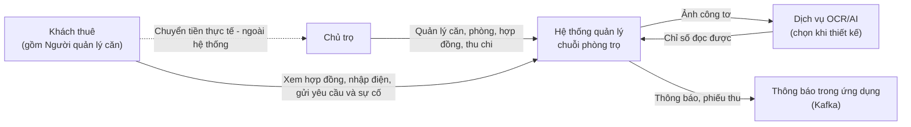

**Hành trình Chủ trọ** (S1 §3.4): Căn → Phòng → Khách thuê → Tài khoản → Hợp đồng & cọc → Tiền điện → Khoản phải thu → Phiếu thu → Thanh toán & công nợ → Sự cố & chi phí → Trả phòng → Báo cáo.
**Hành trình Khách thuê:** Đăng nhập → Xem hợp đồng → Theo dõi thanh toán → Nhập chỉ số điện → Gửi yêu cầu gia hạn/trả phòng → Gửi sự cố → Theo dõi trạng thái → Đặt lại mật khẩu khi cần.

## 8. Business Workflows

Mỗi workflow: **T**rigger · **P**re · **H**appy path · **A**lt · **E**rror · **Post** · **R**ecipient. Quyết định của khách hàng (S4) ghi `Q-xx`; phần BA tự chốt theo ủy quyền ghi `[ASSUMED]` và được liệt kê ở mục 22.2 để Chủ trọ rà soát.

**Quy ước kỳ (Q-02).** _Kỳ T_ là tháng **lập phiếu thu** (ngày 01 đến ngày 10 của tháng T). Phiếu kỳ T gồm: **tiền phòng tháng T (trả trước)** + phí dịch vụ + tiền nước tháng T `[ASSUMED]` + **tiền điện của tháng T−1** (chỉ số ngày 01/T trừ chỉ số ngày 01/T−1) + phí phát sinh − giảm trừ.
_Ví dụ:_ phiếu **kỳ 10/2026**: tiền phòng tháng 10 + điện tháng 9 (chỉ số 01/10 − chỉ số 01/09). Hạn thanh toán **05/10**; từ 06/10 hiển thị _Quá hạn_; **hết ngày 10/10** phần chưa trả được ghi vào công nợ.

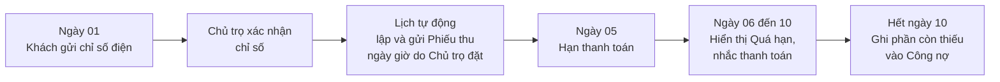

**WF-01 Căn – Phòng – Khách thuê (QT1).** T: Chủ trọ thêm căn/phòng/khách. H: tạo căn → tạo phòng (kèm **nội thất là thuộc tính của phòng**, cập nhật được, không ảnh hưởng trạng thái phòng, Q-25) → ghi hồ sơ khách (người đứng tên hợp đồng) → liên kết khách–phòng–hợp đồng → theo dõi trạng thái và lịch sử. A: sửa thông tin; xem lịch sử thuê; đổi phòng _Trống_ ↔ _Ngừng sử dụng_; căn _Hoạt động_ ↔ _Ngừng hoạt động_. E: dữ liệu sai/trùng SĐT; lỗi lưu → giữ dữ liệu cũ. Post: lịch sử bảo toàn (BR-15). R: Chủ trọ.

**WF-02 Hợp đồng và tiền cọc (QT2, Q-22, Q-17).** T: Chủ trọ và khách ký **bản giấy** (bản in cho khách ghi và ký). H: Chủ trọ tạo **hợp đồng điện tử** (xác nhận đã có bản giấy ký) → nhập phòng, khách, ngày bắt đầu/kết thúc, giá thuê, tiền cọc, đơn giá điện/nước, phí dịch vụ, gói gia hạn (6/12 tháng), điều khoản, **chỉ số điện đầu** (chốt cùng khách tại ngày lập hợp đồng) → kiểm tra → lưu → phòng _Đang thuê_ → lập phiếu kỳ lẻ đầu (nếu ký giữa tháng) → theo dõi hạn → cảnh báo sắp hết hạn (BR-02). Nếu phòng đang _Đã giữ_ cho người này: tiền giữ chỗ được trừ vào tiền cọc (WF-10). A: sửa giá/đơn giá sau thỏa thuận ngoài hệ thống (BR-11, BR-20); xuất bản in. E: ngày kết thúc ≤ bắt đầu; cọc không hợp lệ; thiếu xác nhận bản giấy; lỗi lưu. Post: hợp đồng, cọc, chỉ số đầu lưu nhất quán. R: Chủ trọ; Khách xem.

**WF-03 Gia hạn / Trả phòng / Đặt lại mật khẩu (QT3).** T: khách gửi yêu cầu. H: lưu _Chờ phê duyệt_ → Chủ trọ phê duyệt/từ chối kèm lý do; gia hạn cộng gói 6/12 tháng vào hợp đồng cũ; trả phòng thông thường báo trước ≥ 30 ngày, trả sớm hơn cần Chủ trọ duyệt ngoại lệ có lý do; đã duyệt có thể được Chủ trọ rút duyệt trước ngày trả (không xóa lịch sử); phòng chỉ đổi _Đang xử lý trả phòng_ đúng ngày được duyệt; đặt lại mật khẩu về "1", buộc đổi. E: yêu cầu không còn chờ; ngoại lệ bị từ chối; không rút duyệt sau khi bắt đầu thanh lý. R: Khách (thông báo trong ứng dụng).

**WF-04 Tiền điện (QT4).** T: từ ngày 01 hằng tháng. P: có chỉ số kỳ trước (chỉ số đầu hợp đồng do Chủ trọ nhập, Q-17). A: khách tải lại ảnh hoặc **sửa tay khi OCR sai** (vẫn _Chờ xác nhận_, Q-09); Chủ trọ nhập tay khi chưa có chỉ số, hoặc sửa chỉ số sai; thay công tơ do Chủ trọ ghi nhận. E: ảnh lỗi, OCR không đọc/timeout, chỉ số nhỏ hơn kỳ trước. Post: chỉ số _Đã xác nhận_, lượng điện và tiền điện lưu lịch sử. R: Chủ trọ (xác nhận), Khách (kết quả).

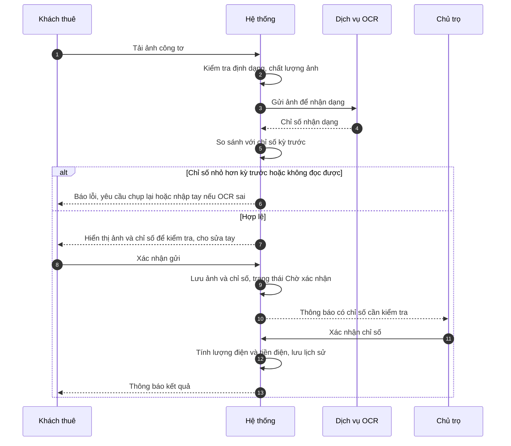

Công thức: `Lượng điện = Chỉ số ngày 01/T − Chỉ số ngày 01/T−1`; `Tiền điện = Lượng điện × Đơn giá điện của hợp đồng hiệu lực`; `Tiền nước = Đơn giá nước × Số người đang ở` (BR-23).

**WF-05 Khoản phải thu và Phiếu thu (QT5, Q-28).** T: đến lịch tự động (một lịch chung toàn chuỗi: ngày trong tháng + giờ) hoặc Chủ trọ tạo thủ công. P: **chỉ số điện của phòng đã _Đã xác nhận_** — phòng chưa xác nhận bị bỏ qua. H: lấy hợp đồng → tính khoản phải thu (BR-03) → lập phiếu cho phòng chưa có phiếu trong kỳ (BR-26) → lưu → gửi **trong ứng dụng**. A: xem phiếu; sửa khoản tính khi chưa có thanh toán; sau khi có thanh toán, Chủ trọ vẫn ghi nhận tiền khách đóng bổ sung bất kỳ lúc nào và, nếu khoản phải thu sai, lập điều chỉnh có lý do/audit sao cho tổng mới không thấp hơn tổng đã thu. Số còn thiếu luôn tính lại từ tổng mới trừ các lần thu còn hiệu lực (BR-47); tạo thủ công nhiều phòng; phiếu kỳ lẻ đầu hợp đồng (không có tiền điện). E: tạo/lưu lỗi một phiếu → không gửi phiếu đó, tiếp tục phòng khác (BR-29). Post: tối đa một phiếu hợp lệ cho mỗi phòng/kỳ. R: Khách.

**WF-06 Thanh toán và công nợ (QT6, Q-01, Q-03, Q-21).** T: khách chuyển tiền ngoài hệ thống, có thể nhiều lần sau hạn. H: (khách có thể tải **minh chứng** để Chủ trọ xem) → Chủ trọ ghi nhận **mỗi lần thu, kể cả sau ngày 10 hoặc sau thanh lý** vào kỳ gốc → hệ thống tính lại số còn thiếu và trạng thái ngay sau mỗi lần thu; nếu công nợ đã ghi, cập nhật số dư công nợ cùng giao dịch (BR-19, BR-34) → sau 05: cờ _Quá hạn_ + nhắc → **hết ngày 10**: phần còn thiếu được ghi vào **công nợ**. Màn khách: hiển thị **nợ cũ riêng** rồi **Tổng cần thanh toán** (BR-33). E: nhập số tiền lớn hơn còn lại → chặn (trả thừa xử lý ngoài hệ thống, Q-30). Post: số tiền chính thức chỉ đổi do Chủ trọ (BR-25); không ghi đè lịch sử thu. R: Chủ trọ; Khách xem.

**WF-07 Sự cố (QT7, Q-24).** T: khách báo hoặc Chủ trọ tự phát hiện (phòng/khu vực chung). H: _Chờ tiếp nhận_ → _Đang xử lý_ → xử lý thực tế ngoài hệ thống → ghi kết quả, chi phí và bên chịu → _Đã xử lý_ → thông báo. Chủ trọ chịu thì ghi khoản chi; Khách chịu thì ghi chờ khấu trừ cọc, không cộng phiếu. Khách sửa/hủy khi chờ tiếp nhận; Chủ trọ hủy khi chưa hoàn tất, có lý do. Sự cố đã xử lý không mở lại trực tiếp; phát sinh mới được liên kết với mã cũ. R: Khách.

**WF-08 Trả phòng và thanh lý (QT8, Q-20).** T: đến ngày trả đã duyệt (hoặc ngày ngoại lệ Chủ trọ chấp thuận), phòng _Đang xử lý trả phòng_. Trước ngày trả, nếu hai bên thay đổi ý định, Chủ trọ có thể rút quyết định trả phòng đã duyệt kèm lý do; lịch sử yêu cầu giữ nguyên và lịch chuyển trạng thái bị hủy. Nếu trả sớm hơn mốc báo trước 30 ngày, Chủ trọ ghi lý do và ngày thỏa thuận; hệ thống vẫn quyết toán theo ngày ở thực tế, các khoản bồi thường chỉ được nhập có căn cứ hợp đồng. H: chốt điện cuối kỳ → kiểm tra phòng/tài sản → tập hợp công nợ, chi phí khách chịu, bồi thường/khấu trừ, hoàn tiền phòng trả trước cho ngày chưa ở → hiển thị từng dòng cọc/khấu trừ/tiền phòng hoàn riêng → tính số hoàn thực tế (BR-39) → thanh lý → phòng _Trống_ → khóa tài khoản (không xóa, BR-17). Ghi nhận hoàn thực tế (ngày, số tiền) dù tiền chuyển ngoài hệ thống. Nếu kết quả âm → ghi nhận công nợ sau thanh lý. E: thông tin chưa đủ → chặn thanh lý (BR-06).

**WF-09 Thu chi và báo cáo (QT9, Q-23).** H: tổng hợp **tiền thực thu** theo ngày thu + thu khác (tiền giữ chỗ không hoàn) − giảm trừ − chi phí (sửa chữa tự động + chi nhập tay; gắn căn hoặc toàn chuỗi, BR-07) → Doanh thu, Lợi nhuận (BR-44) → lọc tháng/quý/năm → so sánh căn → xuất Excel. E: kỳ không hợp lệ; số tiền chi không hợp lệ.

**WF-10 Giữ phòng (Q-11, BR-05).** T: có người muốn giữ phòng _Trống_. H: Chủ trọ nhập người giữ (họ tên, SĐT), tiền giữ chỗ, ngày nhận, **hạn giữ và thỏa thuận hoàn/hủy theo từng trường hợp** → phòng _Đã giữ_. Nhánh 1: người giữ ký hợp đồng trong hạn → tiền giữ chỗ trừ vào cọc đến mức cọc phải nộp, phần dư được ghi nhận hoàn ngoài hệ thống; phòng _Đang thuê_. Nhánh 2: quá hạn → hệ thống chỉ cảnh báo Chủ trọ; Chủ trọ thỏa thuận gia hạn hoặc hủy giữ → phòng _Trống_; khi hủy ghi số hoàn từ 0 đến tiền đã nhận và lý do, phần không hoàn ghi thu khác. Không mặc định 7 ngày hoặc tự quyết định chính sách hoàn; điều khoản từng lần do Chủ trọ nhập và xác nhận với khách.

**WF-11 Người ở cùng (Q-13).** T: khách muốn thêm người ở. H: khách điền thông tin người ở trong "Đề xuất bạn cùng phòng" → Chủ trọ xác nhận → hệ thống lưu hồ sơ người ở vào phòng và **cập nhật số người ở** → tiền nước tính lại từ kỳ lập phiếu kế tiếp. Mỗi phòng chỉ có **một tài khoản**, của người đứng tên hợp đồng. A: Chủ trọ từ chối kèm lý do; Chủ trọ đánh dấu người ở đã rời. E: phòng đủ số người tối đa; trùng người đã ở.

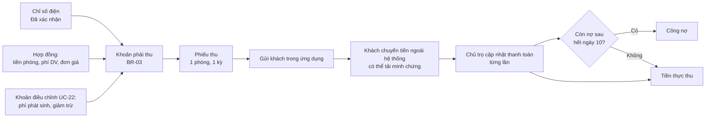

## 9. State Machines

Tên trạng thái theo bảng chuẩn hóa ở mục 6.

### SM-01 Phòng (BR-10, BR-15, Q-19, Q-25)

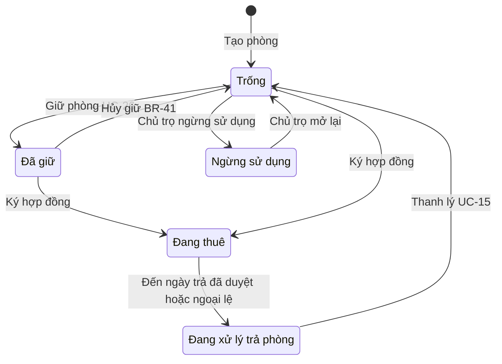

| Từ                   | Sự kiện                                         | Điều kiện                                       | Tới                                       | Ai                          |
| -------------------- | ----------------------------------------------- | ----------------------------------------------- | ----------------------------------------- | --------------------------- |
| Trống                | Giữ phòng                                       | Chưa có hợp đồng hiệu lực                       | Đã giữ                                    | Chủ trọ                     |
| Đã giữ               | Hủy giữ                                         | Chủ trọ chọn hoàn hoặc không hoàn tiền giữ chỗ  | Trống                                     | Chủ trọ                     |
| Đã giữ / Trống       | Hợp đồng được lưu                               | Hợp đồng hợp lệ (nếu Đã giữ thì cùng người giữ) | Đang thuê                                 | Hệ thống                    |
| Đang thuê            | Đến **ngày trả** của yêu cầu trả phòng đã duyệt | Yêu cầu _Đã phê duyệt_                          | Đang xử lý trả phòng                      | Hệ thống (tác vụ định thời) |
| Đang thuê            | Chủ trọ duyệt ngày trả sớm ngoại lệ             | Lý do + ngày thỏa thuận hợp lệ, chưa thanh lý   | Đang xử lý trả phòng (đúng ngày ngoại lệ) | Hệ thống (tác vụ định thời) |
| Đang xử lý trả phòng | Thanh lý                                        | Đủ điều kiện BR-06                              | Trống                                     | Hệ thống (UC-15)            |
| Trống                | Ngừng sử dụng                                   | Không có hợp đồng/giữ phòng                     | Ngừng sử dụng                             | Chủ trọ                     |

**Cấm:** Trống → Đang xử lý trả phòng; Đang thuê → Trống (bỏ qua thanh lý); Đang thuê → Đã giữ; Ngừng sử dụng → Đã giữ/Đang thuê (phải mở lại về Trống trước); xóa phòng còn lịch sử (BR-15). Hủy quyết định trả phòng trước ngày trả giữ phòng _Đang thuê_ và hủy lịch chuyển trạng thái; không xóa lịch sử.

### SM-02 Hợp đồng (BR-02, BR-21, BR-22)

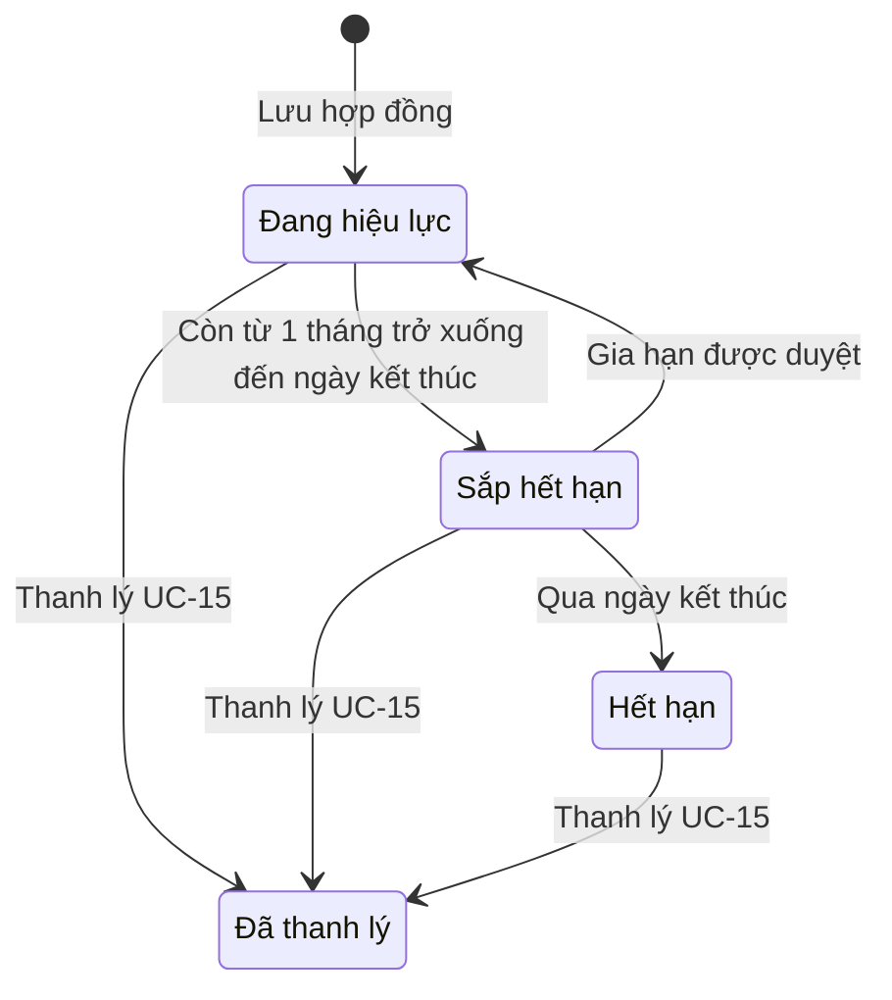

Gia hạn: ngày kết thúc mới = ngày kết thúc hiện tại + 6 hoặc 12 tháng (theo gói trong hợp đồng); Chủ trọ không chỉnh. Chỉ gửi yêu cầu gia hạn khi hợp đồng ở _Sắp hết hạn_ `[ASSUMED]`. **Cấm:** _Đã thanh lý_ → mọi trạng thái; xóa hợp đồng đã phát sinh nghiệp vụ (BR-22); tạo hợp đồng mới khi gia hạn hoặc chuyển phòng (BR-21, Q-12).

### SM-03 Chỉ số điện (BR-04)

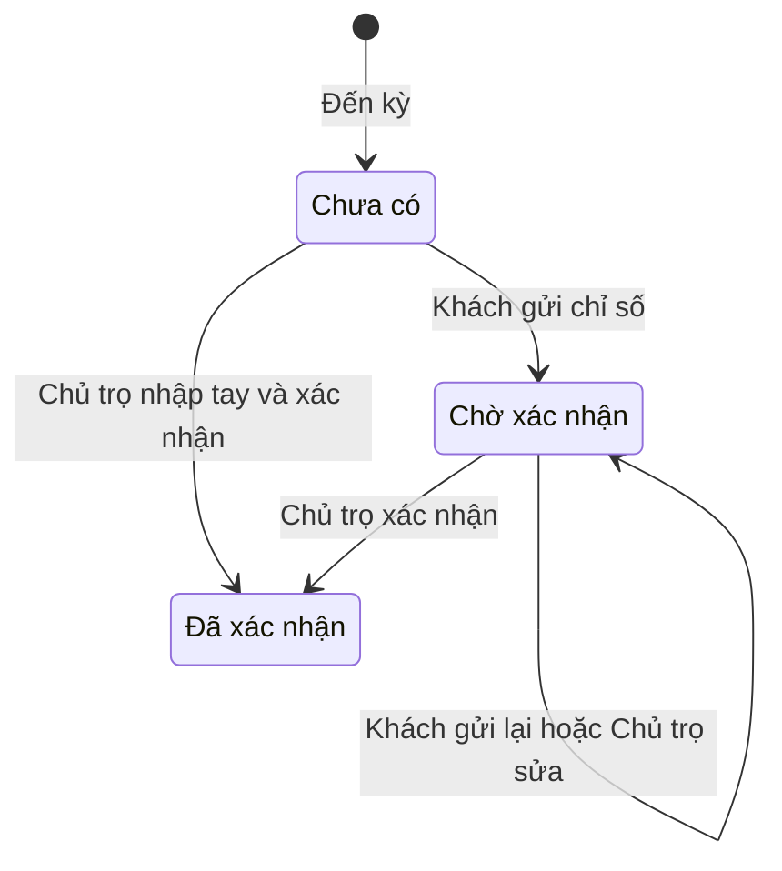

Chỉ số đầu hợp đồng được tạo thẳng ở _Đã xác nhận_ khi lập hợp đồng. **Cấm:** khách tự xác nhận; chỉ số mới nhỏ hơn kỳ trước (trừ thay công tơ do Chủ trọ ghi nhận). Chỉ số _Đã xác nhận_ **không sửa được sau khi phiếu thu của kỳ đó đã lập**; sai sót xử lý bằng sửa phiếu (nếu chưa có thanh toán) hoặc khoản điều chỉnh kỳ sau `[ASSUMED]` (BR-35). Khách gửi lại khi _Chờ xác nhận_ thì bản mới ghi đè, bản cũ giữ trong lịch sử.

### SM-04 Thanh toán của một phòng trong một kỳ (BR-19, Q-02)

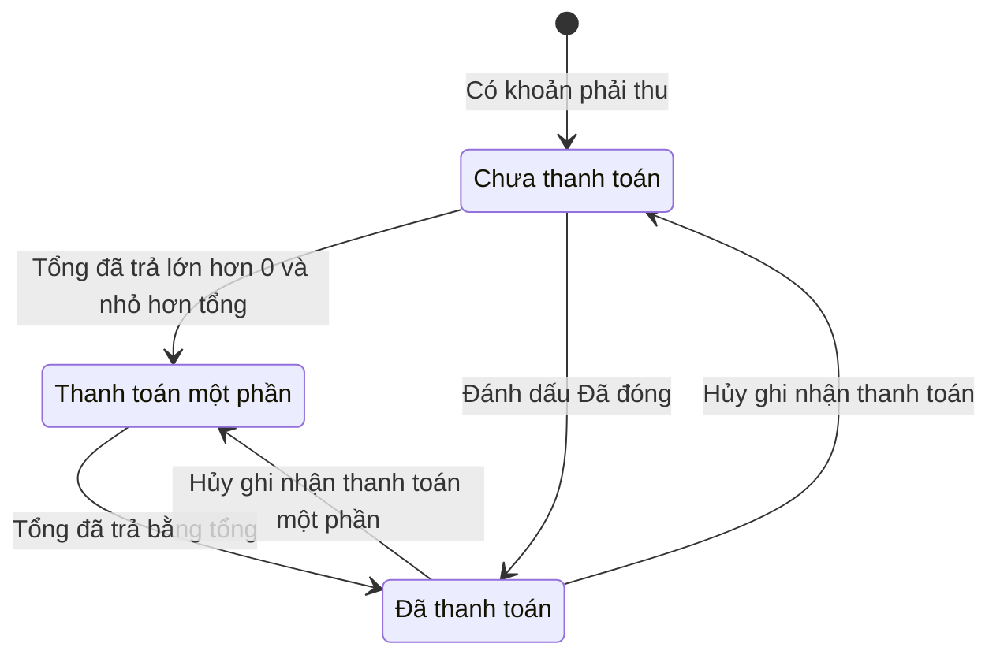

Trạng thái **suy ra từ tổng các bản ghi thanh toán còn hiệu lực**. Hai thuộc tính độc lập: **Quá hạn** (từ ngày 06 khi còn nợ) và **Đã ghi công nợ** (hết ngày 10). Bản ghi thanh toán không xóa, chỉ _hủy_ kèm lý do (audit). **Cấm:** khách đổi trạng thái; minh chứng tự làm đổi số tiền; tổng đã trả vượt tổng phải thu (BR-46).

### SM-05 Yêu cầu (gia hạn / trả phòng / đặt lại mật khẩu) (BR-30, Q-05)

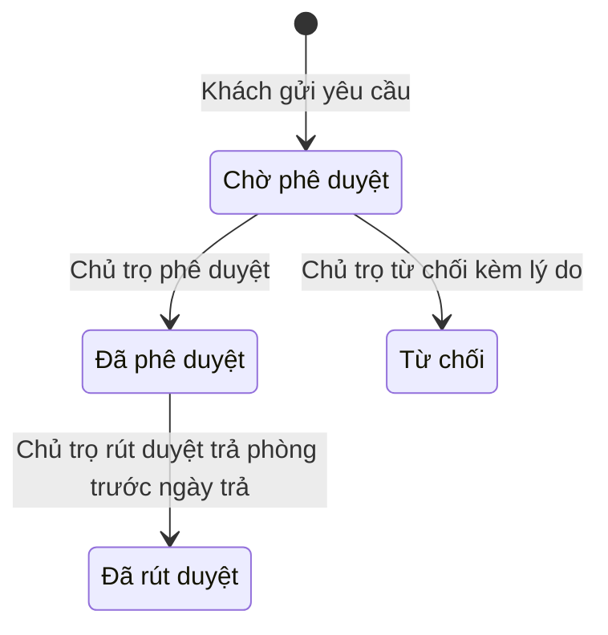

Chỉ yêu cầu _Chờ phê duyệt_ được duyệt/từ chối; riêng trả phòng _Đã phê duyệt_ có thể được Chủ trọ rút duyệt trước ngày trả khi chưa thanh lý, ghi lý do và giữ lịch sử. Mỗi khách chỉ có một yêu cầu cùng loại đang chờ; khách không tự hủy yêu cầu.

### SM-06 Sự cố (BR-31, BR-32, Q-24)

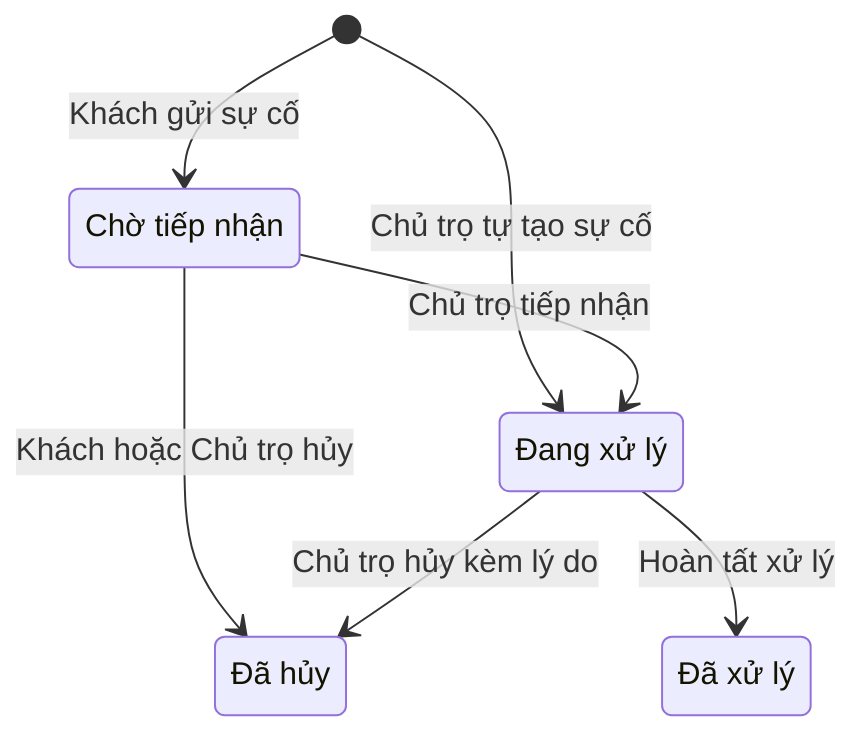

**Cấm:** khách sửa/hủy khi đã tiếp nhận (BR-32); _Đã xử lý_ → _Đang xử lý_ trực tiếp; _Đã hủy_ → trạng thái khác. Vấn đề phát sinh sau hoàn tất được ghi thành sự cố mới tham chiếu sự cố cũ để khoản chi đã ghi không bị đảo ngầm; Chủ trọ chỉ hủy sự cố chưa hoàn tất, có lý do và audit.

### SM-07…SM-13 (dạng bảng)

| ID    | Entity                | Trạng thái và chuyển                                                                                                | Cấm / ghi chú                                                                                                                                                                                                         |
| ----- | --------------------- | ------------------------------------------------------------------------------------------------------------------- | --------------------------------------------------------------------------------------------------------------------------------------------------------------------------------------------------------------------- |
| SM-07 | Phiếu thu             | (chưa có) → **Đã lập** → **Đã gửi**; lỗi tạo/lưu → không gửi (BR-29)                                                | Hai phiếu hợp lệ cùng phòng/kỳ (BR-26). Sau khi có thanh toán: không ghi đè khoản tiền gốc; cho ghi thêm lần thu hoặc điều chỉnh có lý do/lịch sử, tổng mới không thấp hơn đã thu; số còn thiếu luôn tính lại (BR-47) |
| SM-08 | Tài khoản khách       | Chưa cấp → **Hoạt động** → **Đã khóa** ⇄ **Hoạt động** (Chủ trọ mở khóa)                                            | Đăng nhập khi _Đã khóa_; xóa tài khoản (BR-17). Khách quay lại (cùng SĐT): dùng lại hồ sơ, mở khóa, đặt lại mật khẩu "1" (BR-49)                                                                                      |
| SM-09 | Minh chứng thanh toán | **Chờ xác nhận** → **Đã đối chiếu** (tự chuyển khi Chủ trọ lưu cập nhật thanh toán của phòng/kỳ đó)                 | Không có từ chối; minh chứng không làm đổi số tiền (BR-25)                                                                                                                                                            |
| SM-10 | Người ở cùng          | **Chờ xử lý** (đề xuất) → **Đang ở** hoặc **Từ chối**; Đang ở → **Đã rời**                                          | Chấp nhận khi phòng đủ người tối đa; trùng giấy tờ/SĐT trong một phòng; thiếu hồ sơ tùy thân bắt buộc                                                                                                                 |
| SM-11 | Tiền cọc              | Chưa nhận → **Đã nhận** (kể cả phần trừ từ tiền giữ chỗ) → **Đã hoàn / Đã khấu trừ một phần / Đã khấu trừ toàn bộ** | Hoàn lớn hơn cọc còn lại                                                                                                                                                                                              |
| SM-12 | Căn trọ               | **Hoạt động** ⇄ **Ngừng hoạt động**                                                                                 | Ngừng khi còn phòng _Đang thuê/Đã giữ/Đang xử lý trả phòng_                                                                                                                                                           |
| SM-13 | Giữ phòng             | **Đang giữ** → **Đã chuyển thành hợp đồng** / **Đã hủy** (lưu số đã hoàn và số không hoàn, có thể hoàn một phần)    | Hai giữ phòng đang hoạt động cho một phòng; hoàn vượt tiền đã nhận                                                                                                                                                    |

---

## 10. Use Cases

Đã chuẩn hóa từ S2: đánh lại số bước theo thứ tự, thống nhất tên trạng thái, tách luồng thay thế/ngoại lệ. Điểm sửa so với nguồn ghi ở _Lưu ý rà soát_ (ISS-xx, CON-xx ở mục 22). Mã AC dạng `UCxx-ACn` (Given/When/Then).

### 10.1 Use case của nguồn (S2)

#### UC-01 — Đặt lại mật khẩu

- **Mục tiêu:** Khách thuê quên mật khẩu được cấp lại quyền đăng nhập. **Actor:** chính Khách thuê; phụ Chủ trọ (xử lý qua UC-16).
- **Trigger / Tiền ĐK:** Khách ở màn hình Đăng nhập, chọn "Quên mật khẩu"; SĐT đã có trong hệ thống.
- **Main:** 1. Hiển thị form nhập SĐT. 2. Khách nhập SĐT, chọn Xác nhận. 3. Hệ thống kiểm tra SĐT tồn tại, tài khoản _Hoạt động_ và chưa có yêu cầu đang chờ. 4. Tạo Yêu cầu loại _Đặt lại mật khẩu_ ở _Chờ phê duyệt_; thông báo Chủ trọ. 5. Chủ trọ phê duyệt (UC-16). 6. Hệ thống đặt mật khẩu về **"1"** (quyết định của khách hàng, Q-06), yêu cầu _Đã phê duyệt_. 7. Thông báo khách. 8. Khách đăng nhập bằng "1". 9. Hệ thống **buộc đổi mật khẩu** (nhập mật khẩu hiện tại và mật khẩu mới; mới ≥ 8 ký tự gồm chữ và số, khác "1"). 10. Lưu mật khẩu mới dạng băm.
- **Alt:** A1 khách chọn Hủy → về Đăng nhập. A2 Chủ trọ **Từ chối kèm lý do** → yêu cầu _Từ chối_, giữ mật khẩu cũ, thông báo lý do (Q-05).
- **Exception:** E1 SĐT không tồn tại → "Số điện thoại không tồn tại", nhập lại. E2 tài khoản _Đã khóa_ → "Tài khoản đang bị khóa, vui lòng liên hệ Chủ trọ", không tạo yêu cầu. E3 đã có yêu cầu chờ → không tạo thêm. E4 quá 3 yêu cầu/giờ cho một SĐT → từ chối tạm thời `[ASSUMED]` (SEC-07).
- **Hậu ĐK:** Thành công: mật khẩu mới lưu, yêu cầu _Đã phê duyệt_. Thất bại: mật khẩu cũ giữ nguyên.
- **BR:** BR-30, BR-36, BR-37. **FR:** FR-012…FR-019, FR-197.
- **AC:** **UC01-AC1** Given SĐT hợp lệ và tài khoản hoạt động, When gửi yêu cầu, Then yêu cầu _Chờ phê duyệt_ và Chủ trọ nhận thông báo. **UC01-AC2** Given SĐT chưa đăng ký, Then báo lỗi và không tạo yêu cầu. **UC01-AC3** Given Chủ trọ đã duyệt, When khách đăng nhập bằng "1", Then bị buộc đổi và không dùng được chức năng khác trước khi đổi; mật khẩu mới "1" bị từ chối. **UC01-AC4** Given Chủ trọ từ chối, Then mật khẩu cũ vẫn dùng được và khách thấy lý do. **UC01-AC5** Given tài khoản _Đã khóa_, Then không tạo yêu cầu.
- **Rủi ro chấp nhận (RSK-02):** mật khẩu "1" và xác thực chỉ bằng SĐT là quyết định của khách hàng; biện pháp giảm nhẹ: buộc đổi ngay, giới hạn tần suất, chỉ tài khoản _Hoạt động_.

#### UC-02 — Quản lý tài khoản khách thuê

- **Actor:** Chủ trọ. **Tiền ĐK:** đã đăng nhập. Tài khoản chỉ dành cho **người đứng tên hợp đồng** (mỗi phòng một tài khoản, Q-13).
- **Main:** 1. Chọn "Quản lý tài khoản khách thuê". 2. Hiển thị danh sách khách và trạng thái tài khoản. 3. Chọn "Tạo tài khoản". 4. Form (tên đăng nhập mặc định = SĐT). 5. Xác nhận. 6. Kiểm tra: hồ sơ có SĐT; SĐT chưa có tài khoản; khách đã có hợp đồng và đã nhận cọc (BR-01). 7. Tạo tài khoản, mật khẩu khởi tạo "1" (buộc đổi ở lần đầu). 8. Lưu. 9. Thông báo "Thành công".
- **Alt:** A1 Khóa tài khoản (khách vi phạm/đã trả phòng) → _Đã khóa_, lưu lịch sử. A2 **Mở khóa** tài khoản → _Hoạt động_, lưu lịch sử. A3 Khách quay lại thuê (cùng SĐT): dùng lại hồ sơ cũ, sau khi có hợp đồng mới thì mở khóa và đặt lại mật khẩu "1" (BR-49). A4 Hủy tạo → về danh sách.
- **Exception:** E1 thiếu SĐT → "Khách thuê chưa đủ điều kiện cấp tài khoản do thiếu Số điện thoại". E2 SĐT đã có tài khoản → "Tài khoản cho số điện thoại này đã tồn tại". E3 chưa có hợp đồng hoặc chưa nhận cọc → từ chối (BR-01).
- **Hậu ĐK:** Tài khoản và trạng thái được lưu, có lịch sử trạng thái. **BR:** BR-01, BR-17, BR-37, BR-49. **FR:** FR-001…FR-010.
- **AC:** **UC02-AC1** Given khách có SĐT và đủ điều kiện, When tạo, Then tài khoản _Hoạt động_ tên đăng nhập = SĐT. **UC02-AC2** Given SĐT trùng, Then từ chối. **UC02-AC3** Given _Đã khóa_, When đăng nhập, Then từ chối. **UC02-AC4** Given chưa có hợp đồng + cọc, Then từ chối. **UC02-AC5** Given mở khóa, Then đăng nhập lại được và có bản ghi lịch sử.

#### UC-03 — Quản lý căn trọ

- **Actor:** Chủ trọ. **Tiền ĐK:** đã đăng nhập; kết nối dữ liệu ổn định.
- **Main (thêm căn):** 1. Chọn chức năng. 2. Hiển thị danh sách căn (mã, tên, địa chỉ, số phòng, trạng thái hoạt động). 3. Chọn "Thêm mới". 4. Form: tên, địa chỉ, mô tả, quy định chung, hình ảnh tổng quan. 5. Nhập thông tin. 6. Kiểm tra hợp lệ. 7. Lưu; tạo **Mã căn** tự động. 8. Cập nhật danh sách, thông báo "Thêm căn trọ thành công".
- **Alt:** A1 chưa có căn → danh sách trống kèm thông báo. A2 Xem chi tiết một căn. A3 Chỉnh sửa (hiện form dữ liệu cũ → kiểm tra → lưu → về danh sách). A4 Đổi trạng thái _Hoạt động ↔ Ngừng hoạt động_; chặn khi còn phòng _Đang thuê/Đã giữ/Đang xử lý trả phòng_ (Q-25).
- **Exception:** E1 thiếu/sai dữ liệu → không lưu, về bước nhập. E2 lỗi lưu → "Thao tác không thành công", dữ liệu cũ giữ nguyên.
- **Hậu ĐK:** Căn được thêm/cập nhật; trạng thái hoạt động đúng. **FR:** FR-020…FR-023.
- **AC:** **UC03-AC1** Given dữ liệu hợp lệ, When lưu, Then căn có mã tự sinh duy nhất và xuất hiện trong danh sách. **UC03-AC2** Given thiếu trường bắt buộc, Then không lưu. **UC03-AC3** Given lỗi lưu, Then dữ liệu trước đó không đổi. **UC03-AC4** Given còn phòng _Đang thuê_, When ngừng hoạt động căn, Then từ chối.

#### UC-04 — Quản lý phòng

- **Actor:** Chủ trọ. **Tiền ĐK:** có ≥ 1 căn.
- **Main (thêm phòng):** 1. Chọn "Quản lý phòng". 2. Chọn căn. 3. Danh sách phòng (số phòng, giá thuê niêm yết, trạng thái). 4. Chọn "Thêm phòng mới". 5. Form: diện tích, **giá thuê niêm yết** (giá gợi ý khi lập hợp đồng, Q-16), số người ở tối đa, **danh sách nội thất** (tên, số lượng, tình trạng, ghi chú), trạng thái khởi tạo. 6. Nhập; kiểm tra hợp lệ và số phòng duy nhất trong căn. 7. Xác nhận; tạo số phòng; lưu. 8. Cập nhật danh sách, thông báo.
- **Alt:** A1 căn chưa có phòng → danh sách trống. A2 Xem chi tiết (thông tin, giá, trạng thái, nội thất, **người đang ở**). A3 Chỉnh sửa thông tin, giá niêm yết, **nội thất bất kỳ lúc nào** (không ảnh hưởng trạng thái phòng, Q-25). A4 Đổi **Trống ↔ Ngừng sử dụng**; các trạng thái còn lại do hệ thống cập nhật theo sự kiện (SM-01).
- **Exception:** E1 dữ liệu sai định dạng (giá, diện tích) → lỗi tại trường, không lưu. E2 lỗi lưu → giữ dữ liệu cũ. E3 ngừng sử dụng phòng không ở _Trống_ → từ chối.
- **Hậu ĐK:** Phòng và nội thất lưu; trạng thái đúng SM-01. Đổi giá niêm yết **không** đổi giá của hợp đồng đang hiệu lực. **BR:** BR-10, BR-15. **FR:** FR-024…FR-029.
- **AC:** **UC04-AC1** Given số phòng trùng trong căn, Then từ chối. **UC04-AC2** Given phòng có lịch sử, When xóa, Then bị chặn. **UC04-AC3** Given diện tích hoặc giá âm, Then báo lỗi. **UC04-AC4** Given phòng _Đang thuê_, When chuyển _Ngừng sử dụng_, Then từ chối. **UC04-AC5** Given sửa nội thất, Then trạng thái phòng không đổi.

#### UC-05 — Quản lý khách thuê

- **Actor:** Chủ trọ.
- **Main (thêm hồ sơ):** 1. Chọn chức năng. 2. Hiển thị danh sách (họ tên, SĐT, CCCD/giấy tờ, trạng thái khách). 3. Chọn "Thêm khách thuê". 4. Form hồ sơ. 5. Nhập; chọn "Lưu hồ sơ". 6. Kiểm tra hợp lệ và trùng lặp. 7. Tạo **Mã khách thuê**; lưu. 8. Cập nhật danh sách; thông báo thành công.
- **Alt:** A1 chưa có khách → danh sách trống. A2 Xem lịch sử thuê (các phòng, hợp đồng đã thuê). A3 Chỉnh sửa hồ sơ → kiểm tra → lưu. A4 Xem thông tin hồ sơ.
- **Exception:** E1 thiếu/sai định dạng/đã tồn tại → lỗi tại trường, không lưu (trùng theo **SĐT**, Q-22). E2 lỗi lưu → giữ dữ liệu cũ.
- **Hậu ĐK:** Hồ sơ lưu, liên kết được với phòng/hợp đồng; lịch sử thuê bảo toàn. (Nguồn ghi "khách có tài khoản" — việc này thuộc UC-02, `ISS-06`.) **FR:** FR-030…FR-034.
- **AC:** **UC05-AC1** Given SĐT đã tồn tại ở hồ sơ khác, When lưu, Then từ chối. **UC05-AC2** Given khách đã từng thuê, When xem lịch sử, Then thấy mọi phòng/hợp đồng cũ.

#### UC-06 — Quản lý hợp đồng

- **Actor:** Chủ trọ. **Tiền ĐK:** có phòng và khách thuê. Hợp đồng trong hệ thống là **bản điện tử**, tạo sau khi đã có **bản giấy đã ký** (Q-22).
- **Main (tạo):** 1. Chọn chức năng. 2. Danh sách hợp đồng (phòng, khách, thời hạn, tiền thuê, trạng thái). 3. Chọn "Tạo hợp đồng". 4. Form. 5. Nhập: phòng, khách, ngày bắt đầu/kết thúc, **giá thuê hợp đồng** (mặc định lấy giá niêm yết của phòng, sửa được), **tiền cọc**, **đơn giá điện, đơn giá nước, phí dịch vụ**, **gói gia hạn cho phép (6 và/hoặc 12 tháng)**, điều khoản, **chỉ số điện đầu** (chốt cùng khách tại ngày lập, Q-17), và **tick "Đã có bản giấy ký"** (bắt buộc). 6. Kiểm tra: đủ thông tin; ngày kết thúc > bắt đầu; cọc hợp lệ; phòng không có hợp đồng hiệu lực khác. 7. Nhấn Lưu. 8. Lưu hợp đồng, cọc và chỉ số đầu (_Đã xác nhận_) trong một giao dịch; hợp đồng → _Đang hiệu lực_; phòng → _Đang thuê_. 9. Thông báo "Lưu hợp đồng thành công" và gợi ý lập phiếu kỳ lẻ đầu nếu ngày bắt đầu không phải ngày 01 (UC-20).
- **Alt:** A1 Xem chi tiết. A2 Chỉnh sửa: ngày kết thúc, giá, đơn giá điện/nước, phí dịch vụ, điều khoản → có hiệu lực từ **kỳ chưa lập phiếu**; ghi lịch sử thay đổi (AUD-03); không sửa phòng và khách sau khi đã có phiếu thu. A3 Quản lý cọc: xem/sửa số tiền, ngày nhận, trạng thái. A4 Phòng đang _Đã giữ_ cho đúng người này → tiền giữ chỗ **tự trừ vào cọc** (WF-10). A5 Xuất **bản in hợp đồng** từ dữ liệu `[ASSUMED]` (FR-184). A6 Ghi nhận **vi phạm hợp đồng** (nội dung, điều khoản liên quan, ngày), hiển thị cho khách ở UC-07; vi phạm không mặc nhiên mất cọc, chỉ là căn cứ khấu trừ khi trả phòng (BR-24) `[ASSUMED]` (FR-199). _(Gia hạn trực tiếp bởi Chủ trọ đã bỏ — gia hạn chỉ qua UC-13/UC-16, Q-18.)_
- **Exception:** E1 thiếu thông tin. E2 ngày kết thúc ≤ bắt đầu → "Thời gian hợp đồng không hợp lệ". E3 cọc không hợp lệ → "Số tiền cọc không hợp lệ". E4 chưa tick bản giấy → không lưu. E5 phòng đã có hợp đồng hiệu lực / khách trùng SĐT với hồ sơ khác. E6 lỗi lưu → "Không thể lưu hợp đồng. Vui lòng thử lại sau.", không đổi dữ liệu (hợp đồng, cọc, chỉ số đầu, trạng thái phòng cùng thành công hoặc cùng không).
- **Hậu ĐK:** Hợp đồng, cọc, chỉ số đầu, trạng thái phòng nhất quán; lịch sử thay đổi lưu. **BR:** BR-11, BR-20, BR-21, BR-22, BR-38, BR-40, BR-41. **FR:** FR-035…FR-046, FR-180…FR-184, FR-199.
- **AC:** **UC06-AC1** Given dữ liệu hợp lệ, When lưu, Then hợp đồng _Đang hiệu lực_, cọc + chỉ số đầu lưu cùng giao dịch, phòng _Đang thuê_. **UC06-AC2** Given ngày kết thúc ≤ bắt đầu, Then không lưu. **UC06-AC3** Given đổi đơn giá điện, Then các phiếu đã lập giữ giá cũ (BR-11). **UC06-AC4** Given chưa tick bản giấy, Then không lưu. **UC06-AC5** Given phòng _Đã giữ_ của người này với tiền giữ chỗ 2.000.000, When lưu cọc 5.000.000, Then cọc còn phải thu 3.000.000.

#### UC-07 — Xem hợp đồng

- **Actor:** Khách thuê. **Tiền ĐK:** đăng nhập; có phòng và hợp đồng hợp lệ.
- **Main:** 1. Chọn "Xem hợp đồng". 2. Hiển thị trạng thái (Đang hiệu lực/Sắp hết hạn), mã hợp đồng, phòng. 3. Chọn "Xem chi tiết". 4. Hiển thị phòng, ngày bắt đầu/kết thúc, giá thuê, điều khoản. 5. Hiển thị thông tin phát sinh: vi phạm nội quy, thay đổi đơn giá điện/nước (nếu có).
- **Alt:** A1 Xem chi tiết tiền cọc (số tiền, ngày nhận, trạng thái, đã hoàn/khấu trừ). A2 Xem đầy đủ điều khoản. A3 Quay lại.
- **Exception:** E1 không tìm thấy hợp đồng → thông báo. E2 lỗi tải → "Không thể tải thông tin hợp đồng. Vui lòng thử lại sau.", không hiển thị dữ liệu thiếu. E3 không có thông tin phát sinh → hiển thị trạng thái "không có" và **tiếp tục** (nguồn kết thúc UC, `ISS-09`).
- **Hậu ĐK:** Thông tin hiển thị đầy đủ. **BR:** BR-13, BR-14. **FR:** FR-047…FR-049.
- **AC:** **UC07-AC1** Given khách A, When xem hợp đồng, Then chỉ thấy hợp đồng của A. **UC07-AC2** Given hợp đồng còn ≤ 1 tháng, Then trạng thái hiển thị _Sắp hết hạn_.

#### UC-08 — Đề xuất bạn cùng phòng (thêm người ở cùng)

- **Actor:** Khách thuê (người đứng tên); phụ Chủ trọ (UC-28). **Tiền ĐK:** đăng nhập; hợp đồng hiệu lực; số người ở hiện tại < số người tối đa của phòng.
- **Main:** 1. Chọn chức năng. 2. Hiển thị form. 3. Nhập **đủ thông tin tùy thân** của người được đề xuất: họ tên ✱, SĐT ✱, số CCCD/giấy tờ ✱, ngày sinh ✱, giới tính ✱, địa chỉ thường trú ✱, quan hệ với người đứng tên ✱, ngày dự kiến bắt đầu ở ✱; ghi chú tùy chọn. 4. Hệ thống kiểm tra đủ trường, người chưa ở trong phòng, phòng còn chỗ. 5. Hiển thị tóm tắt, khách xác nhận gửi. 6. Lưu đề xuất _Chờ xử lý_; thông báo Chủ trọ. 7. "Đề xuất bạn cùng phòng đã được gửi thành công."
- **Alt:** A1 sửa thông tin → về bước 4. A2 xem lại trước khi gửi. A3 hủy tại màn xác nhận. A4 theo dõi trạng thái (_Chờ xử lý / Đang ở / Từ chối_ + lý do).
- **Exception:** E1 thiếu/sai thông tin. E2 phòng đủ người → "Phòng hiện không còn khả năng tiếp nhận thêm người." E3 người đã ở trong phòng. E4 lỗi lưu. E5 lỗi tạo thông báo → vẫn giữ _Chờ xử lý_.
- **Hậu ĐK:** Đề xuất lưu _Chờ xử lý_; chưa ảnh hưởng số người ở/tiền nước cho tới khi Chủ trọ xác nhận (UC-28). Người ở **không có tài khoản**. **FR:** FR-050…FR-054.
- **AC:** **UC08-AC1** Given phòng đủ người, Then không cho gửi. **UC08-AC2** Given đề xuất hợp lệ, Then _Chờ xử lý_ và số người ở chưa đổi. **UC08-AC3** Given lỗi thông báo, Then đề xuất vẫn được lưu. **UC08-AC4** Given thiếu số giấy tờ hoặc địa chỉ thường trú, When gửi đề xuất, Then hệ thống yêu cầu bổ sung và chưa tạo đề xuất.

#### UC-09 — Nhập chỉ số điện

- **Actor:** Khách thuê; hệ thống ngoài: OCR (EXT-01). **Tiền ĐK:** đăng nhập; phòng hợp lệ; đã đến thời gian nhập kỳ; có chỉ số kỳ trước (chỉ số đầu do Chủ trọ nhập khi lập hợp đồng, UC-06).
- **Main:** 1. Chọn "Nhập chỉ số điện". 2. Hiển thị phòng, chỉ số kỳ trước, vùng tải ảnh. 3. Tải ảnh công tơ. 4. Kiểm tra định dạng và chất lượng ảnh. 5. Gọi OCR nhận dạng chỉ số. 6. So sánh với chỉ số kỳ trước (phải ≥). 7. Hiển thị ảnh và chỉ số nhận dạng. 8. Khách bấm "Xác nhận". 9. Lưu chỉ số và ảnh minh chứng. 10. Trạng thái _Chờ xác nhận_. 11. Thông báo Chủ trọ. 12. Thông báo thành công cho khách.
- **Alt:** A1 kết quả sai → "Tải lại hình ảnh" → hủy kết quả trước, về bước 3. A2 Khách **sửa tay** chỉ số khi OCR sai rồi xác nhận; dữ liệu vẫn _Chờ xác nhận_ và gắn cờ "đã sửa tay" cho Chủ trọ (Q-09).
- **Exception:** E1 ảnh sai định dạng/hỏng → báo lỗi, chọn ảnh khác. E2 OCR không đọc đủ → "Không thể đọc chỉ số điện. Vui lòng chụp lại ảnh rõ hơn.", không lưu. E3 chỉ số < kỳ trước → "Chỉ số điện không hợp lệ. Vui lòng kiểm tra lại hoặc tải ảnh khác.", không cho xác nhận (thay công tơ do Chủ trọ ghi nhận ở UC-10). E4 `[ASSUMED]` OCR không phản hồi/timeout → báo khách, cho chủ trọ nhập tay (UC-10 A1).
- **Hậu ĐK:** Ảnh và chỉ số lưu, ở _Chờ xác nhận_. **BR:** BR-04. **NFR:** NFR-003, NFR-019. **FR:** FR-055…FR-062.
- **AC:** **UC09-AC1** Given ảnh rõ và chỉ số ≥ kỳ trước, When xác nhận, Then dữ liệu _Chờ xác nhận_ kèm ảnh và Chủ trọ nhận thông báo. **UC09-AC2** Given chỉ số < kỳ trước, Then không cho xác nhận. **UC09-AC3** Given OCR timeout, Then không lưu dữ liệu dở dang và hiển thị thông báo. **UC09-AC4** Given OCR đọc sai, When khách sửa tay và xác nhận, Then lưu _Chờ xác nhận_ có cờ "đã sửa tay".

#### UC-10 — Quản lý tiền điện

- **Actor:** Chủ trọ. **Tiền ĐK:** đăng nhập; có phòng đang thuê, hợp đồng hiệu lực có đơn giá điện.
- **Main:** 1. Chọn chức năng. 2. Hiển thị kỳ và căn. 3. Chọn kỳ. 4. Chọn căn. 5. Hiển thị danh sách phòng. 6. Chọn phòng. 7. Hiển thị chỉ số kỳ trước, kỳ hiện tại, ảnh minh chứng, đơn giá hợp đồng, tổng tiền điện. 8. Chủ trọ kiểm tra. 9. Nhấn "Xác nhận". 10. Cập nhật _Đã xác nhận_; tính lượng điện, tiền điện; lưu lịch sử. 11. Thông báo "Xác nhận thành công".
- **Alt:** A1 chưa có chỉ số kỳ này → hiển thị kỳ trước + đơn giá, Chủ trọ "Chỉnh sửa", nhập chỉ số, kiểm tra, ghi nhận, tính tiền điện tạm tính → về bước 7. A2 chỉ số sai → chỉnh sửa → kiểm tra → tính lại tạm tính → về bước 7. A3 Từ chối chỉ số của khách, yêu cầu chụp lại `[ASSUMED]`. A4 Thay công tơ: Chủ trọ nhập chỉ số cuối công tơ cũ, chỉ số đầu công tơ mới và ghi chú `[ASSUMED]`. A5 Chỉ số có cờ "đã sửa tay" được tô nổi để kiểm tra kỹ. A6 Không sửa chỉ số _Đã xác nhận_ sau khi phiếu kỳ đó đã lập (BR-35).
- **Exception:** E1 lỗi xác nhận → giữ trạng thái chưa xác nhận (_Chờ xác nhận_), "Không thể xác nhận. Vui lòng thử lại sau". E2 chỉ số nhập tay không hợp lệ (< kỳ trước).
- **Hậu ĐK:** Chỉ số _Đã xác nhận_; lượng điện, tiền điện theo đơn giá hợp đồng; lưu nguyên tử, lỗi thì giữ dữ liệu cũ (không lưu một phần). **BR:** BR-04, BR-11. **NFR:** NFR-006. **AUD:** AUD-01. **FR:** FR-063…FR-070.
- **AC:** **UC10-AC1** Given chỉ số 120→150, đơn giá 3.500, When xác nhận, Then lượng điện 30 và tiền điện 105.000. **UC10-AC2** Given chủ trọ sửa chỉ số, Then ghi AUD-01 (cũ, mới, ai, khi). **UC10-AC3** Given lỗi lưu giữa chừng, Then không có bản ghi _Đã xác nhận_ một phần.

#### UC-11 — Quản lý thanh toán

- **Actor:** Chủ trọ. **Tiền ĐK:** đăng nhập; phòng đã có khoản phải thu của kỳ.
- **Main:** 1. Chọn chức năng. 2. Hiển thị kỳ và căn. 3. Chọn kỳ. 4. Chọn căn. 5. Bảng phòng: tên, tổng phải thanh toán, đã thanh toán, còn nợ, "Đã đóng", trạng thái, cờ _Quá hạn_, biểu tượng "có minh chứng", "Xem chi tiết". 6. Chủ trọ kiểm tra. 7. Tích "Tất cả đã đóng". 8. Hệ thống tạo **bản ghi thanh toán** (ngày, số tiền) cho phần còn lại của từng phòng: đã thanh toán = tổng, còn nợ = 0, _Đã thanh toán_. 9. Lưu. 10. "Cập nhật thành công".
- **Alt:** A1 Xem chi tiết một phòng (các khoản, **từng lần thanh toán**, minh chứng nếu có). A2 Phòng chưa đóng: bỏ tích "Đã đóng" → _hủy_ các bản ghi tương ứng (kèm lý do, audit) → còn nợ = tổng, _Chưa thanh toán_. A3 Thanh toán một phần: nhập số tiền thực tế nhận lần này (và ngày) → hệ thống tạo bản ghi, tính còn nợ, _Thanh toán một phần_. A4 Có minh chứng: Chủ trọ mở xem ngay trong bảng; khi lưu cập nhật thanh toán của phòng đó, minh chứng tự chuyển _Đã đối chiếu_ (không có luồng từ chối).
- **Quy tắc thời gian:** sau ngày 05: hiển thị _Quá hạn_ cho phòng còn thiếu; **hết ngày 10**: tác vụ định thời ghi số còn thiếu vào công nợ (BR-19). Sau đó các lần thu tiếp theo vẫn ghi vào phiếu kỳ gốc, công nợ giảm ngay.
- **Exception:** E1 lỗi lưu → giữ dữ liệu trước, "Không thể lưu thông tin thanh toán. Vui lòng thử lại.", hiển thị lại bảng. E2 số tiền nhập lớn hơn còn lại → chặn (BR-46). E3 phiếu đã có thanh toán → vẫn ghi nhận thu bổ sung; nếu sửa khoản tính sai thì tạo điều chỉnh có lý do/audit theo BR-47, không ghi đè số gốc.
- **Hậu ĐK:** thanh toán lưu theo từng lần; công nợ sinh tự động theo lịch. **BR:** BR-19, BR-25, BR-34, BR-46. **AUD:** AUD-02. **FR:** FR-071…FR-080, FR-171…FR-173.
- **AC:** **UC11-AC1** Given tổng 3.000.000, đã trả 0, When bỏ tích, Then _Chưa thanh toán_, còn nợ 3.000.000. **UC11-AC2** Given trả 1.000.000, Then _Thanh toán một phần_, còn nợ 2.000.000, có 1 bản ghi thanh toán. **UC11-AC3** Given còn nợ 2.000.000 lúc hết ngày 10, Then công nợ ghi 2.000.000 cho kỳ gốc. **UC11-AC4** Given "Tất cả đã đóng", Then mọi phòng của căn/kỳ thành _Đã thanh toán_ trong một giao dịch. **UC11-AC5** Given nhập 3.500.000 khi còn nợ 3.000.000, Then bị chặn. **UC11-AC6** Given có minh chứng và Chủ trọ lưu thanh toán, Then minh chứng _Đã đối chiếu_.

#### UC-12 — Theo dõi thanh toán

- **Actor:** Khách thuê. **Tiền ĐK:** đăng nhập; hợp đồng hiệu lực; đã có khoản phải trả.
- **Main:** 1. Chọn "Theo dõi thanh toán". 2. Hiển thị kỳ hiện tại: tiền phòng, điện, nước, phí dịch vụ, **công nợ cũ hiển thị riêng** và **Tổng cần thanh toán** = kỳ này + nợ cũ (BR-33), cờ _Quá hạn_, tổng, đã thanh toán, còn lại. 3. Chọn "Xem lịch sử giao dịch". 4. Hiển thị các khoản đã trả. 5. Quay lại.
- **Alt:** A1 chọn kỳ khác. A2 Nộp minh chứng: form → tải ảnh → Xác nhận → kiểm tra ảnh → lưu → minh chứng _Chờ xác nhận_ (tách khỏi trạng thái thanh toán), tự chuyển _Đã đối chiếu_ khi Chủ trọ lưu thanh toán; không bị từ chối → thông báo "Nộp minh chứng thành công".
- **Exception:** E1 thiếu ảnh/định dạng sai → yêu cầu tải lại, không lưu. E2 lỗi lưu → "thao tác không thành công", trạng thái giữ nguyên.
- **Hậu ĐK:** Khách xem được khoản phải trả, đã trả, còn nợ, lịch sử; minh chứng (nếu có) _Chờ xác nhận_. **BR:** BR-13, BR-25. **FR:** FR-081…FR-086.
- **AC:** **UC12-AC1** Given khoản kỳ, Then hiển thị đúng tổng/đã trả/còn lại. **UC12-AC2** Given khách tải minh chứng, Then số tiền thanh toán chính thức **chưa đổi** cho tới khi Chủ trọ cập nhật thanh toán. **UC12-AC3** Given nợ cũ 1.000.000 và kỳ này 3.000.000, Then màn hình hiển thị nợ cũ riêng và Tổng cần thanh toán 4.000.000.

#### UC-13 — Yêu cầu gia hạn

- **Actor:** chính Khách thuê; phụ Chủ trọ. **Tiền ĐK:** đăng nhập; hợp đồng ở _Sắp hết hạn_ (còn ≤ 1 tháng) `[ASSUMED]`, chưa thanh lý.
- **Main:** 1. Vào "Xem hợp đồng". 2. Hiển thị hợp đồng. 3. Chọn "Yêu cầu gia hạn hợp đồng". 4. Form hiển thị các **gói gia hạn của hợp đồng (6 / 12 tháng)** và ngày kết thúc mới dự kiến. 5. Khách chọn gói và nhập nội dung đề nghị. 6. Kiểm tra hợp lệ. 7. Chọn "Gửi yêu cầu". 8. Lưu _Chờ phê duyệt_; thông báo Chủ trọ. 9. "Gửi yêu cầu gia hạn thành công".
- **Alt:** A1 đổi gói → cập nhật ngày kết thúc dự kiến. A2 Theo dõi kết quả (_Đã phê duyệt / Từ chối + lý do_).
- **Exception:** E1 thiếu thông tin/chưa chọn gói. E2 lỗi lưu → "Không thể gửi yêu cầu gia hạn", giữ dữ liệu. E3 đã có yêu cầu gia hạn chờ → không tạo thêm. E4 hợp đồng chưa _Sắp hết hạn_ hoặc đã hết hạn/thanh lý → không cho gửi.
- **Hậu ĐK:** Yêu cầu _Chờ phê duyệt_; khi duyệt, ngày kết thúc mới = ngày kết thúc hiện tại + gói đã chọn (UC-16). **BR:** BR-21, BR-30. **FR:** FR-087…FR-090, FR-185.
- **AC:** **UC13-AC1** Given hợp đồng _Sắp hết hạn_, When chọn gói 6 tháng và gửi, Then yêu cầu _Chờ phê duyệt_. **UC13-AC2** Given hợp đồng còn 5 tháng, Then không gửi được. **UC13-AC3** Given đã có yêu cầu chờ, Then không tạo thêm.

#### UC-14 — Yêu cầu trả phòng

- **Actor:** chính Khách thuê; phụ Chủ trọ. **Tiền ĐK:** đăng nhập; hợp đồng hiệu lực, chưa thanh lý.
- **Main:** 1. Vào "Xem hợp đồng". 2. Hiển thị hợp đồng. 3. Chọn "Yêu cầu trả phòng". 4. Form (ghi chú: phải báo trước ít nhất 30 ngày). 5. Nhập ngày dự kiến trả phòng và nội dung. 6. Kiểm tra: **ngày trả ≥ ngày gửi + 30 ngày** (Q-19), hợp đồng còn hiệu lực. 7. Xác nhận "Gửi yêu cầu". 8. Lưu _Chờ phê duyệt_; thông báo Chủ trọ. 9. "Gửi yêu cầu trả phòng thành công".
- **Alt:** A1 khách hủy thao tác. A2 đổi ngày → về bước 6. A3 đã có yêu cầu trả phòng chờ xử lý → không tạo mới. A4 khách đề nghị trả sớm hơn 30 ngày → gửi Chủ trọ xem xét ngoại lệ cùng lý do, chưa thay đổi ngày trả/phòng cho đến khi Chủ trọ duyệt (UC-16).
- **Exception:** E1 hợp đồng hết hạn/đã thanh lý. E2 thiếu thông tin. E3 ngày trả < ngày gửi + 30 và thiếu lý do ngoại lệ → yêu cầu bổ sung lý do, không cho gửi luồng thường. E4 lỗi lưu → không đổi hợp đồng/phòng.
- **Hậu ĐK:** Yêu cầu _Chờ phê duyệt_. Khi duyệt, phòng **chưa đổi trạng thái**; đến **đúng ngày trả đã duyệt**, hệ thống chuyển phòng _Đang xử lý trả phòng_ (SM-01). Chủ trọ có thể chấp thuận ngoại lệ trả sớm kèm lý do; yêu cầu đã duyệt có thể được Chủ trọ rút trước ngày trả, giữ lịch sử. **BR:** BR-30, BR-45. **FR:** FR-091…FR-094, FR-186.
- **AC:** **UC14-AC1** Given đã có yêu cầu chờ, Then không tạo thêm. **UC14-AC2** Given hợp đồng _Hết hạn_, Then không gửi được. **UC14-AC3** Given hôm nay 04/10 và ngày trả 20/10, Then không duyệt theo luồng thông thường, chỉ cho gửi đề nghị ngoại lệ để Chủ trọ quyết định. **UC14-AC4** Given ngày trả 05/11, Then chấp nhận. **UC14-AC5** Given đề nghị ngoại lệ bị từ chối, Then phòng và hợp đồng không đổi.

#### UC-15 — Xử lý trả phòng

- **Actor:** Chủ trọ. **Tiền ĐK:** yêu cầu trả phòng _Đã phê duyệt_ và **đã đến ngày trả được duyệt** (kể cả ngoại lệ); phòng _Đang xử lý trả phòng_.
- **Main:** 1. Chọn "Xử lý trả phòng". 2. Danh sách yêu cầu đã duyệt và đến ngày trả. 3. Chọn yêu cầu. 4. Hiển thị form: khách, phòng, hợp đồng, cọc, chỉ số điện gần nhất, nội thất, **công nợ và các khoản phải thu chưa trả**, **chi phí hư hỏng do khách chịu đang chờ khấu trừ**. 5. Nhập chỉ số điện cuối kỳ. 6. Hệ thống tính tiền điện cuối kỳ và, theo ngày, tiền nước/phí dịch vụ tháng lẻ (BR-38). 7. Kiểm tra phòng và nội thất; ghi hư hỏng/mất mát. 8. Ghi kết quả kiểm tra và bồi thường. 9. Kiểm tra công nợ (BR-06). 10. Ghi vi phạm/khấu trừ khác theo hợp đồng (BR-24). 11. Hệ thống tổng hợp và **tính cọc còn hoàn** theo BR-39. 12. Chủ trọ xác nhận. 13. Chọn "Thanh lý hợp đồng". 14. Hợp đồng → _Đã thanh lý_, phòng → _Trống_. 15. Khóa tài khoản, giữ lịch sử. 16. Thông báo thành công.
- **Alt:** A1 Có hư hỏng/mất mát → chọn hạng mục nội thất, nhập mô tả và chi phí. A2 **Ghi nhận đã hoàn tiền** (ngày, số tiền) sau khi chuyển tiền ngoài hệ thống; cọc và tiền phòng trả trước hoàn được hiển thị riêng. A3 Kết quả âm → hệ thống ghi **công nợ sau thanh lý** (khách còn nợ); Chủ trọ ghi nhận thu sau qua UC-23.
- **Exception:** E1 chỉ số cuối < chỉ số gần nhất → báo lỗi, nhập lại. E2 thiếu thông tin bắt buộc → liệt kê và chặn thanh lý. E3 lỗi lưu → không thanh lý, giữ trạng thái.
- **Hậu ĐK:** như WF-08; hợp đồng giữ nguyên dữ liệu (BR-22). **BR:** BR-06, BR-17, BR-22, BR-23, BR-24, BR-38, BR-39, BR-48. **AUD:** AUD-09. **FR:** FR-095…FR-104, FR-187…FR-190.
- **AC:** **UC15-AC1** Given thiếu bước bắt buộc, Then chặn thanh lý. **UC15-AC2** Given hoàn tất, Then hợp đồng _Đã thanh lý_, phòng _Trống_, tài khoản khóa, dữ liệu còn. **UC15-AC3** Given cọc 5.000.000, nợ 1.000.000, điện cuối 300.000, hư hỏng khách chịu 200.000, bồi thường 500.000, hoàn tiền phòng trả trước 0, Then cọc hoàn = 5.000.000 − 1.000.000 − 300.000 − 200.000 − 500.000 = 3.000.000. **UC15-AC4** Given nợ 6.000.000 > cọc 5.000.000, Then hoàn 0 và công nợ sau thanh lý 1.000.000 (cộng các khoản khấu trừ khác nếu có). **UC15-AC5** Given khách trả phòng ngày 20 của tháng đã đóng đủ tiền phòng, Then được hoàn/bù tiền phòng theo ngày chưa ở (BR-38).

#### UC-16 — Phê duyệt yêu cầu

- **Actor:** Chủ trọ. **Tiền ĐK:** có ≥ 1 yêu cầu _Chờ phê duyệt_.
- **Main:** 1. Chọn chức năng. 2. Danh sách yêu cầu _Chờ phê duyệt_ (loại, khách, phòng, ngày gửi). 3. Chọn một yêu cầu. 4. Chi tiết yêu cầu, khách, phòng, hợp đồng. 5. Kiểm tra. 6. Chọn "Phê duyệt". 7. Hệ thống kiểm tra yêu cầu còn _Chờ phê duyệt_. 8. Chuyển _Đã phê duyệt_ và xử lý theo loại. 9. Thông báo khách. 10. "Phê duyệt yêu cầu thành công".
- **Xử lý theo loại (bước 8):** **Gia hạn** → ngày kết thúc mới = ngày kết thúc hiện tại + gói khách chọn (Chủ trọ **không chỉnh sửa**, Q-18), lưu lịch sử gia hạn, giữ hợp đồng cũ. **Trả phòng** → ghi nhận ngày trả; **đến ngày trả** mới chuyển phòng _Đang xử lý trả phòng_ (SM-01). **Đặt lại mật khẩu** → mật khẩu về "1", buộc đổi ở lần đăng nhập đầu.
- **Alt:** A1 **Từ chối** (Q-05): nhập lý do bắt buộc → _Từ chối_, không thay đổi dữ liệu đích, thông báo khách kèm lý do. A2 **Duyệt trả phòng sớm ngoại lệ**: kiểm tra ngày không trước hôm nay, ghi lý do/thỏa thuận, duyệt ngày trả mới và thông báo khách; không tự phạt do báo trước dưới 30 ngày. A3 **Rút quyết định trả phòng đã duyệt** trước ngày trả: Chủ trọ ghi lý do, đánh dấu yêu cầu _Đã rút duyệt_, hủy lịch chuyển phòng, phòng giữ _Đang thuê_, thông báo khách; không áp dụng sau khi đã bắt đầu thanh lý.
- **Exception:** E1 yêu cầu không còn _Chờ phê duyệt_ → báo, tải lại. E2 lỗi lưu → không đổi yêu cầu lẫn dữ liệu đích. E3 duyệt gia hạn khi hợp đồng đã thanh lý/hết hiệu lực → từ chối xử lý.
- **Hậu ĐK:** như bước 8. **BR:** BR-21, BR-30, BR-36, BR-45. **AUD:** AUD-05, AUD-06. **NFR:** NFR-017. **FR:** FR-105…FR-112.
- **AC:** **UC16-AC1** Given yêu cầu gia hạn 12 tháng, hợp đồng kết thúc 31/12/2026, When duyệt, Then kết thúc mới 31/12/2027, có lịch sử gia hạn, không có hợp đồng mới. **UC16-AC2** Given yêu cầu trả phòng ngày 05/11, When duyệt, Then phòng vẫn _Đang thuê_ đến 05/11. **UC16-AC3** Given hai phiên cùng duyệt, Then chỉ một thành công. **UC16-AC4** Given lỗi lưu, Then yêu cầu và dữ liệu đích không đổi. **UC16-AC5** Given từ chối không nhập lý do, Then không cho lưu. **UC16-AC6** Given quyết định trả ngày 05/11 được rút trước ngày đó, Then job không chuyển phòng và lịch sử quyết định được giữ. **UC16-AC7** Given Chủ trọ duyệt ngoại lệ ngày trả 20/10, Then chỉ đến 20/10 phòng mới chuyển _Đang xử lý trả phòng_.

#### UC-17 — Quản lý sự cố

- **Actor:** Chủ trọ. **Tiền ĐK:** đăng nhập.
- **Main:** 1. Chọn chức năng. 2. Danh sách sự cố (mã, vị trí phòng/khu vực chung, người báo, loại, ưu tiên, ngày báo, trạng thái; lọc). 3. Lọc _Chờ tiếp nhận_, chọn sự cố. 4. Chi tiết (mô tả, ảnh, vị trí, ưu tiên, thời gian). 5. Xác nhận tiếp nhận. 6. _Đang xử lý_, ghi thời gian tiếp nhận. 7. Chọn **loại sự cố theo danh mục** và nội thất/tài sản liên quan. 8. Lưu. 9. Sau xử lý thực tế, nhập mô tả, thiết bị thay thế, chi phí (≥ 0). 10. Kiểm tra và lưu. 11. Đối tượng chịu chi phí mặc định **Chủ trọ**. 12. Nếu chi phí > 0: ghi khoản chi gắn phòng/căn. 13. Xác nhận hoàn tất. 14. _Đã xử lý_; thông báo khách đã báo.
- **Danh mục `[ASSUMED]` (Q-24, cấu hình được):** Loại: Điện; Nước/ống nước; Cửa/khóa; Thiết bị/nội thất; Internet; Vệ sinh/côn trùng; Khác. Ưu tiên: Thấp, Trung bình, Cao, Khẩn cấp.
- **Alt:** A1 Chủ trọ tự tạo sự cố (chọn phòng hoặc khu vực chung của căn) → _Đang xử lý_ → bước 7. A2 Tra cứu theo trạng thái. A3 Không phát hiện sự cố → chi phí 0, _Đã xử lý_. A4 Không chi phí → chi phí 0. A5 "Lưu cập nhật" chưa hoàn tất → vẫn _Đang xử lý_. A6 **Khách chịu chi phí** → ghi khoản _chờ khấu trừ_ gắn hợp đồng; **không** ghi chi phí vận hành, **không** cộng vào phiếu thu; sẽ khấu trừ ở UC-15 (Q-04, BR-48). A7 Nếu phát sinh tiếp sau khi đã xử lý → tạo sự cố mới tham chiếu sự cố cũ; không sửa chi phí đã chốt. A8 **Hủy** sự cố _Chờ tiếp nhận/Đang xử lý_ kèm lý do (báo nhầm/trùng) → _Đã hủy_.
- **Exception:** E1 không tải được → trạng thái không đổi. E2 trạng thái đã đổi khi tiếp nhận → "Trạng thái sự cố đã thay đổi. Vui lòng tải lại." E3 chi phí không hợp lệ. E4 lỗi lưu cập nhật → giữ thông tin cũ. E5 lỗi hoàn tất → giữ _Đang xử lý_.
- **Hậu ĐK:** trạng thái ∈ {Chờ tiếp nhận, Đang xử lý, Đã xử lý, Đã hủy}; chi phí và đối tượng chịu lưu; khách xem được trạng thái mới nhất. **BR:** BR-07, BR-18, BR-31, BR-48, BR-50. **AUD:** AUD-08. **FR:** FR-113…FR-123, FR-191, FR-192.
- **AC:** **UC17-AC1** Given chi phí 200.000 do Chủ trọ chịu, When hoàn tất, Then _Đã xử lý_, khoản chi 200.000 gắn căn, khách được thông báo. **UC17-AC2** Given Khách chịu 200.000, Then không có khoản chi vận hành và phiếu thu không đổi; khoản 200.000 ở trạng thái _chờ khấu trừ_. **UC17-AC3** Given chi phí âm, Then không lưu. **UC17-AC4** Given trạng thái đã đổi, When tiếp nhận, Then không cập nhật. **UC17-AC5** Given vấn đề sau hoàn tất, Then có sự cố mới tham chiếu sự cố cũ, khoản chi cũ giữ nguyên.

#### UC-18 — Gửi thông báo sự cố

- **Actor:** chính Khách thuê; phụ Chủ trọ. **Tiền ĐK:** đăng nhập; hợp đồng hiệu lực; phòng/căn thuộc hợp đồng đó.
- **Main:** 1. Chọn chức năng. 2. Danh sách sự cố đã gửi (mã, loại, ưu tiên, ngày gửi, trạng thái) + "Gửi sự cố mới". 3. Chọn "Gửi sự cố mới". 4. Form: **vị trí (Phòng của tôi | Khu vực chung của căn)**, loại (danh mục UC-17), ưu tiên, mô tả, ảnh. 5. Chọn loại, ưu tiên, nhập mô tả, đính kèm ảnh (tùy chọn), "Gửi". 6. Kiểm tra hợp lệ; tạo sự cố _Chờ tiếp nhận_, ghi thời gian; thông báo Chủ trọ; "Gửi sự cố thành công".
- **Alt:** A1 Chỉnh sửa khi còn _Chờ tiếp nhận_ (kiểm tra lại trạng thái lúc lưu). A2 Hủy khi còn _Chờ tiếp nhận_ → xác nhận → _Đã hủy_, ẩn khỏi danh sách mặc định của Chủ trọ. A3 Xem chi tiết theo trạng thái: _Chờ tiếp nhận_ (sửa/hủy được); _Đang xử lý_ (chỉ xem); _Đã xử lý_ (kết quả, mô tả, chi phí nếu có; nếu Khách chịu chi phí > 0 thì hiển thị số tiền và dòng "Khoản này sẽ được khấu trừ vào tiền cọc khi trả phòng" (Q-04, BR-48; bỏ phần hiển thị kỳ thanh toán của nguồn)); _Đã hủy_ (chỉ lịch sử).
- **Exception:** E1 thiếu loại/mô tả → lỗi tại trường, giữ dữ liệu đã nhập. E2 ảnh sai định dạng/quá dung lượng → chọn lại; quy định `[ASSUMED]` JPG/JPEG/PNG ≤ 10 MB (nguồn ghi "quy định đề xuất"). E3 đã được tiếp nhận trước khi sửa/hủy → "Sự cố đã được Chủ trọ tiếp nhận và không thể chỉnh sửa hoặc hủy.", tải lại. E4 lỗi lưu → "Không thể gửi sự cố. Vui lòng thử lại.", giữ nội dung. E5 không tải được danh sách/chi tiết → thông báo.
- **Hậu ĐK:** như nguồn. **BR:** BR-31, BR-32. **FR:** FR-124…FR-131.
- **AC:** **UC18-AC1** Given sự cố _Đang xử lý_, When khách bấm sửa/hủy, Then không cho. **UC18-AC2** Given đang sửa nhưng Chủ trọ vừa tiếp nhận, When lưu, Then bị từ chối với thông báo E3. **UC18-AC3** Given ảnh 12 MB, Then bị từ chối.

#### UC-19 — Thống kê báo cáo

- **Actor:** Chủ trọ. **Tiền ĐK:** đăng nhập.
- **Main:** 1. Chọn "Thống kê báo cáo". 2. Hiển thị bộ lọc kỳ (tháng/quý/năm, mặc định tháng hiện tại), phạm vi (từng căn/toàn chuỗi) và các chỉ số **Doanh thu, Giảm trừ, Chi phí, Lợi nhuận**. 3. Chọn kỳ, phạm vi. 4. Tổng hợp theo BR-44: **doanh thu** là tiền thực thu theo **ngày thu** (từ sổ thanh toán, tính theo giá trị trước giảm trừ) + thu khác (tiền giữ chỗ không hoàn); **giảm trừ** trừ ở phần lợi nhuận; **chi phí** gồm chi sửa chữa tự động và chi nhập tay; hiển thị theo từng căn. 5. Xem chi tiết khoản thu/chi. 6. Hiển thị danh sách chi tiết (căn, phòng, loại, số tiền, ngày). 7. "Ghi nhận khoản chi mới": căn hoặc chung toàn chuỗi, **loại** (Sửa chữa, Thay thế thiết bị, Hoa hồng giới thiệu, Khác), số tiền, ngày, ghi chú. 8. Lưu, cập nhật báo cáo kỳ tương ứng. 9. "So sánh giữa các căn". 10. "Xuất Excel" báo cáo đang xem `[ASSUMED]`.
- **Alt:** A1 toàn chuỗi → gộp mọi căn. A2 kỳ không có phát sinh → "không có dữ liệu". A3 chi sửa chữa tự đến từ UC-17. A4 **Sửa** khoản chi nhập tay; **hủy** khoản chi (soft, kèm lý do, audit); khoản từ sự cố chỉ đổi qua UC-17.
- **Exception:** E1 kỳ không hợp lệ/ngược thứ tự. E2 số tiền chi trống/âm/không phải số. E3 lỗi lưu → chưa lưu.
- **Hậu ĐK:** báo cáo hiển thị đúng kỳ/phạm vi; khoản chi lưu. **BR:** BR-07, BR-08, BR-12, BR-44. **NFR:** NFR-002. **AUD:** AUD-10. **FR:** FR-132…FR-143, FR-193, FR-194.
- **AC:** **UC19-AC1** Given thực thu 10.000.000, giảm trừ 500.000, chi 3.000.000 (doanh thu hiển thị 10.500.000), Then Lợi nhuận 7.000.000. **UC19-AC2** Given chi gắn căn A, Then chỉ vào căn A và vào "toàn chuỗi"; chi chung chỉ ở cấp chuỗi. **UC19-AC3** Given sự cố Chủ trọ chịu có chi phí, Then khoản chi xuất hiện tự động. **UC19-AC4** Given sự cố Khách chịu, Then không vào chi phí. **UC19-AC5** Given thu 2 lần trong tháng 9 cho phiếu kỳ 9, Then mỗi lần vào đúng ngày thu.

#### UC-20 — Lập phiếu thu

- **Actor:** Chủ trọ; hệ thống chạy theo lịch (ACT-03). **Tiền ĐK:** đang ở màn Quản lý thanh toán; khoản phải thu đầy đủ; **chỉ số điện của phòng đã _Đã xác nhận_** (Q-28).
- **Main (tạo thủ công):** 1. Chọn "Lập phiếu thu". 2. Hiển thị phiếu thu theo căn và kỳ. 3. Danh sách phiếu đã lập. 4. Chọn "Tạo phiếu mới". 5. Hiển thị các phòng **chưa có phiếu** trong kỳ và đã có chỉ số _Đã xác nhận_ (riêng _phiếu kỳ lẻ đầu hợp đồng_ không cần tiền điện). 6. Chọn một hoặc nhiều phòng. 7. "Tạo". 8. Tạo phiếu. 9. Hiển thị phiếu (phòng, kỳ, các khoản gồm tiền phòng, điện, nước, phí DV, khoản điều chỉnh, tổng). 10. "Lưu". 11. Lưu vào CSDL. 12. Thông báo thành công; gửi phiếu cho khách trong ứng dụng.
- **Alt:** A1 Chỉnh sửa khoản tính gốc khi chưa có thanh toán; sau khi có thanh toán, Chủ trọ được ghi nhận tiền khách đóng bổ sung bất kỳ lúc nào ở UC-11/UC-23. Nếu khoản phải thu sai, nhập khoản điều chỉnh có lý do và audit, tổng mới không thấp hơn đã thu, không ghi đè phiếu gốc/lịch sử; số còn thiếu và công nợ cập nhật theo giao dịch (BR-47). A2 Thiết lập lịch tự động: **một lịch chung toàn chuỗi** (ngày trong tháng + giờ; mặc định ngày 02, 08:00) → Lưu. A3 Xem chi tiết phiếu.
- **Luồng tự động (BR-28, BR-29):** đến lịch, hệ thống xác định phòng chưa có phiếu **và đã có chỉ số _Đã xác nhận_** → tạo → lưu → **chỉ gửi phiếu đã lưu thành công**; phòng chưa xác nhận chỉ số bị **bỏ qua** (Chủ trọ lập thủ công sau); phiếu lỗi bị bỏ qua, các phòng khác vẫn xử lý; chạy lại không sinh phiếu trùng.
- **Exception:** E1 lỗi lưu thủ công → giữ dữ liệu cũ, "Không thể lưu phiếu thu. Vui lòng thử lại", hiển thị lại danh sách phòng. E2 điều chỉnh làm tổng mới thấp hơn đã thu → từ chối; lỗi ghi điều chỉnh → không đổi số còn thiếu.
- **Hậu ĐK:** như nguồn. **BR:** BR-03, BR-26…BR-29, BR-47. **AUD:** AUD-04. **NTF:** NTF-04. **FR:** FR-144…FR-157, FR-181.
- **AC:** **UC20-AC1** Given phòng đã có phiếu kỳ này, Then không xuất hiện ở "Tạo phiếu mới". **UC20-AC2** Given chọn 3 phòng đủ điều kiện, When tạo và lưu, Then 3 phiếu được lưu và gửi. **UC20-AC3** Given job tự động chạy lại, Then không có phiếu trùng. **UC20-AC4** Given 1 phiếu lưu lỗi, Then phiếu đó không gửi và các phiếu khác vẫn gửi. **UC20-AC5** Given phòng chưa xác nhận chỉ số, When job chạy, Then phòng bị bỏ qua. **UC20-AC6** Given tổng phiếu 2.000.000, đã thu 1.000.000 và khách trả thêm 500.000, When Chủ trọ ghi nhận tại UC-11, Then số còn thiếu = 500.000; khoản tính gốc không bị ghi đè. **UC20-AC7** Given đã thu 1.000.000, When điều chỉnh tổng phiếu xuống 900.000, Then từ chối và giữ lịch sử.

### 10.2 Use case bổ sung (đã được khách hàng chấp nhận trong S4)

_(UC-21 "Xác nhận minh chứng thanh toán" đã **bỏ**: Chủ trọ chỉ xem minh chứng ngay trong UC-11, Q-14.)_

#### UC-22 — Quản lý phí phát sinh và khoản giảm trừ

- **Actor:** Chủ trọ. **Tiền ĐK:** đăng nhập; phòng có hợp đồng hiệu lực.
- **Main:** 1. Chọn chức năng (từ chi tiết phòng hoặc menu). 2. Chọn căn, phòng. 3. Danh sách khoản điều chỉnh đang áp dụng. 4. "Thêm khoản". 5. Nhập: **loại** (Phí phát sinh | Giảm trừ), tên/lý do, số tiền > 0, **chế độ: Cố định | Theo kỳ** (Q-15), kỳ áp dụng (nếu _Theo kỳ_), ngày bắt đầu (nếu _Cố định_). 6. Kiểm tra. 7. Lưu. 8. Khoản được tính vào khoản phải thu từ kỳ chưa lập phiếu.
- **Alt:** A1 Sửa/tắt khoản **Cố định** (có hiệu lực từ kỳ chưa lập phiếu). A2 Khoản giảm cho Người quản lý căn: loại _Giảm trừ_, _Cố định_ (BR-09). A3 Hủy khoản _Theo kỳ_ chưa lập phiếu. A4 Nếu phiếu kỳ đã có thanh toán và khoản tính sai, Chủ trọ ghi một khoản sửa sai gắn với phiếu gốc, có lý do/audit theo UC-20 và BR-47; không đổi quy tắc lặp của khoản Cố định hoặc ghi đè các lần thu.
- **Exception:** E1 số tiền không hợp lệ. E2 khoản giảm khiến tổng phiếu sau sửa thấp hơn đã thu → từ chối; không áp dụng hồi tố thay đổi khoản Cố định thông thường. E3 lỗi lưu.
- **Hậu ĐK:** khoản lưu; phiếu chưa thanh toán của kỳ hiện tại được tính lại trước khi gửi; sửa sai phiếu đã thu tiền tạo lịch sử và cập nhật số còn thiếu. **BR:** BR-03, BR-09, BR-42, BR-47. **FR:** FR-175, FR-176. **AC:** **UC22-AC1** Given khoản Cố định 100.000 bắt đầu 10/2026, Then phiếu kỳ 10, 11, 12… đều có khoản này cho đến khi tắt. **UC22-AC2** Given khoản Theo kỳ kỳ 11, Then chỉ phiếu kỳ 11. **UC22-AC3** Given giảm trừ vượt tổng phải thu khi chưa thu tiền, Then tổng phải thu = 0, không âm. **UC22-AC4** Given phiếu đã thu một phần và khoản tính sai, When Chủ trọ nhập sửa sai có lý do, Then cập nhật số còn thiếu và giữ cả phiếu gốc lẫn lịch sử thanh toán.

#### UC-23 — Quản lý công nợ

- **Actor:** Chủ trọ. **Tiền ĐK:** đăng nhập.
- **Main:** 1. Chọn "Quản lý công nợ". 2. Hiển thị bộ lọc (căn, phòng, khách, kỳ gốc, tuổi nợ) và danh sách công nợ: khách, phòng, kỳ gốc, số tiền còn nợ, ngày ghi nợ, số ngày nợ. 3. Chọn một khoản. 4. Chi tiết (phiếu gốc, các lần thanh toán). 5. "Ghi nhận thanh toán nợ": số tiền (≤ còn nợ), ngày. 6. Lưu: tạo bản ghi thanh toán cho phiếu kỳ gốc; công nợ giảm.
- **Alt:** A1 Gửi **nhắc nợ** thủ công trong ứng dụng cho khách (khách còn tài khoản). A2 Công nợ sau thanh lý (khách đã khóa): ghi nhận thu như bước 5. A3 Xuất Excel.
- **Exception:** E1 số tiền > còn nợ → chặn. E2 lỗi lưu.
- **Hậu ĐK:** công nợ cập nhật; tổng "cần thanh toán" của khách (BR-33) cập nhật. **BR:** BR-19, BR-33, BR-34, BR-46. **RPT:** RPT-05. **FR:** FR-165, FR-196. **AC:** **UC23-AC1** Given nợ 2.000.000 kỳ 9, When ghi nhận thu 2.000.000, Then công nợ 0 và phiếu kỳ 9 _Đã thanh toán_. **UC23-AC2** Given nhập 3.000.000, Then bị chặn.

#### UC-24 — Đăng nhập, đăng xuất, đổi mật khẩu

- **Actor:** Chủ trọ, Khách thuê. **Main:** 1. Nhập SĐT/tên đăng nhập và mật khẩu. 2. Hệ thống xác thực, kiểm tra tài khoản _Hoạt động_. 3. Nếu mật khẩu đang là "1" → buộc đổi (chính sách ở BR-37). 4. Vào giao diện theo vai trò. **Đổi mật khẩu:** nhập mật khẩu hiện tại + mới (≥ 8, chữ và số, khác "1").
- **Exception:** sai mật khẩu → báo lỗi chung; 5 lần sai trong 15 phút → khóa đăng nhập tạm 15 phút `[ASSUMED]`; _Đã khóa_ → từ chối; phiên 30 phút không hoạt động → đăng xuất `[ASSUMED]`. **Chủ trọ quên mật khẩu:** khôi phục **ngoài hệ thống** do người quản trị kỹ thuật thực hiện (Q-27); không có tự phục hồi.
- **FR:** FR-011, FR-197, FR-198. **AC:** **UC24-AC1** Given 5 lần sai, Then khóa tạm. **UC24-AC2** Given tài khoản _Đã khóa_, Then từ chối. **UC24-AC3** Given đổi sang "1", Then từ chối.

#### UC-25 — Xem thông báo

- **Actor:** Chủ trọ, Khách thuê. **Main:** 1. Mở "Thông báo". 2. Danh sách thông báo của chính mình (mới nhất trước, đã/chưa đọc, số chưa đọc trên biểu tượng). 3. Mở một thông báo → đánh dấu đã đọc → điều hướng tới đối tượng liên quan (phiếu thu, yêu cầu, sự cố…). Toàn bộ thông báo (kể cả phiếu thu gửi tự động) là **trong ứng dụng** (Q-08).
- **Exception:** không có thông báo → trạng thái trống; lỗi tải → báo lỗi. **NTF:** mục 16.2. **FR:** FR-159, FR-162. **AC:** **UC25-AC1** Given khách A, Then không thấy thông báo của khách B. **UC25-AC2** Given sự kiện lặp, Then không có thông báo trùng.

#### UC-26 — Giữ phòng

- **Actor:** Chủ trọ. **Tiền ĐK:** phòng _Trống_.
- **Main:** 1. Chọn phòng → "Giữ phòng". 2. Nhập theo thỏa thuận từng lần: họ tên người giữ ✱, SĐT ✱, tiền giữ chỗ (≥ 0), ngày nhận, hạn giữ ✱ (sau ngày nhận), điều kiện gia hạn/hủy/hoàn ✱, ghi chú. Không áp mặc định 7 ngày. 3. Kiểm tra. 4. Lưu: giữ phòng _Đang giữ_, phòng → _Đã giữ_.
- **Alt:** A1 Người giữ ký hợp đồng trong hạn → UC-06 (phòng _Đã giữ_ chỉ cho lập hợp đồng với đúng người giữ), tiền giữ chỗ trừ vào cọc đến mức cọc phải nộp; phần vượt ghi nhận hoàn; giữ phòng → _Đã chuyển thành hợp đồng_. A2 **Gia hạn giữ**: Chủ trọ nhập hạn mới theo thỏa thuận và lưu lịch sử. A3 **Hủy giữ**: Chủ trọ nhập số hoàn (0…tiền đã nhận) và lý do theo thỏa thuận; ghi nhận việc hoàn tiền thực tế ngoài hệ thống, phần không hoàn thành **thu khác** của kỳ; phòng → _Trống_. A4 Quá hạn giữ: hệ thống chỉ thông báo Chủ trọ (NTF-13), không tự hủy.
- **Exception:** E1 phòng không _Trống_. E2 lỗi lưu. E3 tiền giữ chỗ lớn hơn cọc của hợp đồng sau này → phần dư xử lý như hoàn (nhập tay).
- **BR:** BR-05, BR-41. **FR:** FR-167…FR-170. **AC:** **UC26-AC1** Given giữ phòng với hạn do Chủ trọ nhập, Then phòng _Đã giữ_ và lưu điều khoản. **UC26-AC2** Given quá hạn, Then phòng vẫn _Đã giữ_ và Chủ trọ có thông báo. **UC26-AC3** Given đã nhận 1.000.000, khi hủy hoàn 300.000, Then ghi thu khác 700.000, ghi nhận hoàn 300.000 và phòng _Trống_.

#### UC-27 — Chuyển phòng (P1)

- **Actor:** Chủ trọ. **Tiền ĐK:** hợp đồng _Đang hiệu lực_; phòng mới _Trống_.
- **Main:** 1. Chọn hợp đồng → "Chuyển phòng". 2. Chọn phòng mới, ngày chuyển, giá thuê mới (mặc định giá niêm yết phòng mới). 3. Nhập chỉ số điện cuối phòng cũ và chỉ số điện đầu phòng mới. 4. Hệ thống tính tiền điện phòng cũ tới ngày chuyển, điều chỉnh tiền phòng theo ngày giữa hai phòng (BR-38) thành khoản điều chỉnh cho phiếu kế tiếp. 5. Xác nhận. 6. **Giữ nguyên hợp đồng** (không tạo mới, Q-12), cập nhật phòng và giá, ghi **lịch sử chuyển phòng**; phòng cũ → _Trống_ (hoặc _Ngừng sử dụng_), phòng mới → _Đang thuê_; cọc giữ nguyên.
- **Exception:** phòng mới không _Trống_; chỉ số không hợp lệ; lỗi lưu → không đổi gì. **BR:** BR-16, BR-22, BR-38. **FR:** FR-195. **AC:** **UC27-AC1** Given chuyển phòng, Then hợp đồng cũ còn nguyên, có bản ghi lịch sử chuyển, phòng cũ _Trống_ và phòng mới _Đang thuê_.

#### UC-28 — Xử lý đề xuất bạn cùng phòng

- **Actor:** Chủ trọ. **Main:** 1. Chọn "Đề xuất bạn cùng phòng" (từ Phê duyệt). 2. Danh sách đề xuất _Chờ xử lý_. 3. Xem đầy đủ họ tên, SĐT, số CCCD/giấy tờ, ngày sinh, giới tính, địa chỉ thường trú, quan hệ và ngày bắt đầu ở. 4. **Chấp nhận** nếu hồ sơ đủ và phòng còn chỗ → lưu hồ sơ **người ở** vào phòng (_Đang ở_), cập nhật **số người ở**, thông báo khách. 5. Từ kỳ lập phiếu kế tiếp, tiền nước = đơn giá × số người (BR-23).
- **Alt:** A1 **Từ chối** kèm lý do. A2 **Đánh dấu người ở đã rời** (ngày rời) → giảm số người ở từ kỳ kế tiếp.
- **Exception:** E1 phòng đã đủ số người tối đa → không chấp nhận. E2 đề xuất không còn _Chờ xử lý_. E3 lỗi lưu.
- **BR:** BR-23, BR-43. **FR:** FR-177…FR-179. **AC:** **UC28-AC1** Given chấp nhận người thứ 2, Then số người ở = 2 và phiếu kỳ kế tiếp tính nước cho 2 người. **UC28-AC2** Given phòng tối đa 2 người đã đủ, Then không chấp nhận thêm.

#### UC-29 — Tác vụ định thời của hệ thống (ACT-03)

| ID     | Tác vụ                        | Lịch                   | Hành vi                                                                                                                      | BR    |
| ------ | ----------------------------- | ---------------------- | ---------------------------------------------------------------------------------------------------------------------------- | ----- |
| SYS-01 | Cảnh báo hợp đồng sắp hết hạn | Hằng ngày              | Hợp đồng còn ≤ 1 tháng và chưa cảnh báo → thông báo Chủ trọ **và** Khách, mỗi hợp đồng một lần; đổi trạng thái _Sắp hết hạn_ | BR-02 |
| SYS-02 | Nhắc thanh toán               | Ngày 05 (cấu hình)     | Phòng còn nợ → nhắc khách; từ 06 gắn cờ _Quá hạn_                                                                            | BR-19 |
| SYS-03 | Ghi công nợ                   | Hết ngày 10 (cấu hình) | Ghi phần còn nợ của khoản phải thu kỳ hiện tại vào công nợ, thông báo khách                                                  | BR-19 |
| SYS-04 | Chuyển phòng đến ngày trả     | Hằng ngày              | Yêu cầu trả phòng đã duyệt, đến ngày trả → phòng _Đang xử lý trả phòng_, thông báo Chủ trọ                                   | BR-45 |
| SYS-05 | Cảnh báo giữ phòng quá hạn    | Hằng ngày              | Giữ phòng quá hạn → thông báo Chủ trọ                                                                                        | BR-41 |
| SYS-06 | Lập và gửi phiếu thu tự động  | Theo lịch UC-20        | Xem UC-20                                                                                                                    | BR-28 |

Mọi tác vụ: có log mỗi lần chạy, chạy lại không tạo bản ghi/thông báo trùng, một lỗi không dừng các đối tượng khác (OPS-04). **FR:** FR-153, FR-158, FR-168, FR-172, FR-173, FR-186. **AC:** **UC29-AC1** Given chạy SYS-03 hai lần, Then công nợ ghi một lần. **UC29-AC2** Given hợp đồng còn 20 ngày, Then đúng một cảnh báo cho mỗi bên.

---

## 11. Functional Requirements

Cú pháp EARS. Mặc định Release = **MVP** `[ASSUMED]` (`Q-33`); `Pri`: M = Must, S = Should, C = Could. Cột _AC_ tham chiếu mã AC ở mục 10. Cách xác minh mặc định: **Test**. Nhãn đặc biệt ghi ngay trong câu.

### 11.1 Tài khoản và xác thực

| ID     | Actor      | Yêu cầu                                                                                                                   | Pri | UC           | AC              |
| ------ | ---------- | ------------------------------------------------------------------------------------------------------------------------- | --- | ------------ | --------------- |
| FR-001 | Chủ trọ    | Hệ thống phải hiển thị danh sách khách thuê kèm trạng thái tài khoản                                                      | M   | UC-02        | UC02-AC1        |
| FR-002 | Chủ trọ    | Khi tạo tài khoản, hệ thống phải dùng SĐT trong hồ sơ làm tên đăng nhập                                                   | M   | UC-02        | UC02-AC1        |
| FR-003 | Chủ trọ    | Nếu hồ sơ khách thiếu SĐT, hệ thống phải từ chối cấp tài khoản và hiển thị lỗi thiếu SĐT                                  | M   | UC-02        | UC02-AC1        |
| FR-004 | Chủ trọ    | Nếu SĐT đã có tài khoản, hệ thống phải từ chối và thông báo tài khoản đã tồn tại                                          | M   | UC-02        | UC02-AC2        |
| FR-005 | Chủ trọ    | Hệ thống phải chỉ cấp tài khoản khi khách đã hoàn tất hợp đồng và tiền cọc (BR-01) `CON-09`                               | M   | UC-02        | UC02-AC4        |
| FR-006 | Hệ thống   | Hệ thống phải khởi tạo mật khẩu ban đầu của tài khoản mới là "1" và buộc đổi ở lần đăng nhập đầu (BR-37, quyết định Q-06) | M   | UC-02        | UC02-AC1        |
| FR-007 | Chủ trọ    | Hệ thống phải cho phép khóa tài khoản và đặt trạng thái _Đã khóa_                                                         | M   | UC-02        | UC02-AC3        |
| FR-008 | Hệ thống   | Nếu tài khoản _Đã khóa_, hệ thống phải từ chối đăng nhập                                                                  | M   | UC-02        | UC02-AC3        |
| FR-009 | Chủ trọ    | Hệ thống phải cho phép mở khóa tài khoản và lưu lịch sử (BR-49)                                                           | S   | UC-02        | UC02-AC5        |
| FR-010 | Hệ thống   | Hệ thống phải lưu lịch sử thay đổi trạng thái tài khoản                                                                   | M   | UC-02        | AUD-06          |
| FR-011 | Mọi actor  | Hệ thống phải yêu cầu đăng nhập trước các chức năng cần xác thực; hỗ trợ đăng nhập/đăng xuất `[ASSUMED]` (UC-24)          | M   | UC-24        | —               |
| FR-012 | Khách thuê | Hệ thống phải cho phép gửi yêu cầu đặt lại mật khẩu bằng SĐT                                                              | M   | UC-01        | UC01-AC1        |
| FR-013 | Khách thuê | Nếu SĐT không tồn tại, hệ thống phải báo lỗi và không tạo yêu cầu (cân nhắc `SEC-07`)                                     | M   | UC-01        | UC01-AC2        |
| FR-014 | Hệ thống   | Hệ thống phải tạo yêu cầu _Chờ phê duyệt_ và thông báo Chủ trọ                                                            | M   | UC-01        | UC01-AC1        |
| FR-015 | Hệ thống   | Khi Chủ trọ phê duyệt, hệ thống phải đặt lại mật khẩu về giá trị khởi tạo                                                 | M   | UC-01, UC-16 | UC01-AC3        |
| FR-016 | Hệ thống   | Hệ thống phải thông báo kết quả cho khách thuê                                                                            | M   | UC-01        | UC01-AC3        |
| FR-017 | Chủ trọ    | Khi từ chối, hệ thống phải giữ mật khẩu cũ và gửi lý do cho khách (BR-36)                                                 | M   | UC-01        | UC01-AC4        |
| FR-018 | Hệ thống   | Sau lần đăng nhập đầu bằng mật khẩu được cấp lại, hệ thống phải buộc đổi mật khẩu và không cho dùng lại "1"               | M   | UC-01        | UC01-AC3        |
| FR-019 | Hệ thống   | Hệ thống phải lưu mật khẩu dưới dạng băm, không lưu bản rõ                                                                | M   | UC-01, UC-02 | Test/Inspection |

### 11.2 Căn, phòng, khách thuê

| ID     | Actor    | Yêu cầu                                                                                                                                  | Pri | UC    | AC            |
| ------ | -------- | ---------------------------------------------------------------------------------------------------------------------------------------- | --- | ----- | ------------- |
| FR-020 | Chủ trọ  | Hệ thống phải hiển thị danh sách căn (mã, tên, địa chỉ, số phòng, trạng thái) và chi tiết căn                                            | M   | UC-03 | UC03-AC1      |
| FR-021 | Chủ trọ  | Hệ thống phải cho thêm căn với tên, địa chỉ, mô tả, quy định chung, hình ảnh; tự sinh mã căn duy nhất; từ chối nếu thiếu trường bắt buộc | M   | UC-03 | UC03-AC1, AC2 |
| FR-022 | Chủ trọ  | Hệ thống phải cho chỉnh sửa thông tin căn sau khi kiểm tra hợp lệ                                                                        | M   | UC-03 | UC03-AC2      |
| FR-023 | Chủ trọ  | Hệ thống phải cho đổi trạng thái căn _Hoạt động ↔ Ngừng hoạt động_ và chặn khi còn phòng Đang thuê/Đã giữ/Đang xử lý trả phòng           | S   | UC-03 | UC03-AC4      |
| FR-024 | Chủ trọ  | Hệ thống phải hiển thị danh sách phòng theo căn (số phòng, giá thuê, trạng thái)                                                         | M   | UC-04 | UC04-AC1      |
| FR-025 | Chủ trọ  | Hệ thống phải cho thêm phòng (diện tích, giá thuê niêm yết, số người tối đa, nội thất) và từ chối số phòng trùng trong cùng căn          | M   | UC-04 | UC04-AC1      |
| FR-026 | Chủ trọ  | Hệ thống phải hiển thị chi tiết phòng (thông tin, giá, trạng thái, nội thất)                                                             | M   | UC-04 | —             |
| FR-027 | Chủ trọ  | Hệ thống phải cho chỉnh sửa thông tin phòng, giá niêm yết và nội thất bất kỳ lúc nào mà không đổi trạng thái phòng                       | M   | UC-04 | UC04-AC5      |
| FR-028 | Hệ thống | Nếu diện tích/giá không đúng định dạng hoặc âm, hệ thống phải báo lỗi tại trường và không lưu                                            | M   | UC-04 | UC04-AC3      |
| FR-029 | Hệ thống | Hệ thống phải chặn xóa phòng còn lịch sử (BR-15) và chỉ cho đổi _Trống ↔ Ngừng sử dụng_ bằng tay                                         | M   | UC-04 | UC04-AC2, AC4 |
| FR-030 | Chủ trọ  | Hệ thống phải hiển thị danh sách khách thuê (họ tên, SĐT, CCCD/giấy tờ, trạng thái)                                                      | M   | UC-05 | —             |
| FR-031 | Chủ trọ  | Hệ thống phải cho thêm hồ sơ khách và tự sinh mã khách thuê                                                                              | M   | UC-05 | UC05-AC1      |
| FR-032 | Hệ thống | Hệ thống phải từ chối hồ sơ thiếu/sai định dạng hoặc **trùng SĐT** với hồ sơ khác (Q-22)                                                 | M   | UC-05 | UC05-AC1      |
| FR-033 | Chủ trọ  | Hệ thống phải cho chỉnh sửa hồ sơ khách                                                                                                  | M   | UC-05 | —             |
| FR-034 | Chủ trọ  | Hệ thống phải hiển thị lịch sử thuê (phòng, hợp đồng) của khách                                                                          | M   | UC-05 | UC05-AC2      |

### 11.3 Hợp đồng và tiền cọc

| ID     | Actor      | Yêu cầu                                                                                                                                                                                                                                   | Pri | UC           | AC               |
| ------ | ---------- | ----------------------------------------------------------------------------------------------------------------------------------------------------------------------------------------------------------------------------------------- | --- | ------------ | ---------------- |
| FR-035 | Chủ trọ    | Hệ thống phải hiển thị danh sách hợp đồng (phòng, khách, thời hạn, tiền thuê, trạng thái)                                                                                                                                                 | M   | UC-06        | —                |
| FR-036 | Chủ trọ    | Hệ thống phải cho tạo hợp đồng với phòng, khách, ngày bắt đầu/kết thúc, giá thuê hợp đồng, tiền cọc, đơn giá điện, đơn giá nước, phí dịch vụ, gói gia hạn (6/12 tháng), điều khoản, chỉ số điện đầu và xác nhận đã có bản giấy ký (BR-40) | M   | UC-06        | UC06-AC1, AC4    |
| FR-037 | Hệ thống   | Nếu ngày kết thúc ≤ ngày bắt đầu, hệ thống phải từ chối lưu                                                                                                                                                                               | M   | UC-06        | UC06-AC2         |
| FR-038 | Hệ thống   | Hệ thống phải từ chối hợp đồng khi phòng đã có hợp đồng hiệu lực khác `[ASSUMED]`                                                                                                                                                         | M   | UC-06        | —                |
| FR-039 | Hệ thống   | Hệ thống phải lưu hợp đồng và tiền cọc trong cùng một giao dịch                                                                                                                                                                           | M   | UC-06        | UC06-AC1         |
| FR-040 | Hệ thống   | Hệ thống phải tự cập nhật trạng thái hợp đồng (_Sắp hết hạn_ khi còn ≤ 1 tháng; _Hết hạn_ khi qua ngày kết thúc)                                                                                                                          | M   | UC-06, UC-07 | UC07-AC2         |
| FR-041 | Chủ trọ    | Hệ thống phải hiển thị chi tiết hợp đồng                                                                                                                                                                                                  | M   | UC-06        | —                |
| FR-042 | Chủ trọ    | Hệ thống phải cho chỉnh sửa hợp đồng (có hiệu lực từ kỳ chưa lập phiếu) và lưu lịch sử thay đổi                                                                                                                                           | M   | UC-06        | UC06-AC3, AUD-03 |
| FR-043 | Chủ trọ    | Hệ thống phải cho quản lý tiền cọc (số tiền, ngày nhận, trạng thái)                                                                                                                                                                       | M   | UC-06        | —                |
| FR-044 | Hệ thống   | Nếu số tiền cọc không hợp lệ, hệ thống phải từ chối lưu                                                                                                                                                                                   | M   | UC-06        | —                |
| FR-045 | —          | **DEPRECATED** — gia hạn trực tiếp bởi Chủ trọ đã bỏ; gia hạn chỉ qua yêu cầu (Q-18)                                                                                                                                                      | —   | UC-06        | —                |
| FR-046 | Hệ thống   | Khi đổi đơn giá điện/nước/phí dịch vụ, hệ thống phải giữ nguyên dữ liệu các kỳ trước (BR-11)                                                                                                                                              | M   | UC-06        | UC06-AC3         |
| FR-047 | Khách thuê | Hệ thống phải hiển thị cho khách trạng thái và thông tin tóm tắt hợp đồng **của chính khách**                                                                                                                                             | M   | UC-07        | UC07-AC1         |
| FR-048 | Khách thuê | Hệ thống phải hiển thị chi tiết hợp đồng, điều khoản, vi phạm và thay đổi đơn giá                                                                                                                                                         | M   | UC-07        | UC07-AC1         |
| FR-049 | Khách thuê | Hệ thống phải hiển thị chi tiết tiền cọc (số tiền, ngày nhận, trạng thái, đã hoàn/khấu trừ)                                                                                                                                               | M   | UC-07        | —                |

### 11.4 Bạn cùng phòng, điện

| ID     | Actor      | Yêu cầu                                                                                                                                                                       | Pri | UC    | AC            |
| ------ | ---------- | ----------------------------------------------------------------------------------------------------------------------------------------------------------------------------- | --- | ----- | ------------- |
| FR-050 | Khách thuê | Hệ thống phải cho nhập thông tin người được đề xuất: họ tên, SĐT, CCCD/giấy tờ, ngày sinh, giới tính, địa chỉ thường trú, quan hệ với người đứng tên, ngày bắt đầu ở, ghi chú | M   | UC-08 | UC08-AC2      |
| FR-051 | Hệ thống   | Hệ thống phải từ chối đề xuất khi thiếu thông tin, người đã ở trong phòng, hoặc phòng đã đủ số người tối đa                                                                   | S   | UC-08 | UC08-AC1, AC4 |
| FR-052 | Hệ thống   | Hệ thống phải hiển thị bản tóm tắt để khách xác nhận, rồi lưu đề xuất _Chờ xử lý_                                                                                             | S   | UC-08 | —             |
| FR-053 | Hệ thống   | Hệ thống phải thông báo Chủ trọ khi có đề xuất; nếu gửi thông báo lỗi vẫn giữ đề xuất                                                                                         | S   | UC-08 | UC08-AC2      |
| FR-054 | Khách thuê | Hệ thống phải cho khách theo dõi trạng thái đề xuất                                                                                                                           | S   | UC-08 | —             |
| FR-055 | Khách thuê | Hệ thống phải hiển thị phòng, chỉ số kỳ trước và cho tải ảnh công tơ khi đến kỳ nhập                                                                                          | M   | UC-09 | UC09-AC1      |
| FR-056 | Hệ thống   | Hệ thống phải kiểm tra định dạng và chất lượng ảnh, từ chối ảnh hỏng/sai định dạng                                                                                            | M   | UC-09 | UC09-AC1      |
| FR-057 | Hệ thống   | Hệ thống phải gửi ảnh tới dịch vụ OCR để nhận dạng chỉ số                                                                                                                     | M   | UC-09 | UC09-AC1      |
| FR-058 | Hệ thống   | Nếu chỉ số nhận dạng nhỏ hơn chỉ số kỳ trước, hệ thống phải từ chối xác nhận                                                                                                  | M   | UC-09 | UC09-AC2      |
| FR-059 | Hệ thống   | Hệ thống phải hiển thị ảnh và chỉ số nhận dạng để khách kiểm tra trước khi gửi                                                                                                | M   | UC-09 | —             |
| FR-060 | Khách thuê | Hệ thống phải cho tải lại ảnh hoặc sửa tay chỉ số khi OCR sai; dữ liệu vẫn _Chờ xác nhận_ và gắn cờ "đã sửa tay" (Q-09)                                                       | M   | UC-09 | UC09-AC4      |
| FR-061 | Hệ thống   | Khi khách xác nhận, hệ thống phải lưu chỉ số và ảnh với trạng thái _Chờ xác nhận_                                                                                             | M   | UC-09 | UC09-AC1      |
| FR-062 | Hệ thống   | Hệ thống phải thông báo Chủ trọ có chỉ số cần kiểm tra; nếu OCR lỗi/timeout phải báo khách mà không lưu dữ liệu dở                                                            | M   | UC-09 | UC09-AC3      |
| FR-063 | Chủ trọ    | Hệ thống phải hiển thị thông tin điện theo kỳ, căn, phòng (chỉ số trước/nay, ảnh, đơn giá, tổng tiền)                                                                         | M   | UC-10 | —             |
| FR-064 | Hệ thống   | Hệ thống phải hiển thị chỉ số do khách gửi cho Chủ trọ xác nhận                                                                                                               | M   | UC-10 | UC10-AC1      |
| FR-065 | Chủ trọ    | Khi phòng chưa có chỉ số kỳ này, hệ thống phải cho Chủ trọ nhập chỉ số và tính tiền điện tạm tính                                                                             | M   | UC-10 | —             |
| FR-066 | Chủ trọ    | Hệ thống phải cho sửa chỉ số chưa chính xác và tính lại tạm tính                                                                                                              | M   | UC-10 | UC10-AC2      |
| FR-067 | Chủ trọ    | Hệ thống phải cho xem ảnh minh chứng                                                                                                                                          | M   | UC-10 | —             |
| FR-068 | Chủ trọ    | Hệ thống phải cho Chủ trọ xác nhận chỉ số và chuyển _Đã xác nhận_                                                                                                             | M   | UC-10 | UC10-AC1      |
| FR-069 | Hệ thống   | Khi chỉ số _Đã xác nhận_, hệ thống phải tính Lượng điện = nay − trước và Tiền điện = lượng × đơn giá của hợp đồng hiệu lực                                                    | M   | UC-10 | UC10-AC1      |
| FR-070 | Hệ thống   | Hệ thống phải lưu lịch sử chỉ số và tiền điện; lỗi lưu thì giữ dữ liệu cũ                                                                                                     | M   | UC-10 | UC10-AC3      |

### 11.5 Thanh toán, phiếu thu, công nợ

| ID     | Actor      | Yêu cầu                                                                                                                                                                                                                                                                                | Pri | UC                  | AC                 |
| ------ | ---------- | -------------------------------------------------------------------------------------------------------------------------------------------------------------------------------------------------------------------------------------------------------------------------------------- | --- | ------------------- | ------------------ |
| FR-071 | Chủ trọ    | Hệ thống phải hiển thị thanh toán theo kỳ và căn (tổng phải thanh toán, đã thanh toán, còn nợ, trạng thái)                                                                                                                                                                             | M   | UC-11               | UC11-AC1           |
| FR-072 | Chủ trọ    | Hệ thống phải hiển thị chi tiết khoản phải thanh toán của từng phòng                                                                                                                                                                                                                   | M   | UC-11               | —                  |
| FR-073 | Chủ trọ    | Hệ thống phải cho nhập số tiền thực tế đã thanh toán của phòng                                                                                                                                                                                                                         | M   | UC-11               | UC11-AC2           |
| FR-074 | Chủ trọ    | Hệ thống phải cho đánh dấu "Đã đóng" (đã thanh toán = tổng, còn nợ = 0)                                                                                                                                                                                                                | M   | UC-11               | UC11-AC4           |
| FR-075 | Chủ trọ    | Hệ thống phải có "Tất cả đã đóng" áp dụng cho mọi phòng của căn/kỳ trong một giao dịch                                                                                                                                                                                                 | M   | UC-11               | UC11-AC4           |
| FR-076 | Hệ thống   | Hệ thống phải tính số còn thiếu = tổng phải thu hiện hành (gồm điều chỉnh hợp lệ) − tổng các bản ghi thanh toán còn hiệu lực; cập nhật ngay khi Chủ trọ ghi nhận thu bổ sung hoặc điều chỉnh                                                                                           | M   | UC-11, UC-20, UC-23 | UC20-AC6, AC7      |
| FR-077 | Hệ thống   | Hệ thống phải xác định trạng thái: 0 → Chưa thanh toán; (0, tổng) → Thanh toán một phần; = tổng → Đã thanh toán (BR-19)                                                                                                                                                                | M   | UC-11               | UC11-AC1, AC2      |
| FR-078 | Hệ thống   | Sau ngày 05 phòng còn nợ phải có cờ _Quá hạn_; hết ngày 10, hệ thống phải ghi phần còn thiếu vào công nợ và giữ thông tin Chưa/Một phần (BR-19)                                                                                                                                        | M   | UC-11, UC-29        | UC11-AC3           |
| FR-079 | Hệ thống   | Hệ thống phải lưu **từng lần thanh toán** (ngày, số tiền, người ghi nhận); không xóa, chỉ hủy kèm lý do (BR-34)                                                                                                                                                                        | M   | UC-11, UC-12        | UC11-AC2           |
| FR-080 | Hệ thống   | Nếu lưu thất bại, hệ thống phải giữ nguyên dữ liệu trước và báo lỗi                                                                                                                                                                                                                    | M   | UC-11               | AUD-02             |
| FR-081 | Khách thuê | Hệ thống phải hiển thị khoản phải thanh toán kỳ hiện tại (các thành phần, tổng, đã trả, còn lại)                                                                                                                                                                                       | M   | UC-12               | UC12-AC1           |
| FR-082 | Khách thuê | Hệ thống phải hiển thị lịch sử thanh toán                                                                                                                                                                                                                                              | M   | UC-12               | UC12-AC1           |
| FR-083 | Khách thuê | Hệ thống phải cho xem kỳ trước                                                                                                                                                                                                                                                         | M   | UC-12               | —                  |
| FR-084 | Khách thuê | Hệ thống phải cho khách tải ảnh minh chứng để Chủ trọ xem                                                                                                                                                                                                                              | S   | UC-12               | UC12-AC2           |
| FR-085 | Hệ thống   | Hệ thống phải từ chối minh chứng thiếu ảnh/sai định dạng; lỗi lưu thì giữ nguyên trạng thái                                                                                                                                                                                            | M   | UC-12               | —                  |
| FR-086 | Hệ thống   | Hệ thống phải lưu minh chứng ở _Chờ xác nhận_, **không** đổi số tiền chính thức, và tự chuyển _Đã đối chiếu_ khi Chủ trọ lưu thanh toán của phòng/kỳ đó (BR-25)                                                                                                                        | M   | UC-12, UC-11        | UC12-AC2, UC11-AC6 |
| FR-157 | Hệ thống   | Khi dữ liệu kỳ đầy đủ, hệ thống phải tính Khoản phải thu = Tiền phòng + Tiền điện + Tiền nước + Phí dịch vụ + Phí phát sinh − Giảm trừ (BR-03)                                                                                                                                         | M   | WF-05               | UC20-AC2           |
| FR-144 | Chủ trọ    | Hệ thống phải hiển thị danh sách phiếu thu đã lập theo căn và kỳ                                                                                                                                                                                                                       | M   | UC-20               | —                  |
| FR-145 | Chủ trọ    | Hệ thống phải hiển thị thông tin phiếu thu                                                                                                                                                                                                                                             | M   | UC-20               | —                  |
| FR-146 | Chủ trọ    | Hệ thống phải cho sửa khoản tính trước khi có thanh toán; sau khi có thanh toán, cho ghi nhận các lần thu tiếp theo và điều chỉnh khoản tính sai có lý do, audit, tổng mới không nhỏ hơn đã thu; tính lại số còn thiếu/công nợ, không ghi đè phiếu gốc hoặc lịch sử thanh toán (BR-47) | M   | UC-20, UC-11        | UC20-AC6, AC7      |
| FR-147 | Chủ trọ    | Hệ thống phải liệt kê các phòng chưa có phiếu trong kỳ và đã có chỉ số _Đã xác nhận_ để tạo thủ công                                                                                                                                                                                   | M   | UC-20               | UC20-AC1           |
| FR-148 | Chủ trọ    | Hệ thống phải cho chọn một hoặc nhiều phòng để tạo phiếu                                                                                                                                                                                                                               | M   | UC-20               | UC20-AC2           |
| FR-149 | Hệ thống   | Hệ thống phải hiển thị phiếu vừa tạo (phòng, ngày, các khoản, tổng) trước khi lưu                                                                                                                                                                                                      | M   | UC-20               | —                  |
| FR-150 | Hệ thống   | Hệ thống phải lưu phiếu; lỗi lưu thì giữ dữ liệu trước và hiển thị lại danh sách phòng chưa có phiếu                                                                                                                                                                                   | M   | UC-20               | —                  |
| FR-151 | Hệ thống   | Hệ thống phải đảm bảo mỗi phòng có tối đa một phiếu hợp lệ cho mỗi kỳ (BR-26)                                                                                                                                                                                                          | M   | UC-20               | UC20-AC1, AC3      |
| FR-152 | Chủ trọ    | Hệ thống phải cho thiết lập **một lịch chung toàn chuỗi** (ngày trong tháng + giờ) để tự lập và gửi phiếu                                                                                                                                                                              | M   | UC-20               | —                  |
| FR-153 | Hệ thống   | Khi đến lịch, hệ thống phải tạo và lưu phiếu cho phòng chưa có phiếu **và đã xác nhận chỉ số**, bỏ qua phòng chưa xác nhận (BR-28)                                                                                                                                                     | M   | UC-20               | UC20-AC3, AC5      |
| FR-154 | Hệ thống   | Nếu một phiếu tạo/lưu lỗi, hệ thống phải không gửi phiếu đó và tiếp tục các phòng còn lại (BR-29)                                                                                                                                                                                      | M   | UC-20               | UC20-AC4           |
| FR-155 | Hệ thống   | Hệ thống phải chỉ gửi phiếu cho khách sau khi phiếu được lưu thành công                                                                                                                                                                                                                | M   | UC-20               | UC20-AC2           |
| FR-156 | Hệ thống   | Hệ thống phải không sinh phiếu trùng khi tác vụ tự động chạy lại trong cùng kỳ                                                                                                                                                                                                         | M   | UC-20               | UC20-AC3           |

### 11.6 Yêu cầu, trả phòng

| ID     | Actor      | Yêu cầu                                                                                                                                                                                                                   | Pri | UC    | AC                 |
| ------ | ---------- | ------------------------------------------------------------------------------------------------------------------------------------------------------------------------------------------------------------------------- | --- | ----- | ------------------ |
| FR-087 | Khách thuê | Hệ thống phải cho khách chọn gói gia hạn (6 hoặc 12 tháng theo hợp đồng) và nhập nội dung khi hợp đồng _Sắp hết hạn_                                                                                                      | M   | UC-13 | UC13-AC1, AC2      |
| FR-088 | Hệ thống   | Hệ thống phải từ chối yêu cầu gia hạn thiếu gói/thiếu thông tin hoặc khi hợp đồng không ở _Sắp hết hạn_                                                                                                                   | M   | UC-13 | UC13-AC2           |
| FR-089 | Hệ thống   | Hệ thống phải lưu yêu cầu gia hạn _Chờ phê duyệt_ và thông báo Chủ trọ; lỗi lưu thì giữ dữ liệu cũ                                                                                                                        | M   | UC-13 | UC13-AC1           |
| FR-090 | Hệ thống   | Hệ thống phải không tạo yêu cầu gia hạn thứ hai khi đã có yêu cầu chờ                                                                                                                                                     | M   | UC-13 | UC13-AC3           |
| FR-091 | Khách thuê | Hệ thống phải cho nhập ngày trả/nội dung; ngày trả thông thường ≥ ngày gửi + 30 ngày; nếu sớm hơn thì gửi đề nghị ngoại lệ để Chủ trọ duyệt kèm lý do (BR-45)                                                             | M   | UC-14 | UC14-AC3…5         |
| FR-092 | Hệ thống   | Hệ thống phải không tạo yêu cầu trả phòng thứ hai khi đã có yêu cầu chờ xử lý                                                                                                                                             | M   | UC-14 | UC14-AC1           |
| FR-093 | Hệ thống   | Hệ thống phải từ chối yêu cầu khi hợp đồng đã hết hạn hoặc thanh lý                                                                                                                                                       | M   | UC-14 | UC14-AC2           |
| FR-094 | Hệ thống   | Hệ thống phải lưu yêu cầu _Chờ phê duyệt_ và thông báo Chủ trọ                                                                                                                                                            | M   | UC-14 | —                  |
| FR-095 | Chủ trọ    | Hệ thống phải hiển thị danh sách yêu cầu trả phòng đã duyệt                                                                                                                                                               | M   | UC-15 | —                  |
| FR-096 | Chủ trọ    | Hệ thống phải hiển thị form xử lý trả phòng (khách, phòng, hợp đồng, cọc, chỉ số trước, tài sản, công nợ)                                                                                                                 | M   | UC-15 | —                  |
| FR-097 | Hệ thống   | Hệ thống phải tính lượng điện và tiền điện cuối kỳ từ chỉ số cuối kỳ; báo lỗi nếu chỉ số không hợp lệ                                                                                                                     | M   | UC-15 | —                  |
| FR-098 | Hệ thống   | Hệ thống phải tính tiền nước cuối kỳ = đơn giá × số người ở, tháng lẻ theo ngày (BR-23, BR-38)                                                                                                                            | M   | UC-15 | UC15-AC3           |
| FR-099 | Chủ trọ    | Hệ thống phải cho ghi nhận kết quả kiểm tra phòng/tài sản, hư hỏng, mất mát và bồi thường                                                                                                                                 | M   | UC-15 | —                  |
| FR-100 | Hệ thống   | Hệ thống phải hiển thị và đối chiếu công nợ của khách trước khi thanh lý (BR-06)                                                                                                                                          | M   | UC-15 | UC15-AC1           |
| FR-101 | Chủ trọ    | Hệ thống phải cho ghi nhận vi phạm (gắn điều khoản) và khoản khấu trừ theo hợp đồng (BR-24)                                                                                                                               | M   | UC-15 | —                  |
| FR-102 | Hệ thống   | Hệ thống phải tính cọc còn hoàn theo BR-39 (nếu âm → hoàn 0 và ghi công nợ sau thanh lý)                                                                                                                                  | M   | UC-15 | UC15-AC3, AC4      |
| FR-103 | Hệ thống   | Nếu thông tin bắt buộc chưa đủ, hệ thống phải chặn thanh lý và liệt kê mục cần hoàn tất                                                                                                                                   | M   | UC-15 | UC15-AC1           |
| FR-104 | Hệ thống   | Khi thanh lý, hệ thống phải chuyển hợp đồng _Đã thanh lý_, phòng _Trống_, khóa tài khoản khách, giữ lịch sử (BR-17, BR-22)                                                                                                | M   | UC-15 | UC15-AC2           |
| FR-105 | Chủ trọ    | Hệ thống phải hiển thị danh sách yêu cầu _Chờ phê duyệt_                                                                                                                                                                  | M   | UC-16 | —                  |
| FR-106 | Chủ trọ    | Hệ thống phải hiển thị chi tiết yêu cầu, khách, phòng, hợp đồng                                                                                                                                                           | M   | UC-16 | —                  |
| FR-107 | Hệ thống   | Khi phê duyệt, hệ thống phải kiểm tra yêu cầu vẫn _Chờ phê duyệt_ rồi chuyển _Đã phê duyệt_                                                                                                                               | M   | UC-16 | UC16-AC3           |
| FR-108 | Hệ thống   | Duyệt gia hạn: cập nhật ngày kết thúc hợp đồng hiện tại, lưu lịch sử gia hạn, không tạo hợp đồng mới (BR-21)                                                                                                              | M   | UC-16 | UC16-AC1           |
| FR-109 | Hệ thống   | Khi duyệt trả phòng, hệ thống phải lưu ngày trả thường hoặc ngoại lệ đã được Chủ trọ chấp thuận; chỉ đến ngày đó mới chuyển phòng; trước ngày trả Chủ trọ có thể rút duyệt có lý do, hủy lịch chuyển, giữ lịch sử (BR-45) | M   | UC-16 | UC16-AC2, AC6, AC7 |
| FR-110 | Hệ thống   | Duyệt đặt lại mật khẩu: cập nhật mật khẩu tài khoản (xem FR-015)                                                                                                                                                          | M   | UC-16 | —                  |
| FR-111 | Chủ trọ    | Hệ thống phải cho từ chối yêu cầu kèm lý do bắt buộc (BR-36)                                                                                                                                                              | M   | UC-16 | UC16-AC5           |
| FR-112 | Hệ thống   | Hệ thống phải thông báo kết quả cho khách; lỗi lưu thì không đổi yêu cầu lẫn dữ liệu đích                                                                                                                                 | M   | UC-16 | UC16-AC4           |

### 11.7 Sự cố, thu chi, báo cáo

| ID     | Actor      | Yêu cầu                                                                                                                     | Pri | UC    | AC            |
| ------ | ---------- | --------------------------------------------------------------------------------------------------------------------------- | --- | ----- | ------------- |
| FR-113 | Chủ trọ    | Hệ thống phải hiển thị danh sách sự cố có lọc theo trạng thái                                                               | M   | UC-17 | —             |
| FR-114 | Chủ trọ    | Hệ thống phải hiển thị chi tiết sự cố (mô tả, ảnh, phòng/căn, ưu tiên, thời gian báo)                                       | M   | UC-17 | —             |
| FR-115 | Chủ trọ    | Khi tiếp nhận, hệ thống phải chuyển _Đang xử lý_ và ghi thời gian; nếu trạng thái đã đổi thì từ chối và tải lại             | M   | UC-17 | UC17-AC4      |
| FR-116 | Chủ trọ    | Hệ thống phải cho Chủ trọ tự tạo sự cố ở trạng thái _Đang xử lý_                                                            | M   | UC-17 | —             |
| FR-117 | Chủ trọ    | Hệ thống phải cho xác định tài sản liên quan và phân loại sự cố theo danh mục cấu hình (FR-191)                             | M   | UC-17 | —             |
| FR-118 | Chủ trọ    | Hệ thống phải cho ghi kết quả xử lý (mô tả, thiết bị thay thế, chi phí ≥ 0) và từ chối chi phí không hợp lệ                 | M   | UC-17 | UC17-AC3      |
| FR-119 | Chủ trọ    | Hệ thống phải cho lưu cập nhật mà chưa hoàn tất, giữ _Đang xử lý_                                                           | S   | UC-17 | —             |
| FR-120 | Chủ trọ    | Hệ thống phải đặt đối tượng chịu chi phí mặc định là Chủ trọ và cho chuyển sang Khách thuê                                  | M   | UC-17 | UC17-AC2      |
| FR-121 | Hệ thống   | Khi Chủ trọ chịu và chi phí > 0, hệ thống phải ghi khoản chi gắn phòng/căn                                                  | M   | UC-17 | UC17-AC1      |
| FR-122 | Hệ thống   | Khi Khách chịu, hệ thống phải không ghi vào chi phí vận hành và không tự cộng vào phiếu thu (BR-18) `CON-02`                | M   | UC-17 | UC17-AC2      |
| FR-123 | Hệ thống   | Khi hoàn tất, hệ thống phải chuyển _Đã xử lý_ và thông báo khách đã báo (kể cả trường hợp không phát hiện sự cố, chi phí 0) | M   | UC-17 | UC17-AC1      |
| FR-124 | Khách thuê | Hệ thống phải hiển thị danh sách sự cố của khách                                                                            | M   | UC-18 | —             |
| FR-125 | Khách thuê | Hệ thống phải cho gửi sự cố mới, tự xác định phòng/căn theo hợp đồng hiệu lực                                               | M   | UC-18 | —             |
| FR-126 | Hệ thống   | Hệ thống phải từ chối sự cố thiếu loại hoặc mô tả; giữ dữ liệu đã nhập                                                      | M   | UC-18 | —             |
| FR-127 | Hệ thống   | Hệ thống phải kiểm tra ảnh đính kèm theo NFR-019                                                                            | M   | UC-18 | UC18-AC3      |
| FR-128 | Hệ thống   | Hệ thống phải lưu sự cố _Chờ tiếp nhận_ và thông báo Chủ trọ; lỗi lưu thì giữ nội dung khách đã nhập                        | M   | UC-18 | —             |
| FR-129 | Khách thuê | Hệ thống phải cho sửa sự cố chỉ khi còn _Chờ tiếp nhận_ (kiểm tra lại lúc lưu)                                              | M   | UC-18 | UC18-AC1, AC2 |
| FR-130 | Khách thuê | Hệ thống phải cho hủy sự cố chỉ khi còn _Chờ tiếp nhận_, chuyển _Đã hủy_ và ẩn khỏi danh sách mặc định của Chủ trọ          | M   | UC-18 | UC18-AC1      |
| FR-131 | Khách thuê | Hệ thống phải hiển thị trạng thái và kết quả xử lý theo từng trạng thái (BR-32)                                             | M   | UC-18 | —             |
| FR-132 | Chủ trọ    | Hệ thống phải cho lọc báo cáo theo tháng/quý/năm (mặc định tháng hiện tại) và phạm vi căn/toàn chuỗi                        | M   | UC-19 | —             |
| FR-133 | Hệ thống   | Hệ thống phải tính Doanh thu = tiền thực thu theo ngày thu (trước giảm trừ) + thu khác (BR-44)                              | M   | UC-19 | UC19-AC1, AC5 |
| FR-134 | Hệ thống   | Hệ thống phải tính Chi phí = chi sửa chữa tự động + chi khác nhập tay                                                       | M   | UC-19 | UC19-AC3      |
| FR-135 | Hệ thống   | Hệ thống phải tính Lợi nhuận = Doanh thu − Giảm trừ − Chi phí (BR-08, BR-44)                                                | M   | UC-19 | UC19-AC1      |
| FR-136 | Chủ trọ    | Hệ thống phải hiển thị kết quả theo từng căn                                                                                | M   | UC-19 | —             |
| FR-137 | Chủ trọ    | Hệ thống phải hiển thị chi tiết khoản thu/chi (căn, phòng, loại, số tiền, ngày)                                             | M   | UC-19 | —             |
| FR-138 | Chủ trọ    | Hệ thống phải cho ghi nhận khoản chi (căn hoặc toàn chuỗi, loại, số tiền, ngày, ghi chú)                                    | M   | UC-19 | UC19-AC2      |
| FR-139 | Hệ thống   | Hệ thống phải từ chối số tiền chi trống/âm/không phải số                                                                    | M   | UC-19 | —             |
| FR-140 | Hệ thống   | Hệ thống phải gắn khoản chi theo căn hoặc ở cấp toàn chuỗi (BR-07)                                                          | M   | UC-19 | UC19-AC2      |
| FR-141 | Hệ thống   | Hệ thống phải tự tiếp nhận chi phí sửa chữa từ UC-17, không cần nhập lại                                                    | M   | UC-19 | UC19-AC3      |
| FR-142 | Chủ trọ    | Hệ thống phải hiển thị bảng so sánh doanh thu/chi phí/lợi nhuận giữa các căn trong cùng kỳ                                  | M   | UC-19 | —             |
| FR-143 | Hệ thống   | Hệ thống phải báo lỗi kỳ không hợp lệ và hiển thị "không có dữ liệu" cho kỳ không phát sinh                                 | M   | UC-19 | —             |

### 11.8 Chức năng hệ thống và đề xuất bổ sung

| ID     | Actor     | Yêu cầu                                                                                                                            | Pri | UC            | Nhãn          |
| ------ | --------- | ---------------------------------------------------------------------------------------------------------------------------------- | --- | ------------- | ------------- |
| FR-158 | Hệ thống  | Hệ thống phải cảnh báo Chủ trọ **và** Khách thuê khi hợp đồng còn ≤ 1 tháng đến ngày hết hạn, mỗi hợp đồng một lần (BR-02)         | M   | UC-29         | UC29-AC2      |
| FR-159 | Hệ thống  | Hệ thống phải gửi thông báo đúng đối tượng và không gửi trùng cho cùng một sự kiện (S1 §4.3)                                       | M   | —             | CONFIRMED     |
| FR-160 | Hệ thống  | Hệ thống phải cập nhật trạng thái phòng theo SM-01 khi hợp đồng có hiệu lực, duyệt trả phòng, thanh lý                             | M   | UC-06, 16, 15 | `[ASSUMED]`   |
| FR-161 | Hệ thống  | Hệ thống phải lưu và cho tra cứu lịch sử phòng, hợp đồng, giao dịch, không xóa khi đã phát sinh nghiệp vụ (BR-15, BR-22)           | M   | —             | CONFIRMED     |
| FR-162 | Mọi actor | Hệ thống phải cho xem danh sách thông báo của chính mình và đánh dấu đã đọc                                                        | M   | UC-25         | UC25-AC1      |
| FR-163 | Chủ trọ   | Hệ thống phải hiển thị biểu tượng "có minh chứng" và cho xem minh chứng ngay trong màn quản lý thanh toán (không có luồng từ chối) | M   | UC-11         | UC11-AC6      |
| FR-164 | Chủ trọ   | Hệ thống phải cho nhập phí phát sinh và giảm trừ theo phòng, chế độ Cố định hoặc Theo kỳ (BR-42)                                   | M   | UC-22         | UC22-AC1, AC2 |
| FR-165 | Chủ trọ   | Hệ thống phải cho xem công nợ theo căn/phòng/khách/kỳ gốc và tuổi nợ                                                               | M   | UC-23         | UC23-AC1      |
| FR-166 | Chủ trọ   | Hệ thống phải cho xem hồ sơ tùy thân đầy đủ để chấp nhận/từ chối đề xuất người ở cùng, đồng thời cập nhật số người ở               | M   | UC-28         | UC28-AC1      |

### 11.9 Yêu cầu bổ sung v0.2 (từ trả lời S4)

| ID     | Actor      | Yêu cầu                                                                                                                                                                                                                       | Pri | UC           | Nhãn                             |
| ------ | ---------- | ----------------------------------------------------------------------------------------------------------------------------------------------------------------------------------------------------------------------------- | --- | ------------ | -------------------------------- |
| FR-167 | Chủ trọ    | Hệ thống phải cho giữ phòng _Trống_ với người giữ, SĐT, tiền giữ chỗ, ngày nhận, hạn giữ và điều kiện gia hạn/hủy/hoàn do Chủ trọ nhập theo từng thỏa thuận; phòng chuyển _Đã giữ_                                            | M   | UC-26        | UC26-AC1                         |
| FR-168 | Hệ thống   | Khi giữ phòng quá hạn, hệ thống phải chỉ thông báo Chủ trọ, không tự hủy                                                                                                                                                      | M   | UC-26, UC-29 | Q-11                             |
| FR-169 | Chủ trọ    | Khi hủy giữ, hệ thống phải cho ghi số hoàn 0…tiền đã nhận và lý do; phần không hoàn ghi thu khác, phòng → _Trống_                                                                                                             | M   | UC-26        | UC26-AC3                         |
| FR-170 | Hệ thống   | Khi người giữ ký hợp đồng trong hạn, hệ thống phải trừ tiền giữ chỗ vào tiền cọc tối đa bằng cọc phải nộp; phần dư được ghi nhận hoàn ngoài hệ thống                                                                          | M   | UC-26, UC-06 | UC26-AC1                         |
| FR-171 | Hệ thống   | Hệ thống phải chặn ghi nhận thanh toán lớn hơn số tiền còn lại (BR-46)                                                                                                                                                        | M   | UC-11, UC-23 | Q-30                             |
| FR-172 | Hệ thống   | Hệ thống phải tự ghi công nợ vào cuối ngày 10 (cấu hình), chạy lại không ghi trùng                                                                                                                                            | M   | UC-29        | Q-02                             |
| FR-173 | Hệ thống   | Hệ thống phải nhắc khách vào ngày 05 và gắn cờ _Quá hạn_ từ ngày 06 cho phòng còn nợ                                                                                                                                          | M   | UC-29        | Q-02, `[ASSUMED]` thời điểm nhắc |
| FR-174 | Khách thuê | Hệ thống phải hiển thị nợ cũ riêng và "Tổng cần thanh toán" = kỳ này + nợ cũ (BR-33)                                                                                                                                          | M   | UC-12        | Q-01                             |
| FR-175 | Chủ trọ    | Hệ thống phải cho tạo, sửa, tắt khoản điều chỉnh thông thường cho kỳ chưa lập phiếu; với phiếu đã có thanh toán, khoản tính sai chỉ được sửa bằng khoản sửa sai có lý do/audit gắn phiếu gốc theo BR-47, không ghi đè lịch sử | M   | UC-22, UC-20 | UC22-AC4                         |
| FR-176 | Hệ thống   | Hệ thống phải tự áp dụng khoản điều chỉnh _Cố định_ vào mỗi kỳ cho đến khi tắt hoặc hợp đồng kết thúc                                                                                                                         | M   | UC-22        | Q-15                             |
| FR-177 | Chủ trọ    | Hệ thống phải chỉ chấp nhận người ở cùng khi đủ họ tên, SĐT, giấy tờ, ngày sinh, giới tính, địa chỉ thường trú, quan hệ và ngày bắt đầu ở; số người không vượt tối đa; từ chối phải có lý do và thông báo                     | M   | UC-28        | UC28-AC1, AC2                    |
| FR-178 | Chủ trọ    | Hệ thống phải cho đánh dấu người ở đã rời và cập nhật số người từ kỳ kế tiếp                                                                                                                                                  | S   | UC-28        | `[ASSUMED]`                      |
| FR-179 | Hệ thống   | Hệ thống phải tính tiền nước = đơn giá × số người ở tại ngày lập phiếu                                                                                                                                                        | M   | UC-20        | BR-23                            |
| FR-180 | Hệ thống   | Hệ thống phải tính tiền lẻ tháng đầu/cuối theo ngày, làm tròn từng khoản đến đồng (BR-38)                                                                                                                                     | M   | UC-06, UC-15 | Q-16, `[ASSUMED]` chi tiết       |
| FR-181 | Chủ trọ    | Hệ thống phải cho lập phiếu kỳ lẻ đầu hợp đồng (không có tiền điện) khi hợp đồng bắt đầu giữa tháng                                                                                                                           | M   | UC-20, UC-06 | `[ASSUMED]`                      |
| FR-182 | Hệ thống   | Hệ thống phải chỉ lưu hợp đồng điện tử khi Chủ trọ tick "Đã có bản giấy ký" (BR-40)                                                                                                                                           | M   | UC-06        | Q-22                             |
| FR-183 | Hệ thống   | Hệ thống phải ghi chỉ số điện đầu (ngày = ngày lập hợp đồng) ở trạng thái _Đã xác nhận_ cùng giao dịch lưu hợp đồng                                                                                                           | M   | UC-06        | Q-17                             |
| FR-184 | Chủ trọ    | Hệ thống nên cho xuất bản in hợp đồng từ dữ liệu đã nhập                                                                                                                                                                      | C   | UC-06        | Q-22, `[ASSUMED]`                |
| FR-185 | Hệ thống   | Khi duyệt gia hạn, hệ thống phải tự đặt ngày kết thúc mới = ngày kết thúc hiện tại + gói đã chọn; Chủ trọ không chỉnh sửa                                                                                                     | M   | UC-16        | Q-18                             |
| FR-186 | Hệ thống   | Đến ngày trả được duyệt (kể cả ngoại lệ), nếu yêu cầu chưa bị rút duyệt, hệ thống phải chuyển phòng _Đang xử lý trả phòng_ và thông báo Chủ trọ                                                                               | M   | UC-29        | UC16-AC6, AC7                    |
| FR-187 | Hệ thống   | Khi xử lý trả phòng, hệ thống phải tự đưa công nợ, khoản phải thu chưa trả và chi phí khách chịu chờ khấu trừ vào bảng quyết toán                                                                                             | M   | UC-15        | Q-04, Q-20                       |
| FR-188 | Chủ trọ    | Hệ thống phải cho ghi nhận đã hoàn tiền cọc (ngày, số tiền)                                                                                                                                                                   | M   | UC-15        | Q-20                             |
| FR-189 | Hệ thống   | Nếu quyết toán âm, hệ thống phải ghi công nợ sau thanh lý và cho Chủ trọ ghi nhận thu về sau                                                                                                                                  | M   | UC-15, UC-23 | Q-20                             |
| FR-190 | Hệ thống   | Hệ thống phải hoàn/bù tiền phòng đã trả trước cho các ngày chưa ở khi trả phòng giữa tháng                                                                                                                                    | M   | UC-15        | `[ASSUMED]`                      |
| FR-191 | Hệ thống   | Hệ thống phải có danh mục loại sự cố và mức ưu tiên cấu hình được; vị trí sự cố gồm phòng hoặc khu vực chung                                                                                                                  | M   | UC-17, UC-18 | Q-24, `[ASSUMED]`                |
| FR-192 | Chủ trọ    | Hệ thống nên cho Chủ trọ hủy sự cố chưa hoàn tất kèm lý do/audit; sự cố đã xử lý không mở lại, phát sinh tiếp được tạo thành sự cố mới tham chiếu sự cố cũ                                                                    | S   | UC-17        | UC17-AC5                         |
| FR-193 | Chủ trọ    | Hệ thống phải cho sửa và hủy (soft) khoản chi nhập tay kèm lý do, ghi audit                                                                                                                                                   | M   | UC-19        | Q-23                             |
| FR-194 | Chủ trọ    | Hệ thống nên cho xuất báo cáo đang xem ra Excel                                                                                                                                                                               | C   | UC-19        | Q-23, `[ASSUMED]`                |
| FR-195 | Chủ trọ    | Hệ thống phải cho chuyển phòng giữ nguyên hợp đồng, ghi lịch sử chuyển, chốt điện phòng cũ, đặt chỉ số đầu phòng mới (P1)                                                                                                     | S   | UC-27        | Q-12                             |
| FR-196 | Chủ trọ    | Hệ thống phải cho ghi nhận thu nợ cũ vào phiếu kỳ gốc, kể cả khách đã bị khóa tài khoản                                                                                                                                       | M   | UC-23        | Q-21                             |
| FR-197 | Hệ thống   | Hệ thống phải yêu cầu mật khẩu mới ≥ 8 ký tự gồm chữ và số và khác "1"                                                                                                                                                        | M   | UC-01, UC-24 | `[ASSUMED]`                      |
| FR-198 | Chủ trọ    | Hệ thống phải cho Chủ trọ đổi mật khẩu khi đã đăng nhập; khôi phục mật khẩu Chủ trọ làm ngoài hệ thống                                                                                                                        | M   | UC-24        | Q-27                             |
| FR-199 | Chủ trọ    | Hệ thống phải cho ghi nhận vi phạm hợp đồng (nội dung, điều khoản, ngày), hiển thị cho khách và làm căn cứ khấu trừ khi trả phòng (BR-24)                                                                                     | S   | UC-06        | `[ASSUMED]`                      |
| FR-200 | Chủ trọ    | Hệ thống phải cho Chủ trọ cấu hình các mốc ngày (ghi chỉ số, hạn thanh toán, ghi công nợ, ngưỡng cảnh báo hợp đồng, hạn giữ mặc định), lịch phiếu tự động, danh mục sự cố/chi phí và giới hạn ảnh (NFR-013)                   | M   | UC-20        | `[ASSUMED]`                      |

### 11.10 Bổ sung yêu cầu giao diện Chủ trọ v0.4 (21–22/10/2026)

Các yêu cầu dưới đây ghi lại quyết định giao diện Chủ trọ trong quá trình triển khai. Chúng bổ sung cách truy cập và trình bày cho các UC/FR ở trên; không thay quyền truy cập, công thức tiền hoặc trạng thái dữ liệu. Số FR mới được cấp tiếp sau FR-200 để có thể theo dõi và kiểm thử riêng.

| ID | Actor | Yêu cầu | Pri | UC/FR liên quan | Tiêu chí kiểm nhận |
| --- | --- | --- | --- | --- | --- |
| FR-201 | Chủ trọ | Sidebar phải có mục riêng cho **Chỉ số điện**, **Sự cố** và **Trả phòng**; **Cấu hình hệ thống** thuộc **Cài đặt**. | M | UC-10, UC-15, UC-17, UC-20 | Từ sidebar mở trực tiếp đúng trang; trang cấu hình không nằm trong nhóm Vận hành. |
| FR-202 | Chủ trọ | Màn Chỉ số điện phải chọn **căn trước, phòng sau**; ô phòng chỉ liệt kê phòng thuộc căn đã chọn và chưa cho chọn khi chưa chọn căn. Kỳ trên màn này dùng để **lọc lịch sử chỉ số**. | M | UC-10, FR-063…FR-068 | Đổi căn làm mất lựa chọn phòng cũ và tải phòng đúng căn; đổi kỳ chỉ đổi danh sách đang xem, không tự đổi kỳ ghi chỉ số mới. |
| FR-203 | Chủ trọ | Nút **Xem OCR** phải hiển thị kết quả nhận dạng hoặc thông báo lỗi cụ thể; nếu OCR không đọc được, Chủ trọ có thể nhập chỉ số bằng tay rồi xác nhận theo luồng hợp lệ. | M | UC-10, FR-065…FR-068 | Có phản hồi khi OCR thành công/thất bại; chỉ số nhập tay được kiểm tra với chỉ số trước; không coi OCR lỗi là chỉ số đã xác nhận. |
| FR-204 | Chủ trọ | Ở chế độ thẻ của danh sách phòng, nhấn vào thẻ phải mở chi tiết phòng gồm căn, số phòng, giá thuê, diện tích, sức chứa, trạng thái và thông tin nội thất sẵn có. | M | UC-04, FR-026 | Có thể đóng chi tiết; chi tiết đúng phòng vừa chọn. |
| FR-205 | Mọi actor | Thanh tab của các nhóm trang phải căn giữa nội dung theo chiều dọc; tiêu đề, mô tả, bộ lọc và nội dung trong các khung có khoảng đệm nhất quán, không sát viền. | S | NFR-010 | Kiểm tra các trang dùng chung khung/tab ở kích thước desktop và màn hẹp, không cắt chữ hoặc che thao tác. |
| FR-206 | Chủ trọ | Danh sách hợp đồng phải hiển thị **số/tên phòng** dễ đọc thay cho UUID/mã nội bộ; hộp thoại chi tiết hợp đồng phải có khoảng đệm, nút đóng rõ ràng và hiển thị **lịch sử hợp đồng** trong cùng hộp thoại. | M | UC-06, FR-035, FR-041, FR-042 | Danh sách và chi tiết cùng phòng; lịch sử tải theo hợp đồng đã chọn; đóng bằng nút và phím Escape. |
| FR-207 | Chủ trọ | Trong chi tiết hợp đồng chỉ có **một thao tác In hợp đồng**; bản in được xem trước trong chi tiết trước khi gọi hộp thoại in của trình duyệt. | S | UC-06, FR-184 | Không có hai nút cùng dẫn đến một lệnh in; bản xem trước đúng hợp đồng; lệnh in được kích hoạt từ nút duy nhất. |
| FR-208 | Chủ trọ | Tiền cọc phải là một phần của **chi tiết hợp đồng**, thể hiện số tiền, ngày nhận, trạng thái, số đã hoàn và đã khấu trừ nếu có. | M | UC-06, FR-043, FR-049 | Mở chi tiết hợp đồng thấy phần cọc của chính hợp đồng; không cần tab Tiền cọc riêng trên thanh điều hướng chính. |
| FR-209 | Chủ trọ | Cả sáu tab **Giữ phòng, Cư dân, Tài khoản, Hợp đồng, Người ở cùng, Yêu cầu** phải có bộ lọc theo căn; danh sách và lựa chọn phòng/hợp đồng trong thao tác phải theo căn đang chọn. | M | UC-02, UC-05, UC-06, UC-08, UC-16, UC-26 | Chọn căn A không hiển thị bản ghi của căn B; chọn “Tất cả căn trọ” xem toàn bộ trong phạm vi Chủ trọ; đổi căn cập nhật các lựa chọn phụ thuộc. |
| FR-210 | Chủ trọ | Trang Người ở cùng phải căn lề tiêu đề, mô tả và bảng nhất quán với các trang quản lý khác; bảng dài phải đọc được ở màn hẹp. | S | UC-28, FR-166 | Phần “Đề xuất chờ xử lý” và “Người ở cùng đã duyệt” có khoảng đệm tương ứng; không có chữ sát mép khung. |

**Phạm vi lọc của FR-202 và FR-209:** bộ lọc giao diện không thay thế kiểm tra quyền sở hữu tại API. Khi không có căn hoặc phòng phù hợp, hiển thị trạng thái rỗng rõ ràng. Các form tạo/sửa chỉ được chọn tài nguyên thuộc căn đang lọc và thuộc Chủ trọ đăng nhập.

---

## 12. Business Rules

Nguồn: S1 §4.4. "UC/FR" liệt kê chỗ áp dụng. Mọi BR mặc định `[CONFIRMED]` nhưng có chú ý riêng ở cột _Rà soát_.

| ID    | Quy tắc                                                                                                                                                                                                                                                                                         | Điều kiện / ngoại lệ                                                    | UC / FR                                  | Rà soát                                          |
| ----- | ----------------------------------------------------------------------------------------------------------------------------------------------------------------------------------------------------------------------------------------------------------------------------------------------- | ----------------------------------------------------------------------- | ---------------------------------------- | ------------------------------------------------ |
| BR-01 | Khách chỉ được cấp tài khoản sau khi hoàn tất điều kiện thuê (hợp đồng, tiền cọc); tài khoản gắn hồ sơ khách                                                                                                                                                                                    | —                                                                       | UC-02 / FR-005                           | `CON-09`: UC-02 chưa kiểm tra                    |
| BR-02 | Cảnh báo Chủ trọ và Khách khi hợp đồng sắp hết hạn, **tối thiểu 1 tháng trước**                                                                                                                                                                                                                 | —                                                                       | UC-07 / FR-040, FR-158                   | Chưa có UC thực thi                              |
| BR-03 | Khoản phải thu của **kỳ T** (T = tháng lập phiếu) = Tiền phòng tháng T (**trả trước**) + Tiền điện tháng T−1 + Tiền nước + Phí DV + Phí phát sinh − Giảm trừ. Ngày 01 ghi chỉ số; **hạn thanh toán ngày 05**; **hết ngày 10 ghi phần còn nợ vào công nợ**. Không phạt chậm thanh toán           | Cho khách nợ thêm ngày là việc ngoài hệ thống; mốc 05 và 10 là cấu hình | WF-05, UC-20 / FR-157, FR-172            | Q-02 đã chốt; CON-01, 05, 19 giải quyết          |
| BR-04 | Khách gửi ảnh công tơ để OCR; so với kỳ trước; khách kiểm tra rồi gửi; _Chờ xác nhận_ → chính thức khi Chủ trọ xác nhận                                                                                                                                                                         | Chỉ số < kỳ trước bị chặn                                               | UC-09, UC-10 / FR-055…070                | —                                                |
| BR-05 | Phòng _Đã giữ_ quá hạn: hệ thống cảnh báo Chủ trọ; Chủ trọ gia hạn giữ hoặc hủy giữ (phòng → _Trống_) và chọn hoàn/không hoàn tiền giữ chỗ                                                                                                                                                      | —                                                                       | UC-26 / FR-167…170                       | Q-11, BR-41                                      |
| BR-06 | Chỉ thanh lý sau khi chốt điện, kiểm tra phòng/tài sản, kiểm tra công nợ, xác định khấu trừ hợp lệ                                                                                                                                                                                              | —                                                                       | UC-15 / FR-100…104                       | —                                                |
| BR-07 | Chi phí liên quan trực tiếp một căn gắn căn đó; chi chung ghi ở cấp chuỗi                                                                                                                                                                                                                       | —                                                                       | UC-17, UC-19 / FR-121, 140               | —                                                |
| BR-08 | Lợi nhuận = Doanh thu − Giảm trừ − Chi phí (≡ Tiền thực thu − Chi phí)                                                                                                                                                                                                                          | —                                                                       | UC-19 / FR-135                           | Q-23, BR-44                                      |
| BR-09 | Người quản lý căn dùng tài khoản khách thường; hỗ trợ ngoài hệ thống; **khoản giảm tiền phòng là khoản giảm trừ** (không ghi là chi phí)                                                                                                                                                        | —                                                                       | UC-22 / FR-164                           | CON-06 giải quyết (Q-07)                         |
| BR-10 | Phòng: Trống → Đã giữ → Đang thuê → Đang xử lý trả phòng (đúng ngày trả) → Trống; thêm _Ngừng sử dụng_ (Trống ⇄ Ngừng sử dụng)                                                                                                                                                                  | —                                                                       | SM-01 / FR-160, FR-186                   | CON-14 giải quyết                                |
| BR-11 | Đơn giá điện, nước lưu trong hợp đồng; thay đổi sau thỏa thuận ngoài hệ thống, Chủ trọ cập nhật; kỳ trước giữ nguyên                                                                                                                                                                            | —                                                                       | UC-06 / FR-046                           | —                                                |
| BR-12 | Chủ trọ là actor duy nhất quản lý chính thức thanh toán, công nợ, thu, chi, doanh thu, chi phí, lợi nhuận                                                                                                                                                                                       | —                                                                       | UC-11, UC-19 / SEC-02                    | —                                                |
| BR-13 | Khách chỉ truy cập thông tin của bản thân, phòng đang thuê, hợp đồng và giao dịch của mình                                                                                                                                                                                                      | —                                                                       | UC-07, UC-12, UC-18 / SEC-03             | —                                                |
| BR-14 | Khách chỉ được dùng các chức năng được cho phép                                                                                                                                                                                                                                                 | —                                                                       | SEC-02                                   | —                                                |
| BR-15 | Không xóa phòng nếu mất lịch sử; ngừng dùng thì đổi trạng thái                                                                                                                                                                                                                                  | —                                                                       | UC-04 / FR-029                           | `CON-14`                                         |
| BR-16 | Chuyển phòng: **giữ nguyên hợp đồng**, ghi lịch sử chuyển, cập nhật phòng và giá, giữ lịch sử                                                                                                                                                                                                   | —                                                                       | UC-27 (P1) / FR-195                      | Q-12                                             |
| BR-17 | Sau trả phòng không xóa tài khoản; khóa quyền, giữ lịch sử                                                                                                                                                                                                                                      | —                                                                       | UC-15 / FR-104                           | —                                                |
| BR-18 | Chi sửa chữa thông thường do Chủ trọ chịu; nếu khách gây hư hỏng thì ghi trách nhiệm khách; **không tự tạo phạt/cộng vào tiền phòng** nếu chưa có quy định                                                                                                                                      | —                                                                       | UC-17, UC-18 / FR-122                    | `CON-02`                                         |
| BR-19 | Trạng thái thanh toán suy từ tổng các lần thu còn hiệu lực so với tổng phải thu hiện hành. Sau ngày 05 còn thiếu → cờ _Quá hạn_; hết ngày 10 theo Asia/Ho_Chi_Minh ghi công nợ phần còn thiếu một lần; các lần thu/điều chỉnh sau đó cập nhật số dư công nợ của kỳ gốc ngay, không tạo nợ trùng | Quá hạn/công nợ không làm mất thông tin Chưa/Một phần                   | UC-11, UC-23, UC-29 / FR-074…078, FR-172 | Q-02; Chủ trọ duyệt N-02, N-06                   |
| BR-20 | Phí dịch vụ quy định trong hợp đồng; thay đổi sau thỏa thuận ngoài hệ thống                                                                                                                                                                                                                     | —                                                                       | UC-06                                    | —                                                |
| BR-21 | Gia hạn được duyệt: ngày kết thúc mới = ngày kết thúc hiện tại + gói 6/12 tháng của hợp đồng; Chủ trọ không chỉnh; lưu lịch sử; **không tạo hợp đồng mới**                                                                                                                                      | Chỉ gửi yêu cầu khi hợp đồng _Sắp hết hạn_ `[ASSUMED]`                  | UC-13, UC-16 / FR-087, FR-185            | Q-18; CON-08 giải quyết                          |
| BR-22 | Hợp đồng hết hiệu lực/thanh lý phải được giữ; không xóa hợp đồng đã phát sinh nghiệp vụ                                                                                                                                                                                                         | —                                                                       | FR-161                                   | —                                                |
| BR-23 | Không quản lý chỉ số nước. **Tiền nước = Đơn giá nước × Số người đang ở** (người đứng tên + người ở cùng _Đang ở_) tại ngày lập phiếu; tháng lẻ tính theo ngày (BR-38)                                                                                                                          | Người ở mới tính từ kỳ lập phiếu kế tiếp                                | WF-04, UC-15 / FR-098, FR-179            | Q-13                                             |
| BR-24 | Vi phạm phải gắn nội dung và điều khoản; không mặc nhiên mất cọc; khấu trừ căn cứ hợp đồng                                                                                                                                                                                                      | —                                                                       | UC-15 / FR-101                           | `GAP-10` chưa có chỗ ghi vi phạm ngoài trả phòng |
| BR-25 | Chuyển tiền ngoài hệ thống. Khách có thể tải minh chứng (_Chờ xác nhận_) để Chủ trọ xem; minh chứng **không** đổi số tiền. Chỉ khi Chủ trọ cập nhật thanh toán thì số tiền chính thức/công nợ đổi và minh chứng thành _Đã đối chiếu_                                                            | Không có luồng từ chối minh chứng                                       | UC-11, UC-12 / FR-086, FR-163            | Q-14; CON-10, 11 giải quyết                      |
| BR-26 | Mỗi phòng một phiếu thu hợp lệ cho một kỳ; tạo thủ công chỉ hiển thị phòng chưa có phiếu                                                                                                                                                                                                        | —                                                                       | UC-20 / FR-151                           | —                                                |
| BR-27 | Phiếu cần sửa khoản tính: trước khi có thanh toán có thể cập nhật; sau khi có thanh toán chỉ sửa qua bản ghi điều chỉnh có lý do, audit; mọi khoản thu thêm ghi thành lần thanh toán mới, số còn thiếu tính lại, không ghi đè tiền gốc                                                          | —                                                                       | UC-20, UC-11 / FR-146                    | Chủ trọ chốt N-06; giữ lịch sử Q-28              |
| BR-28 | **Một lịch chung toàn chuỗi** (ngày trong tháng + giờ). Đến lịch: phòng chưa có phiếu **và đã xác nhận chỉ số điện** → tạo, lưu, gửi trong ứng dụng; phòng chưa xác nhận bị bỏ qua                                                                                                              | —                                                                       | UC-20 / FR-152…153                       | Q-28                                             |
| BR-29 | Chỉ phiếu tạo/lưu thành công mới gửi; lỗi một phiếu không dừng các phòng khác; Chủ trọ lập tay phiếu thiếu                                                                                                                                                                                      | —                                                                       | UC-20 / FR-154…155                       | —                                                |
| BR-30 | Chỉ yêu cầu _Chờ phê duyệt_ được xử lý: **phê duyệt hoặc từ chối kèm lý do** (BR-36). Gia hạn → cập nhật HĐ + lịch sử; Trả phòng → ghi ngày trả, đến ngày trả phòng mới _Đang xử lý trả phòng_; Đặt lại mật khẩu → mật khẩu về "1"                                                              | —                                                                       | UC-16 / FR-105…112                       | CON-03 giải quyết (Q-05)                         |
| BR-31 | Sự cố: Chờ tiếp nhận → Đang xử lý → Đã xử lý; khách hủy khi Chờ tiếp nhận → Đã hủy                                                                                                                                                                                                              | —                                                                       | SM-06                                    | —                                                |
| BR-32 | Khách chỉ sửa/hủy sự cố khi _Chờ tiếp nhận_                                                                                                                                                                                                                                                     | —                                                                       | UC-18 / FR-129…130                       | —                                                |

**Quy tắc bổ sung v0.2** (từ trả lời S4; nhãn `[ASSUMED]` = BA chốt theo ủy quyền, rà soát ở 22.2):

| ID    | Quy tắc                                                                                                                                                                                                                                                                                                                                                                                                                                   | Nguồn                                                   | UC / FR                                      |
| ----- | ----------------------------------------------------------------------------------------------------------------------------------------------------------------------------------------------------------------------------------------------------------------------------------------------------------------------------------------------------------------------------------------------------------------------------------------- | ------------------------------------------------------- | -------------------------------------------- |
| BR-33 | Nợ cũ **không** cộng vào Tổng phải thanh toán của kỳ mới; màn khách hiển thị nợ cũ riêng và "Tổng cần thanh toán" = kỳ này + nợ cũ                                                                                                                                                                                                                                                                                                        | Q-01                                                    | UC-12 / FR-174                               |
| BR-34 | Mỗi lần thanh toán là một bản ghi (ngày, số tiền, người ghi nhận); tổng đã trả = tổng bản ghi còn hiệu lực; bản ghi không xóa, chỉ hủy kèm lý do                                                                                                                                                                                                                                                                                          | Q-03                                                    | UC-11 / FR-079                               |
| BR-35 | Chỉ số _Đã xác nhận_ không sửa sau khi phiếu kỳ đó đã lập; sai sót xử lý bằng sửa phiếu (chưa thanh toán) hoặc khoản điều chỉnh kỳ sau; khách gửi lại khi _Chờ xác nhận_ thì ghi đè (giữ lịch sử); thay công tơ do Chủ trọ ghi nhận                                                                                                                                                                                                       | Q-17 `[ASSUMED]`                                        | UC-10                                        |
| BR-36 | Mọi yêu cầu _Chờ phê duyệt_ có thể bị từ chối kèm lý do bắt buộc                                                                                                                                                                                                                                                                                                                                                                          | Q-05                                                    | UC-16 / FR-111                               |
| BR-37 | Mật khẩu khởi tạo/đặt lại là "1" và buộc đổi ở lần đăng nhập đầu; mật khẩu mới ≥ 8 ký tự gồm chữ và số, khác "1"                                                                                                                                                                                                                                                                                                                          | Q-06 (rủi ro RSK-02 được chấp nhận); độ dài `[ASSUMED]` | UC-01, UC-24 / FR-006, FR-197                |
| BR-38 | Tiền lẻ theo ngày: Tiền = Giá tháng × Số ngày ở / Số ngày thực của tháng, làm tròn từng khoản đến đồng; áp dụng cho tiền phòng, phí dịch vụ, tiền nước ở tháng đầu và tháng cuối hợp đồng (và khi chuyển phòng). Tháng lẻ đầu lập phiếu kỳ lẻ đầu khi ký; tháng cuối: tiền phòng đã trả trước cho ngày chưa ở được hoàn/bù trừ khi quyết toán                                                                                             | Q-16 (tính lẻ); chi tiết `[ASSUMED]`                    | UC-06, UC-15, UC-20 / FR-180, FR-181, FR-190 |
| BR-39 | Bảng quyết toán hiển thị riêng cọc đã nhận, nợ các khoản phải thu, điện cuối kỳ, nước/phí DV còn thiếu, chi phí khách chịu, bồi thường có căn cứ và tiền phòng trả trước của ngày chưa ở cần hoàn. Số ròng = cọc + tiền phòng hoàn − các khoản còn nợ/khấu trừ (mỗi khoản chỉ tính một lần); hoàn thực tế = max(0, số ròng), số ròng âm thành công nợ sau thanh lý; ghi ngày/số tiền hoàn thực tế                                         | Q-20; Chủ trọ duyệt N-04                                | UC-15 / FR-102, FR-187…190                   |
| BR-40 | Hợp đồng điện tử chỉ được tạo khi Chủ trọ xác nhận đã có bản giấy đã ký; chỉ số điện đầu do Chủ trọ nhập ở ngày lập hợp đồng (chốt cùng khách)                                                                                                                                                                                                                                                                                            | Q-22, Q-09, Q-17                                        | UC-06 / FR-182, FR-183                       |
| BR-41 | Giữ phòng: Chủ trọ nhập tiền, hạn và điều kiện hủy/hoàn theo từng thỏa thuận; quá hạn chỉ cảnh báo; ký trong hạn thì trừ tiền giữ chỗ vào cọc đến mức cọc, hoàn phần dư; khi hủy ghi số hoàn 0…đã nhận, phần không hoàn là thu khác                                                                                                                                                                                                       | Chủ trọ chốt N-07                                       | UC-26 / FR-167…170                           |
| BR-42 | Phí phát sinh và giảm trừ do Chủ trọ nhập, chế độ _Cố định_ (lặp mọi kỳ đến khi tắt) hoặc _Theo kỳ_                                                                                                                                                                                                                                                                                                                                       | Q-15                                                    | UC-22 / FR-175, 176                          |
| BR-43 | Người ở cùng: khách điền, Chủ trọ xác nhận, hệ thống lưu vào phòng và cập nhật số người (≤ tối đa); không có tài khoản riêng; mỗi phòng một tài khoản của người đứng tên                                                                                                                                                                                                                                                                  | Q-13                                                    | UC-08, UC-28 / FR-177                        |
| BR-44 | Doanh thu hiển thị trước giảm trừ; Lợi nhuận = Doanh thu − Giảm trừ − Chi phí. Với giá trị trước giảm G, giảm D, tổng thực trả N = G − D > 0, mỗi lần thu p phân bổ doanh thu p × G/N và giảm trừ p × D/N; làm tròn đến đồng, dồn sai số vào lần thu cuối để tổng doanh thu − tổng giảm trừ = tổng tiền thực thu. Nếu N = 0 thì không có doanh thu từ khoản này; theo dõi giảm trừ đã cấp riêng, không trừ lần hai vào lợi nhuận tiền mặt | Q-23, Q-07; Chủ trọ duyệt N-03                          | UC-19 / FR-133, 135                          |
| BR-45 | Trả phòng thông thường báo trước ≥ 30 ngày; trả sớm chỉ khi Chủ trọ duyệt ngoại lệ có lý do/ngày thỏa thuận, không tự phạt. Duyệt xong phòng chỉ đổi đúng ngày trả; trước ngày đó Chủ trọ có thể rút duyệt có lý do, hủy lịch chuyển phòng, giữ lịch sử; cấm rút sau khi bắt đầu thanh lý                                                                                                                                                 | Q-19; Chủ trọ chốt N-08                                 | UC-14, UC-16, UC-29 / FR-091, 109, 186       |
| BR-46 | Số tiền ghi nhận thanh toán không vượt tổng còn lại; trả thừa xử lý ngoài hệ thống                                                                                                                                                                                                                                                                                                                                                        | Q-30                                                    | UC-11, UC-23 / FR-171                        |
| BR-47 | Sau khi phiếu có thanh toán, Chủ trọ vẫn có thể ghi nhận các lần khách đóng sau bất kỳ lúc nào vào kỳ gốc. Số còn thiếu/công nợ = tổng phải thu sau điều chỉnh − tổng thu còn hiệu lực. Sửa khoản tính sai bằng điều chỉnh có lý do/audit, không ghi đè phiếu/lần thu; tổng mới ≥ đã thu; mỗi phiếu chỉ một bản hợp lệ                                                                                                                    | Chủ trọ chốt N-06                                       | UC-11, UC-20, UC-23 / FR-076, 079, 146       |
| BR-48 | Chi phí hư hỏng khách chịu: ghi _chờ khấu trừ_, trừ vào cọc khi trả phòng; không cộng vào phiếu thu                                                                                                                                                                                                                                                                                                                                       | Q-04                                                    | UC-17, UC-15 / FR-122, 187                   |
| BR-49 | Trùng khách xác định theo SĐT; khách quay lại dùng lại hồ sơ, mở khóa tài khoản, đặt lại mật khẩu                                                                                                                                                                                                                                                                                                                                         | Q-22, Q-27                                              | UC-02 / FR-009                               |
| BR-50 | Chủ trọ có thể hủy sự cố chưa hoàn tất kèm lý do/audit; sự cố đã xử lý không mở lại trực tiếp; phát sinh tiếp thì tạo sự cố mới tham chiếu mã cũ, giữ khoản chi đã chốt                                                                                                                                                                                                                                                                   | Chủ trọ chốt N-09                                       | UC-17 / FR-192                               |

---

## 13. Data Requirements

### 13.1 Conceptual model (mức khái niệm, không áp đặt bảng/DB)

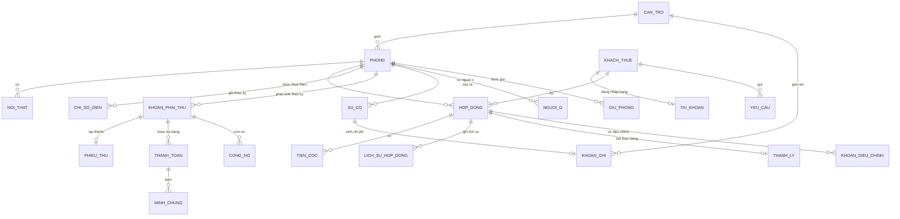

### 13.2 Data dictionary (rút gọn: kiểu logic · bắt buộc ✱ · ràng buộc)

| Thực thể                            | Trường chính                                                                                                                                                                                                                                                                                                        | Nhạy cảm                                            | Lưu giữ                   |
| ----------------------------------- | ------------------------------------------------------------------------------------------------------------------------------------------------------------------------------------------------------------------------------------------------------------------------------------------------------------------- | --------------------------------------------------- | ------------------------- |
| **Căn trọ**                         | mã (tự sinh, unique ✱), tên ✱, địa chỉ ✱, mô tả, quy định chung, ảnh tổng quan, trạng thái hoạt động ✱                                                                                                                                                                                                              | Internal                                            | Vĩnh viễn (BR-15)         |
| **Phòng**                           | mã/số phòng (unique trong căn ✱), căn ✱, diện tích (số > 0 ✱), **giá thuê niêm yết** (tiền ≥ 0 ✱), số người tối đa (số nguyên ≥ 1 ✱), số người đang ở, trạng thái ✱ (Trống/Đã giữ/Đang thuê/Đang xử lý trả phòng/Ngừng sử dụng)                                                                                     | Internal                                            | Vĩnh viễn                 |
| **Nội thất (thuộc tính của phòng)** | phòng ✱, tên ✱, số lượng ✱, tình trạng, ghi chú; cập nhật tự do, không ảnh hưởng trạng thái phòng                                                                                                                                                                                                                   | Internal                                            | Theo phòng                |
| **Khách thuê (hồ sơ)**              | mã (tự sinh ✱), họ tên ✱, SĐT ✱ (hợp lệ, **unique**, dùng làm tên đăng nhập), CCCD/giấy tờ ✱, trạng thái; là người đứng tên hợp đồng                                                                                                                                                                                | **Restricted**: CCCD; **Confidential**: SĐT, họ tên | Trong thời gian vận hành  |
| **Tài khoản**                       | tên đăng nhập = SĐT (unique ✱), mật khẩu băm ✱, trạng thái ✱, hồ sơ khách ✱, lịch sử trạng thái                                                                                                                                                                                                                     | **Restricted**                                      | Giữ sau trả phòng (BR-17) |
| **Hợp đồng**                        | mã ✱, phòng ✱, khách ✱, ngày bắt đầu ✱, ngày kết thúc ✱ (> bắt đầu), **giá thuê hợp đồng** ✱, đơn giá điện ✱, đơn giá nước ✱, phí dịch vụ ✱, gói gia hạn (6/12), chỉ số điện đầu + ngày ✱, **đã có bản giấy ký** ✱, điều khoản, trạng thái ✱                                                                        | Confidential                                        | Vĩnh viễn (BR-22)         |
| **Tiền cọc**                        | hợp đồng ✱, số tiền ✱ (> 0), ngày nhận, trạng thái ✱, số hoàn, số khấu trừ                                                                                                                                                                                                                                          | Confidential                                        | Theo hợp đồng             |
| **Lịch sử hợp đồng / gia hạn**      | hợp đồng ✱, loại thay đổi ✱, giá trị cũ/mới ✱, ngày ✱, người thực hiện ✱                                                                                                                                                                                                                                            | Confidential                                        | Vĩnh viễn                 |
| **Chỉ số điện**                     | phòng ✱, kỳ ✱ (unique phòng+kỳ), chỉ số ✱ (số ≥ chỉ số trước), ảnh ✱ (nếu khách gửi), trạng thái ✱, người gửi/xác nhận, thời gian                                                                                                                                                                                   | Internal                                            | Vĩnh viễn (lịch sử)       |
| **Khoản phải thu**                  | phòng ✱, kỳ ✱, tiền phòng, tiền điện, tiền nước, phí DV, phí phát sinh, giảm trừ, tổng ✱ (≥ 0); số tiền bị khóa khi đã có thanh toán                                                                                                                                                                                | Confidential                                        | Vĩnh viễn                 |
| **Phiếu thu**                       | phòng ✱, kỳ ✱ (unique phòng+kỳ, BR-26), khoản phải thu ✱, trạng thái ✱ (Đã lập/Đã gửi), thời gian lập/gửi                                                                                                                                                                                                           | Confidential                                        | Vĩnh viễn                 |
| **Thanh toán (bản ghi từng lần)**   | khoản phải thu ✱, ngày ✱, số tiền ✱ (> 0, không vượt còn lại), người ghi nhận ✱, trạng thái (Hiệu lực/Đã hủy), lý do hủy                                                                                                                                                                                            | Confidential                                        | Vĩnh viễn                 |
| **Minh chứng thanh toán**           | khoản phải thu ✱, ảnh ✱, trạng thái ✱ (Chờ xác nhận/Đã đối chiếu), thời gian                                                                                                                                                                                                                                        | **Confidential** (ảnh có thể chứa số tài khoản)     | Trong thời gian vận hành  |
| **Công nợ**                         | phòng ✱, kỳ gốc ✱, số dư còn thiếu ✱ (tính lại theo tổng thu và điều chỉnh), ngày ghi nhận ✱, trạng thái                                                                                                                                                                                                            | Confidential                                        | Vĩnh viễn                 |
| **Yêu cầu**                         | loại ✱ (Gia hạn/Trả phòng/Đặt lại MK), khách ✱, nội dung, ngày đề xuất (gia hạn/trả phòng), lý do ngoại lệ, trạng thái ✱ (kể cả Đã rút duyệt cho trả phòng), lý do từ chối/rút duyệt                                                                                                                                | Internal                                            | Vĩnh viễn                 |
| **Người ở cùng**                    | phòng ✱, họ tên ✱, SĐT ✱, CCCD/giấy tờ ✱, ngày sinh ✱, giới tính ✱, địa chỉ thường trú ✱, quan hệ ✱, ngày bắt đầu ở ✱, ngày rời, trạng thái ✱ (Chờ xử lý/Đang ở/Từ chối/Đã rời), lý do từ chối                                                                                                                      | **Restricted**: CCCD (PII người thứ ba)             | Trong thời gian vận hành  |
| **Sự cố**                           | mã ✱, sự cố trước (nếu tiếp diễn), vị trí ✱ (phòng hoặc khu vực chung của căn), người báo, loại ✱ (danh mục), ưu tiên ✱ (Thấp/TB/Cao/Khẩn cấp), mô tả ✱, ảnh, trạng thái ✱ (kể cả Đã hủy), thời gian báo/tiếp nhận/hoàn tất, kết quả, chi phí (≥ 0), đối tượng chịu chi phí ✱, trạng thái khấu trừ (nếu khách chịu) | Internal                                            | Vĩnh viễn                 |
| **Khoản chi**                       | căn (hoặc "toàn chuỗi") ✱, loại ✱ (Sửa chữa/Thay thế thiết bị/Hoa hồng giới thiệu/Khác), số tiền (> 0) ✱, ngày ✱, ghi chú, nguồn (tay/từ sự cố) ✱, trạng thái (Hiệu lực/Đã hủy)                                                                                                                                     | Confidential                                        | Vĩnh viễn                 |
| **Thanh lý hợp đồng**               | hợp đồng ✱, chỉ số điện cuối kỳ, kết quả kiểm tra, công nợ, các khoản khấu trừ, cọc còn hoàn, ngày thanh lý ✱                                                                                                                                                                                                       | Confidential                                        | Vĩnh viễn                 |
| **Thông báo**                       | người nhận ✱, loại ✱, nội dung ✱, thời gian, đã đọc (trong ứng dụng)                                                                                                                                                                                                                                                | Internal                                            | 12 tháng `[ASSUMED]`      |
| **Giữ phòng**                       | phòng ✱, người giữ ✱, SĐT ✱, tiền giữ chỗ (≥ 0), ngày nhận ✱, hạn giữ ✱, điều kiện gia hạn/hủy/hoàn ✱, số đã hoàn, số không hoàn, lý do, trạng thái ✱ (SM-13), lịch sử thỏa thuận                                                                                                                                   | Confidential                                        | Vĩnh viễn                 |
| **Khoản điều chỉnh**                | hợp đồng/phòng ✱, loại ✱ (Phí phát sinh/Giảm trừ), tên/lý do ✱, số tiền (> 0) ✱, chế độ ✱ (Cố định/Theo kỳ), kỳ hoặc ngày bắt đầu ✱, trạng thái (Đang áp dụng/Đã tắt)                                                                                                                                               | Confidential                                        | Vĩnh viễn                 |
| **Quyết toán trả phòng**            | hợp đồng ✱, các thành phần BR-39, cọc còn hoàn, công nợ sau thanh lý, ngày hoàn thực tế, số tiền hoàn                                                                                                                                                                                                               | Confidential                                        | Vĩnh viễn                 |
| **Lịch chuyển phòng** (P1)          | hợp đồng ✱, phòng cũ/mới ✱, ngày chuyển ✱, chỉ số cuối/đầu                                                                                                                                                                                                                                                          | Internal                                            | Vĩnh viễn                 |
| **Cấu hình**                        | ngày ghi chỉ số, hạn thanh toán (05), ngày ghi công nợ (10), ngưỡng cảnh báo hợp đồng, lịch phiếu tự động (ngày + giờ), hạn giữ mặc định, giới hạn ảnh, danh mục sự cố/chi phí                                                                                                                                      | Internal                                            | Vĩnh viễn (có lịch sử)    |
| **Audit log**                       | thời gian ✱, người ✱, hành động ✱, đối tượng ✱, giá trị cũ/mới                                                                                                                                                                                                                                                      | Confidential                                        | Xem NFR-015               |

**Chất lượng dữ liệu:** tiền là số nguyên VND không âm `[ASSUMED]`; thời gian theo múi giờ Việt Nam; làm tròn từng khoản đến đồng (BR-38).

---

## 14. Integration Requirements

| ID     | Hệ thống ngoài                                      | Mục đích                                          | Chiều                    | Contract dự kiến                                       | Xác thực                            | Timeout / Retry                                 | Idempotency                                                                       | Lỗi và fallback                                                                                                                               |
| ------ | --------------------------------------------------- | ------------------------------------------------- | ------------------------ | ------------------------------------------------------ | ----------------------------------- | ----------------------------------------------- | --------------------------------------------------------------------------------- | --------------------------------------------------------------------------------------------------------------------------------------------- |
| INT-01 | OCR/AI (EXT-01)                                     | Đọc chỉ số từ ảnh công tơ (UC-09)                 | Hệ thống → OCR → kết quả | Vào: ảnh (JPG/PNG ≤ 10 MB). Ra: chỉ số số + độ tin cậy | Theo nhà cung cấp chọn khi thiết kế | Timeout theo NFR-003; retry ≤ 1 lần `[ASSUMED]` | Gửi lại cùng ảnh cho kết quả tương đương; không tạo chỉ số tới khi khách xác nhận | Không đọc được/timeout → khách chụp lại hoặc sửa tay; Chủ trọ nhập tay (UC-10). Gửi ảnh cho dịch vụ OCR đã chọn là chấp nhận được `[ASSUMED]` |
| INT-02 | Thông báo trong ứng dụng (nội bộ, nền Kafka — Q-08) | Gửi thông báo và phiếu thu                        | Hệ thống → người dùng    | Sự kiện thông báo theo mục 16.2                        | Theo phiên đăng nhập                | Tiêu thụ lại sau khi phục hồi (NFR-021)         | Không gửi trùng (FR-159)                                                          | Lỗi thông báo không làm mất dữ liệu nghiệp vụ (UC-08 E5; BR-29)                                                                               |
| INT-03 | _(đã bỏ)_                                           | Nhập dữ liệu cũ do Chủ trọ **tự nhập tay** (Q-26) | —                        | —                                                      | —                                   | —                                               | —                                                                                 | —                                                                                                                                             |

---

## 15. Security, Privacy và Authorization

### 15.1 Ma trận actor × resource × action

C = tạo, R = xem, U = sửa, D = xóa/hủy, A = duyệt/xác nhận, **own** = chỉ dữ liệu của chính mình, — = cấm.

| Resource                       | Chủ trọ                 | Khách thuê                                               |
| ------------------------------ | ----------------------- | -------------------------------------------------------- |
| Căn, Phòng, Tài sản            | C R U (D bị BR-15 chặn) | — (xem thông tin phòng của mình, gián tiếp qua hợp đồng) |
| Hồ sơ khách                    | C R U                   | R own (tối thiểu)                                        |
| Tài khoản khách                | C R khóa/mở khóa        | — (chỉ đổi mật khẩu của mình)                            |
| Hợp đồng, Tiền cọc             | C R U                   | R own                                                    |
| Chỉ số điện                    | R U A                   | C own (gửi), R own                                       |
| Khoản phải thu, Phiếu thu      | C R U                   | R own                                                    |
| Thanh toán, Công nợ            | C R U A                 | R own (xem), C minh chứng own                            |
| Yêu cầu (gia hạn/trả phòng/MK) | R A                     | C R own                                                  |
| Đề xuất bạn cùng phòng         | R A                     | C R own                                                  |
| Sự cố                          | C R U A                 | C R own; U D own khi _Chờ tiếp nhận_                     |
| Khoản chi, Báo cáo             | C R                     | —                                                        |
| Giữ phòng, Người ở cùng        | C R U A                 | — (đề xuất người ở cùng: C R own)                        |
| Khoản điều chỉnh, Công nợ      | C R U                   | R own (nợ của mình)                                      |
| Thông báo                      | R                       | R own                                                    |
| Audit log                      | R                       | —                                                        |

Người quản lý căn: quyền = Khách thuê (BR-09); **không** xem dữ liệu phòng/khách khác (`Q-27` xác nhận).

### 15.2 Yêu cầu bảo mật

| ID     | Yêu cầu                                                                                                                                                                                                                                | Nguồn / nhãn             |
| ------ | -------------------------------------------------------------------------------------------------------------------------------------------------------------------------------------------------------------------------------------- | ------------------------ |
| SEC-01 | Mọi chức năng cần xác thực chỉ dùng được sau khi đăng nhập                                                                                                                                                                             | S1 §4.3                  |
| SEC-02 | Phân quyền Chủ trọ/Khách thuê **phía máy chủ** theo ma trận 15.1; mặc định từ chối                                                                                                                                                     | S1 §4.3, BR-12, BR-14    |
| SEC-03 | Khách thuê chỉ truy cập dữ liệu thuộc phạm vi của mình; kiểm tra quyền sở hữu trên từng truy vấn (chống truy cập chéo ID)                                                                                                              | BR-13                    |
| SEC-04 | Mật khẩu lưu bằng thuật toán băm có muối, không đảo ngược                                                                                                                                                                              | S1 §4.3                  |
| SEC-05 | Tài khoản _Đã khóa_ không đăng nhập được                                                                                                                                                                                               | S1 §4.3, BR-17           |
| SEC-06 | Mật khẩu khởi tạo/đặt lại là "1" theo quyết định của khách hàng (rủi ro được chấp nhận, RSK-02); hệ thống phải buộc đổi ngay ở lần đăng nhập đầu, chỉ cho vào màn đổi mật khẩu cho đến khi đổi, và không cho dùng "1" làm mật khẩu mới | Q-06                     |
| SEC-07 | Chống lạm dụng quên mật khẩu: tối đa 3 yêu cầu/giờ/SĐT, chỉ tài khoản _Hoạt động_, không tạo yêu cầu trùng; giữ thông báo "Số điện thoại không tồn tại" như đặc tả (rủi ro lộ SĐT được chấp nhận)                                      | Q-06, `[ASSUMED]` ngưỡng |
| SEC-08 | Đăng nhập: giới hạn số lần sai (5 lần/15 phút `[ASSUMED]`), phiên hết hạn sau 30 phút không hoạt động `[ASSUMED]`                                                                                                                      | `[ASSUMED]`              |
| SEC-09 | Tệp tải lên: kiểm tra loại thật của tệp (không chỉ phần mở rộng), giới hạn dung lượng, lưu ngoài thư mục chạy mã, phục vụ qua kiểm soát quyền                                                                                          | NFR-019, `[ASSUMED]`     |
| SEC-10 | CCCD/giấy tờ (khách và người ở cùng): chỉ Chủ trọ xem; che bớt ký tự trong danh sách; không ghi vào log                                                                                                                                | `[ASSUMED]`              |
| SEC-11 | Truyền dữ liệu qua kênh mã hóa (HTTPS)                                                                                                                                                                                                 | `[ASSUMED]`              |
| SEC-12 | Dữ liệu tài chính và cá nhân được bảo vệ ở mức phù hợp quy mô sinh viên (truy cập có phân quyền, sao lưu, không lộ trong log)                                                                                                          | S1 §4.3, Q-29            |
| SEC-13 | Thao tác nhạy cảm (khóa/mở khóa, đặt lại mật khẩu, sửa chỉ số/thanh toán/phiếu, thanh lý, đổi đơn giá) ghi audit (mục 16.1)                                                                                                            | `[ASSUMED]`              |
| SEC-14 | Thông tin riêng tư không lộ trong thông báo hoặc phiếu hiển thị trong ứng dụng (chỉ người nhận được xem)                                                                                                                               | `[ASSUMED]`              |

**Quy định pháp luật áp dụng:** nguồn và khách hàng không yêu cầu ở giai đoạn này (Q-29: triển khai quy mô sinh viên). Hệ thống vẫn áp dụng các biện pháp bảo vệ dữ liệu cơ bản ở trên; khi triển khai thực tế, Chủ trọ tự chịu trách nhiệm tuân thủ pháp luật về dữ liệu cá nhân và lưu trữ chứng từ.

---

## 16. Audit, Notification và Report

### 16.1 Audit (`[ASSUMED]` từ BR-11, S1 "Lưu lịch sử…")

Trường bắt buộc: thời gian, người thực hiện, hành động, đối tượng, giá trị cũ → mới, kết quả. Người xem: Chủ trọ. Lưu: xem NFR-015.

| ID     | Sự kiện cần audit                                                                     |
| ------ | ------------------------------------------------------------------------------------- |
| AUD-01 | Nhập/sửa/xác nhận chỉ số điện (kể cả người gửi và ảnh)                                |
| AUD-02 | Cập nhật số tiền thanh toán, "Đã đóng", "Tất cả đã đóng", xác nhận/từ chối minh chứng |
| AUD-03 | Thay đổi hợp đồng: giá thuê, đơn giá điện/nước, phí dịch vụ, cọc, thời hạn, gia hạn   |
| AUD-04 | Tạo/sửa/gửi phiếu thu; thay đổi lịch tự động                                          |
| AUD-05 | Phê duyệt/từ chối yêu cầu                                                             |
| AUD-06 | Tạo, khóa, mở khóa tài khoản; đặt lại mật khẩu                                        |
| AUD-07 | Đổi trạng thái phòng                                                                  |
| AUD-08 | Tiếp nhận/hoàn tất sự cố; thay đổi chi phí và đối tượng chịu chi phí                  |
| AUD-09 | Thanh lý hợp đồng, tính cọc hoàn, khấu trừ                                            |
| AUD-10 | Tạo/sửa khoản chi                                                                     |

### 16.2 Thông báo

**Tất cả thông báo là trong ứng dụng** (Q-08), phát qua cơ chế sự kiện Kafka; xem UC-25.

| ID     | Trigger                                                      | Người nhận       | Nội dung               | Nguồn        |
| ------ | ------------------------------------------------------------ | ---------------- | ---------------------- | ------------ |
| NTF-01 | Khách gửi yêu cầu đặt lại mật khẩu                           | Chủ trọ          | Khách, SĐT             | UC-01        |
| NTF-02 | Duyệt/từ chối đặt lại mật khẩu                               | Khách            | Kết quả (+ lý do)      | UC-01, UC-16 |
| NTF-03 | Chỉ số điện _Chờ xác nhận_                                   | Chủ trọ          | Phòng, kỳ, cờ sửa tay  | UC-09        |
| NTF-04 | Phiếu thu được lập và lưu thành công (tự động hoặc thủ công) | Khách            | Phiếu thu              | UC-20, BR-29 |
| NTF-05 | Hợp đồng còn ≤ 1 tháng                                       | Chủ trọ và Khách | Hợp đồng, ngày hết hạn | BR-02        |
| NTF-06 | Yêu cầu gia hạn/trả phòng mới                                | Chủ trọ          | Loại, khách, phòng     | UC-13, UC-14 |
| NTF-07 | Kết quả phê duyệt/từ chối yêu cầu                            | Khách            | Kết quả (+ lý do)      | UC-16        |
| NTF-08 | Sự cố mới                                                    | Chủ trọ          | Mã, vị trí, ưu tiên    | UC-18        |
| NTF-09 | Sự cố hoàn tất                                               | Khách đã báo     | Kết quả xử lý          | UC-17        |
| NTF-10 | Đề xuất người ở cùng mới                                     | Chủ trọ          | Người được đề xuất     | UC-08        |
| NTF-11 | Khách tải minh chứng                                         | Chủ trọ          | Phòng, kỳ              | UC-12        |
| NTF-12 | Nhắc thanh toán (ngày 05) và khi ghi công nợ (hết ngày 10)   | Khách            | Số tiền còn nợ         | UC-29        |
| NTF-13 | Giữ phòng quá hạn                                            | Chủ trọ          | Phòng, người giữ       | UC-26        |
| NTF-14 | Chấp nhận/từ chối người ở cùng                               | Khách            | Kết quả (+ lý do)      | UC-28        |
| NTF-15 | Đến ngày trả phòng đã duyệt                                  | Chủ trọ          | Phòng, khách           | UC-29        |

Quy tắc chung: đúng đối tượng; không gửi trùng; lỗi thông báo không làm hỏng dữ liệu nghiệp vụ; không có opt-out ở giai đoạn này `[ASSUMED]`; tiếng Việt.

### 16.3 Báo cáo

| ID     | Báo cáo                                    | Người xem | Chỉ số / bộ lọc                | Độ tươi dữ liệu                 |
| ------ | ------------------------------------------ | --------- | ------------------------------ | ------------------------------- |
| RPT-01 | Doanh thu – Chi phí – Lợi nhuận            | Chủ trọ   | Tháng/quý/năm × căn/toàn chuỗi | Theo thời gian thực `[ASSUMED]` |
| RPT-02 | So sánh giữa các căn                       | Chủ trọ   | Cùng kỳ                        | idem                            |
| RPT-03 | Chi tiết khoản thu                         | Chủ trọ   | căn, phòng, loại, tiền, ngày   | idem                            |
| RPT-04 | Chi tiết khoản chi                         | Chủ trọ   | idem                           | idem                            |
| RPT-05 | Công nợ theo căn/phòng/khách/tuổi nợ       | Chủ trọ   | căn, phòng, kỳ gốc, số ngày nợ | Theo thời gian thực             |
| RPT-06 | Hợp đồng sắp hết hạn                       | Chủ trọ   | Còn ≤ 1 tháng                  | Theo thời gian thực             |
| RPT-07 | Xuất Excel các báo cáo (Could) `[ASSUMED]` | Chủ trọ   | idem                           | —                               |

---

## 17. Non-functional Requirements

S1 §4.3 chỉ nêu định tính ("phù hợp", "nhanh chóng") và nói rõ các mốc 3 s/5 s **chỉ là mục tiêu kỹ thuật của nhóm nếu khách chưa xác nhận**. Mọi con số dưới đây `[ASSUMED]` trừ khi ghi khác; BA đã chốt theo ủy quyền (Q-31), Chủ trọ rà soát ở 22.2.

| ID      | Nhóm           | Yêu cầu có số đo                                                                                                                                                                   | Điều kiện đo / xác minh                              |
| ------- | -------------- | ---------------------------------------------------------------------------------------------------------------------------------------------------------------------------------- | ---------------------------------------------------- |
| NFR-001 | Hiệu năng      | Thao tác xem/lưu thông thường: p95 ≤ 3 s                                                                                                                                           | 50 người dùng đồng thời, dữ liệu 1 năm; kiểm thử tải |
| NFR-002 | Hiệu năng      | Báo cáo toàn chuỗi 12 tháng: p95 ≤ 5 s; tính tiền điện/khoản phải thu một phòng: ≤ 1 s                                                                                             | Dữ liệu ở mức NFR-005; kiểm thử                      |
| NFR-003 | Hiệu năng      | OCR: từ khi tải xong ảnh đến khi hiển thị kết quả p95 ≤ 10 s; quá 30 s coi là timeout và báo khách                                                                                 | Ảnh ≤ 10 MB, mạng di động 4G; kiểm thử tích hợp      |
| NFR-004 | Sẵn sàng       | Khả dụng ≥ 98,0%/tháng (≈ 14,4 giờ ngừng/tháng); trong ngày 01–10 hằng tháng không gián đoạn quá 2 giờ liên tục `[ASSUMED]`                                                        | Giám sát                                             |
| NFR-005 | Quy mô         | Đạt NFR với 150 phòng và 300 người ở (3 căn × 50 phòng); hiện tại ≈ 90 phòng/180 người (Q-10); kiểm thử tải ở 3× (450 phòng, 900 người); thêm căn/phòng chỉ cần cấu hình           | Dữ liệu giả lập; kiểm thử tải                        |
| NFR-006 | Toàn vẹn       | Mọi nghiệp vụ lưu nhiều bản ghi (xác nhận điện, "Tất cả đã đóng", lập phiếu, thanh lý, hoàn tất sự cố, duyệt yêu cầu) là **tất cả-hoặc-không**: lỗi giữa chừng → 0 bản ghi dở dang | Kiểm thử chèn lỗi                                    |
| NFR-007 | Toàn vẹn       | Không có hai phiếu thu hợp lệ cùng phòng/kỳ; chạy lại tác vụ tự động tạo 0 phiếu trùng                                                                                             | Kiểm thử đồng thời và chạy lại                       |
| NFR-008 | Sao lưu        | Sao lưu đầy đủ hằng ngày, giữ 30 ngày; RPO ≤ 24 giờ; RTO ≤ 8 giờ; thử khôi phục mỗi quý                                                                                            | Biên bản khôi phục                                   |
| NFR-009 | Bảo mật        | Theo SEC-04, SEC-08; không có mật khẩu bản rõ trong CSDL/log                                                                                                                       | Kiểm tra mã, quét                                    |
| NFR-010 | Tương thích    | Hai phiên bản chính gần nhất của Chrome, Edge, Firefox, Safari; giao diện khách dùng được ở màn hình rộng ≥ 360 px                                                                 | Kiểm thử trình duyệt                                 |
| NFR-011 | Dễ dùng        | Khách mới hoàn tất "Nhập chỉ số điện" trong ≤ 2 phút, không cần hướng dẫn, ≥ 4/5 người thử UAT                                                                                     | UAT                                                  |
| NFR-012 | Thông báo      | Thông báo trong ứng dụng hiển thị ≤ 1 phút sau trigger khi người dùng đang trực tuyến; 0 thông báo trùng cho một sự kiện                                                           | Log thông báo                                        |
| NFR-013 | Bảo trì        | Ngày 01/05/10, ngưỡng cảnh báo 1 tháng, giới hạn ảnh, lịch phiếu là **cấu hình**, đổi không cần sửa mã                                                                             | Kiểm tra cấu hình                                    |
| NFR-014 | Quan sát       | Mọi lỗi lưu có log kèm mã tương quan; nhìn thấy tỷ lệ lỗi theo chức năng                                                                                                           | Kiểm tra log                                         |
| NFR-015 | Lưu giữ audit  | Không xóa audit trong suốt thời gian vận hành `[ASSUMED]` (Q-29)                                                                                                                   | Chính sách lưu                                       |
| NFR-016 | Địa phương hóa | Tiếng Việt; tiền VND; ngày dd/MM/yyyy; múi giờ Asia/Ho_Chi_Minh                                                                                                                    | Kiểm thử                                             |
| NFR-017 | Đồng thời      | Hai người cùng sửa một đối tượng: phát hiện và từ chối thao tác lưu sau (UC-16 E1, UC-17 E2, UC-18 E3)                                                                             | Kiểm thử đồng thời                                   |
| NFR-018 | Trợ năng       | Không yêu cầu chuẩn WCAG; chữ ≥ 14 px và tương phản đủ đọc trên điện thoại `[ASSUMED]`                                                                                             | Kiểm tra giao diện                                   |
| NFR-019 | Tệp            | Ảnh JPG/JPEG/PNG, ≤ 10 MB/ảnh, áp dụng cho ảnh công tơ, minh chứng, sự cố (nguồn chỉ nêu cho sự cố)                                                                                | Kiểm thử tải tệp                                     |
| NFR-020 | Mở rộng        | Thêm căn/phòng chỉ cần cấu hình dữ liệu, không sửa mã                                                                                                                              | Kiểm thử                                             |
| NFR-021 | Thông báo      | Sự kiện thông báo không mất khi bộ tiêu thụ tạm ngừng; được xử lý lại trong ≤ 5 phút sau khi phục hồi `[ASSUMED]`                                                                  | Kiểm thử ngắt/phục hồi                               |
| NFR-022 | Chi phí        | Hệ thống chạy được ở quy mô sinh viên: không bắt buộc dịch vụ trả phí; OCR phải có phương án miễn phí hoặc mock (Q-29)                                                             | Kiểm tra cấu hình triển khai                         |

---

## 18. Vận hành và Chuyển đổi

| ID     | Yêu cầu                                                                                                                                                            | Nhãn                                   |
| ------ | ------------------------------------------------------------------------------------------------------------------------------------------------------------------ | -------------------------------------- |
| OPS-01 | Sao lưu/khôi phục theo NFR-008; người phụ trách kiểm thử khôi phục mỗi quý và lưu biên bản                                                                         | Chủ trọ duyệt N-11; thống nhất NFR-008 |
| OPS-02 | Chủ trọ tự vận hành; nhóm phát triển hỗ trợ kỹ thuật; khôi phục mật khẩu Chủ trọ làm ngoài hệ thống                                                                | `[ASSUMED]` (Q-27, Q-31)               |
| OPS-03 | Tài liệu hướng dẫn: 1 trang cho khách thuê (nhập điện, theo dõi thanh toán, báo sự cố); 1 bộ cho Chủ trọ (chu trình kỳ: điện → phiếu → thanh toán → báo cáo)       | `[ASSUMED]`                            |
| OPS-04 | Giám sát tác vụ định thời (UC-29, phiếu tự động): có log mỗi lần chạy, cảnh báo khi không chạy/lỗi, chạy lại không tạo bản ghi trùng                               | `[ASSUMED]` từ BR-02, BR-19, BR-28     |
| OPS-05 | Quản lý cấu hình (NFR-013) do Chủ trọ thực hiện                                                                                                                    | `[ASSUMED]`                            |
| MIG-01 | **Chủ trọ tự nhập tay** dữ liệu hiện có của 3 căn (căn, phòng, khách, hợp đồng, cọc, chỉ số điện gần nhất, công nợ còn lại); không có công cụ nhập hàng loạt ở MVP | Q-26                                   |
| MIG-02 | Chạy song song với Excel ít nhất 1 kỳ trước khi bỏ Excel                                                                                                           | `[ASSUMED]`                            |
| MIG-03 | Tiêu chí go/no-go: đối chiếu tổng phải thu, đã thu, công nợ của kỳ chạy song song **sai lệch 0 đồng**                                                              | `[ASSUMED]`                            |
| MIG-04 | Rollback nghiệp vụ: giữ Excel làm nguồn dự phòng trong kỳ đầu                                                                                                      | `[ASSUMED]`                            |

## 19. Seed, Mock và Test Data

Không dùng dữ liệu cá nhân thật; SĐT/CCCD là giá trị giả hợp lệ định dạng.

| Nhóm                     | Bộ dữ liệu tối thiểu                                                                                                                                       |
| ------------------------ | ---------------------------------------------------------------------------------------------------------------------------------------------------------- |
| Căn/phòng                | 3 căn (1 phòng _Ngừng sử dụng_; 1 phòng _Đã giữ_ quá hạn); ≥ 12 phòng phủ 4 trạng thái SM-01; 1 phòng đã đủ số người tối đa                                |
| Khách/tài khoản          | ≥ 9 khách; 1 Người quản lý căn có giảm trừ; 1 khách thiếu SĐT; 1 cặp SĐT trùng; 1 tài khoản _Đã khóa_; 1 khách chưa có hợp đồng/cọc                        |
| Hợp đồng                 | Đang hiệu lực; **còn 20 ngày** (Sắp hết hạn); Hết hạn; Đã thanh lý; có lịch sử gia hạn; có đổi đơn giá điện giữa hai kỳ; ngày kết thúc ≤ bắt đầu (âm tính) |
| Điện                     | Chờ xác nhận; Đã xác nhận; chưa có chỉ số; chỉ số < kỳ trước; ảnh rõ/mờ/hỏng; kỳ chuyển năm (12 → 1)                                                       |
| Thanh toán               | Chưa/Một phần/Đã thanh toán; quá hạn còn nợ; phòng đã đóng đủ; 1 minh chứng _Chờ xác nhận_; nhập thanh toán lớn hơn còn lại (âm tính)                      |
| Phiếu thu                | Phòng đã có phiếu; phòng chưa có; lịch tự động bật, 1 phòng cố tình lỗi tạo phiếu                                                                          |
| Yêu cầu                  | Mỗi loại ở _Chờ phê duyệt_; khách đã có yêu cầu trả phòng chờ; yêu cầu bị xử lý đồng thời bởi 2 phiên                                                      |
| Sự cố                    | Đủ 4 trạng thái; chi phí 0; Chủ trọ chịu; Khách chịu; sự cố bị tiếp nhận khi khách đang sửa                                                                |
| Chi                      | Chi gắn căn; chi chung chuỗi; chi âm (âm tính)                                                                                                             |
| Mock ngoài               | **OCR giả**: đọc đúng, đọc sai, không đọc được, timeout. **Bộ phát thông báo giả**: thành công, tạm ngừng rồi phục hồi                                     |
| Người ở cùng / Giữ phòng | Phòng tối đa 2 người đã có 1 người ở cùng; đề xuất _Chờ xử lý_; giữ phòng còn hạn, quá hạn; hủy giữ hoàn và không hoàn                                     |
| Điều chỉnh / kỳ lẻ       | Khoản Cố định và Theo kỳ; hợp đồng bắt đầu ngày 15 (kỳ lẻ đầu); trả phòng giữa tháng (hoàn tiền phòng theo ngày)                                           |
| Biên                     | Tháng 28/29 ngày; ngày 01/05/10; hợp đồng kết thúc đúng ngày; ảnh 10 MB và 10 MB + 1 byte                                                                  |

## 20. Acceptance và UAT

- **Điều kiện nghiệm thu release MVP:** mọi FR _Must_ có AC đạt; 0 lỗi nghiêm trọng về tiền (sai tính, trùng phiếu, mất dữ liệu); NFR-006/007 đạt; MIG-03 đạt (đối chiếu 1 kỳ); Chủ trọ đã rà soát các mục `[ASSUMED]` ở 22.2.
- **Người ký nhận:** Chủ trọ (Q-34).
- **Kịch bản UAT chính:** UAT-01 vòng đời một kỳ đầy đủ (điện → xác nhận → phiếu → thanh toán một phần → công nợ → báo cáo); UAT-02 tạo hợp đồng → cấp tài khoản → khách xem; UAT-03 gia hạn qua yêu cầu và duyệt; UAT-04 trả phòng và thanh lý có khấu trừ; UAT-05 sự cố do Chủ trọ chịu và do Khách chịu; UAT-06 đặt lại mật khẩu; UAT-07 phiếu tự động có 1 phòng lỗi; UAT-08 phân quyền (khách A không xem được dữ liệu khách B); UAT-09 OCR sai/không đọc và chủ trọ nhập tay; UAT-10 mất kết nối giữa chừng khi "Tất cả đã đóng" (không dữ liệu dở); UAT-11 giữ phòng → ký hợp đồng trừ cọc; UAT-12 thêm người ở cùng và tiền nước kỳ sau; UAT-13 ghi công nợ hết ngày 10 và thu nợ cũ; UAT-14 trả phòng giữa tháng có chi phí khách chịu và quyết toán cọc.
- **Definition of Done (mức nghiệp vụ):** có UC + AC; AC chạy đạt trên dữ liệu seed; audit/thông báo kèm theo đúng; không mâu thuẫn quyền; khách hàng xác nhận bằng demo.

---

## 21. Traceability Matrix

### 21.1 Use case → yêu cầu

| UC       | Workflow          | Business Goal | FR                           | BR                             | NFR / SEC / AUD / NTF                | AC         | Release |
| -------- | ----------------- | ------------- | ---------------------------- | ------------------------------ | ------------------------------------ | ---------- | ------- |
| UC-01    | WF-03             | BG-03         | 012–019, 197                 | 30, 36, 37                     | SEC-04, 06, 07 / AUD-06 / NTF-01, 02 | UC01-AC1…5 | MVP     |
| UC-02    | WF-01             | BG-02         | 001–010                      | 01, 17, 37, 49                 | SEC-05 / AUD-06                      | UC02-AC1…5 | MVP     |
| UC-03    | WF-01             | BG-02         | 020–023                      | 15                             | NFR-006                              | UC03-AC1…4 | MVP     |
| UC-04    | WF-01             | BG-02         | 024–029                      | 10, 15                         | — / AUD-07                           | UC04-AC1…5 | MVP     |
| UC-05    | WF-01             | BG-02         | 030–034                      | 49                             | SEC-10                               | UC05-AC1…2 | MVP     |
| UC-06    | WF-02             | BG-05, BG-09  | 035–046, 180–184, 199        | 11, 20, 21, 22, 24, 38, 40, 41 | NFR-006 / AUD-03                     | UC06-AC1…5 | MVP     |
| UC-07    | WF-02             | BG-05         | 047–049                      | 02, 13                         | SEC-03                               | UC07-AC1…2 | MVP     |
| UC-08    | WF-11             | BG-02         | 050–054                      | 23, 43                         | — / NTF-10                           | UC08-AC1…3 | MVP     |
| UC-09    | WF-04             | BG-06         | 055–062                      | 04                             | NFR-003, 019 / NTF-03                | UC09-AC1…4 | MVP     |
| UC-10    | WF-04             | BG-03, BG-06  | 063–070                      | 04, 11, 35                     | NFR-006 / AUD-01                     | UC10-AC1…3 | MVP     |
| UC-11    | WF-06             | BG-03, BG-04  | 071–080, 171–173             | 12, 19, 25, 34, 46             | NFR-006 / AUD-02 / NTF-11            | UC11-AC1…6 | MVP     |
| UC-12    | WF-06             | BG-04         | 081–086, 174                 | 13, 25, 33                     | SEC-03, 09                           | UC12-AC1…3 | MVP     |
| UC-13    | WF-03             | BG-05         | 087–090                      | 21, 30                         | NTF-06                               | UC13-AC1…3 | MVP     |
| UC-14    | WF-03             | BG-05, BG-09  | 091–094                      | 30, 45                         | NTF-06                               | UC14-AC1…4 | MVP     |
| UC-15    | WF-08             | BG-09         | 095–104, 187–190             | 06, 17, 22, 23, 24, 38, 39, 48 | NFR-006 / AUD-09                     | UC15-AC1…5 | MVP     |
| UC-16    | WF-03             | BG-05         | 105–112, 185                 | 21, 30, 36, 45                 | NFR-017 / AUD-05 / NTF-02, 07        | UC16-AC1…5 | MVP     |
| UC-17    | WF-07             | BG-07, BG-08  | 113–123, 191, 192            | 07, 18, 31, 48, 50             | NFR-017 / AUD-08 / NTF-09            | UC17-AC1…5 | MVP     |
| UC-18    | WF-07             | BG-08         | 124–131                      | 31, 32                         | NFR-019 / NTF-08                     | UC18-AC1…3 | MVP     |
| UC-19    | WF-09             | BG-07         | 132–143, 193, 194            | 07, 08, 12, 44                 | NFR-002 / AUD-10 / RPT-01…04, 07     | UC19-AC1…5 | MVP     |
| UC-20    | WF-05             | BG-01, BG-03  | 144–157, 179, 181            | 03, 26–29, 47                  | NFR-007 / AUD-04 / NTF-04            | UC20-AC1…6 | MVP     |
| UC-22    | WF-05             | BG-03         | 164, 175, 176                | 03, 09, 42                     | AUD-03                               | UC22-AC1…3 | MVP     |
| UC-23    | WF-06             | BG-04         | 165, 171, 196                | 19, 33, 34, 46                 | RPT-05                               | UC23-AC1…2 | MVP     |
| UC-24    | —                 | BG-02         | 011, 197, 198                | 37                             | SEC-01, 05, 06, 08                   | UC24-AC1…3 | MVP     |
| UC-25    | —                 | BG-01         | 159, 162                     | —                              | NFR-012                              | UC25-AC1…2 | MVP     |
| UC-26    | WF-10             | BG-02         | 167–170                      | 05, 41                         | NTF-13                               | UC26-AC1…3 | MVP     |
| UC-27    | WF-02             | BG-02         | 195                          | 16, 22, 38                     | AUD-07                               | UC27-AC1   | P1      |
| UC-28    | WF-11             | BG-02         | 166, 177, 178                | 23, 43                         | NTF-14                               | UC28-AC1…2 | MVP     |
| UC-29    | WF-05, 06, 08, 10 | BG-04, BG-05  | 153, 158, 168, 172, 173, 186 | 02, 19, 41, 45                 | NFR-021 / NTF-05, 12, 13, 15         | UC29-AC1…2 | MVP     |
| Hệ thống | mọi WF            | BG-01         | 157, 159, 160, 161, 200      | 03, 15, 22                     | NFR-013                              | —          | MVP     |

**Bổ sung truy vết v0.4:** FR-201 → UC-10/15/17/20; FR-202/203 → UC-10; FR-204 → UC-04; FR-205 → NFR-010 (khung giao diện dùng chung); FR-206/207/208 → UC-06; FR-209 → UC-02/05/06/08/16/26; FR-210 → UC-28. Tiêu chí kiểm nhận tương ứng nằm tại §11.10.

### 21.2 Business Goal → phủ

BG-01 → WF-04, 05, UC-09, 10, 20, 25, FR-157 · BG-02 → UC-02…05, 08, 24, 26, 28 · BG-03 → UC-10, 11, 20, 22 · BG-04 → UC-11, 12, 23, 29 · BG-05 → UC-06, 07, 13, 14, 16, 29 · BG-06 → UC-09, 10 · BG-07 → UC-17, 19 · BG-08 → UC-17, 18 · BG-09 → UC-06, 14, 15.
Không có FR mồ côi; không có BG thiếu yêu cầu thực hiện. FR-045 là `DEPRECATED` (không tính).

---

## 22. Assumptions, Risks, Quyết định và Câu hỏi

### 22.1 Mâu thuẫn trong nguồn — đã giải quyết

| ID     | Quyết định                                                                                   | Căn cứ   |
| ------ | -------------------------------------------------------------------------------------------- | -------- |
| CON-01 | Nợ cũ hiển thị riêng, không cộng vào tổng kỳ mới; có thêm "Tổng cần thanh toán" (BR-33)      | Q-01     |
| CON-02 | Chi phí khách chịu khấu trừ vào cọc khi trả phòng; sửa UC-18 bỏ phần "kỳ thanh toán" (BR-48) | Q-04     |
| CON-03 | Từ chối yêu cầu có cho cả 3 loại; UC-01 chỉ tạo yêu cầu, xử lý ở UC-16 (BR-36)               | Q-05     |
| CON-04 | UC-15 chỉ nhập chỉ số **điện**; nước theo số người (BR-23)                                   | BA       |
| CON-05 | Thêm UC-22 nhập phí phát sinh/giảm trừ                                                       | Q-15     |
| CON-06 | Giảm tiền cho Người quản lý căn chỉ là **giảm trừ**, không ghi "chi phí quản lý căn"         | Q-07     |
| CON-07 | Hoàn cọc chuyển hết sang UC-15 (BR-39); UC-06 chỉ quản lý cọc                                | BA       |
| CON-08 | Bỏ gia hạn trực tiếp; gia hạn chỉ qua yêu cầu và duyệt                                       | Q-18     |
| CON-09 | UC-02 kiểm tra hợp đồng + cọc (FR-005)                                                       | BA       |
| CON-10 | Tách trạng thái minh chứng khỏi trạng thái thanh toán (SM-09)                                | Q-14     |
| CON-11 | Chủ trọ chỉ xem minh chứng trong UC-11, không có luồng xác nhận/từ chối riêng                | Q-14     |
| CON-12 | Dùng bảng trạng thái chuẩn hóa mục 6                                                         | BA       |
| CON-13 | UC-08 chỉ gửi đề xuất; UC-28 để Chủ trọ xử lý                                                | Q-13     |
| CON-14 | Thêm trạng thái phòng _Ngừng sử dụng_ và căn _Ngừng hoạt động_                               | Q-25, BA |
| CON-15 | Phòng đổi _Đang xử lý trả phòng_ đúng ngày trả (BR-45)                                       | Q-19     |
| CON-16 | Lưu từng lần thanh toán có ngày (BR-34)                                                      | Q-03     |
| CON-17 | Giữ mật khẩu "1" theo khách; rủi ro được chấp nhận (RSK-02), có giảm nhẹ                     | Q-06     |
| CON-18 | Chuẩn hóa UC-16 (tên trạng thái, bỏ lặp luồng)                                               | BA       |
| CON-19 | Hạn ngày 05; hết ngày 10 ghi công nợ (cấu hình)                                              | Q-02     |
| CON-20 | SM-02 định nghĩa đủ 4 trạng thái hợp đồng                                                    | BA       |
| CON-21 | FR-036 bổ sung đủ trường hợp đồng                                                            | BA       |

### 22.2 Quyết định BA đã được Chủ trọ chốt (v0.3)

Chủ trọ xác nhận N-01…N-05, N-11…N-16 theo khuyến nghị và chỉnh N-06…N-10 ngày 04/10/2026. Bảng dưới lưu quyết định đã chốt, không còn danh sách chờ duyệt nghiệp vụ.

| ID   | Quyết định đã chốt                                                                                                                                                                                               | Nơi áp dụng                       |
| ---- | ---------------------------------------------------------------------------------------------------------------------------------------------------------------------------------------------------------------- | --------------------------------- |
| N-01 | **ĐÃ DUYỆT:** Kỳ T = tháng lập phiếu; phiếu 10/2026 gồm tiền phòng, nước, phí dịch vụ tháng 10 trả trước + điện tháng 9; chỉ số 01/10 − 01/09                                                                    | Mục 8, BR-03                      |
| N-02 | **ĐÃ DUYỆT:** Nhắc ngày 05; quá hạn từ 06; ghi công nợ sau khi kết thúc ngày 10 theo Asia/Ho_Chi_Minh; việc gia hạn nợ ngoài hệ thống                                                                            | UC-29, BR-19                      |
| N-03 | **ĐÃ DUYỆT:** Doanh thu trước giảm trừ; lợi nhuận = doanh thu − giảm trừ − chi phí; phân bổ giảm trừ theo tỷ lệ phần thực thu, số lẻ cộng vào lần thu cuối, kỳ net 0 không tạo doanh thu tiền mặt                | BR-44, UC-19                      |
| N-04 | **ĐÃ DUYỆT:** Tháng lẻ tính theo ngày thực và làm tròn từng khoản; khi trả giữa tháng tách cọc, khấu trừ và tiền phòng trả trước cần hoàn thành các dòng riêng trong quyết toán                                  | BR-38, BR-39                      |
| N-05 | **ĐÃ DUYỆT:** Chỉ yêu cầu gia hạn khi hợp đồng _Sắp hết hạn_; cộng 6/12 tháng vào ngày kết thúc hiện tại                                                                                                         | UC-13, BR-21                      |
| N-06 | **ĐÃ DUYỆT, CÓ SỬA:** Cho Chủ trọ ghi nhận khách đóng sau bất kỳ lúc nào, số còn thiếu/công nợ tính lại; điều chỉnh khoản tính sai phải có lý do/audit, không ghi đè lịch sử, tổng mới ≥ đã thu                  | BR-27, BR-47, UC-11, UC-20, UC-23 |
| N-07 | **ĐÃ DUYỆT, CÓ SỬA:** Hạn giữ, tiền giữ và điều kiện hoàn/hủy do Chủ trọ nhập theo thỏa thuận từng lần; khi hủy cho hoàn 0…số đã nhận, phần không hoàn thành thu khác                                            | BR-41, UC-26                      |
| N-08 | **ĐÃ DUYỆT, CÓ SỬA:** Luồng thường báo trước 30 ngày; Chủ trọ duyệt trả sớm ngoại lệ có lý do; trước ngày trả có thể rút duyệt có lý do, giữ lịch sử và hủy lịch chuyển phòng; không rút khi đã bắt đầu thanh lý | BR-45, UC-14…16, UC-29            |
| N-09 | **ĐÃ DUYỆT, CÓ SỬA:** Danh mục sự cố cơ bản như UC-17; Chủ trọ chỉ hủy khi chưa hoàn tất; sự cố đã xử lý giữ nguyên, phát sinh tiếp tạo sự cố mới tham chiếu mã cũ                                               | BR-50, SM-06, UC-17               |
| N-10 | **ĐÃ DUYỆT, CÓ SỬA:** Người ở cùng phải điền đủ họ tên, SĐT, giấy tờ, ngày sinh, giới tính, địa chỉ thường trú, quan hệ và ngày bắt đầu ở; Chủ trọ xem đầy đủ và xác nhận                                        | UC-08, UC-28, SEC-10              |
| N-11 | **ĐÃ DUYỆT:** Các số đo NFR §17 áp dụng làm mục tiêu UAT ở quy mô sinh viên; thử khôi phục mỗi quý (NFR-008/OPS-01)                                                                                              | Mục 17                            |
| N-12 | **ĐÃ DUYỆT:** Mật khẩu mới ≥ 8 ký tự gồm chữ và số, khác "1"; 5 lần sai/15 phút khóa tạm; hết phiên sau 30 phút không hoạt động                                                                                  | SEC-06, SEC-08                    |
| N-13 | **ĐÃ DUYỆT:** Lịch phiếu mặc định ngày 02 lúc 08:00 Asia/Ho_Chi_Minh, Chủ trọ đổi được                                                                                                                           | UC-20                             |
| N-14 | **ĐÃ DUYỆT:** Vi phạm ghi trong hợp đồng, khách xem được, chỉ khấu trừ khi Chủ trọ chọn khoản tiền/căn cứ khi thanh lý; không tự mất cọc                                                                         | UC-06 A6, UC-15, FR-199           |
| N-15 | **ĐÃ DUYỆT:** Chủ trọ quên mật khẩu khôi phục ngoài hệ thống bởi quản trị kỹ thuật sau xác minh và lưu biên bản; không có tự phục hồi                                                                            | UC-24, OPS-02                     |
| N-16 | **ĐÃ DUYỆT:** UC-27 P1; UC-21 bỏ; các UC khác MVP, nghiệm thu trước FR Must, FR Should/Could theo khả năng triển khai                                                                                            | Mục 5, 20                         |

### 22.3 Tổng hợp trả lời của Chủ trọ (S4)

| Q            | Quyết định                                                                                     | Áp dụng             |
| ------------ | ---------------------------------------------------------------------------------------------- | ------------------- |
| Q-01         | Nợ cũ hiển thị riêng + Tổng cần thanh toán                                                     | BR-33, FR-174       |
| Q-02         | Tiền phòng trả trước, điện tháng trước; hạn 05; ghi nợ ngày 10                                 | Mục 8, BR-03, BR-19 |
| Q-03         | Lưu từng lần thanh toán                                                                        | BR-34, FR-079       |
| Q-04         | Chi phí khách chịu khấu trừ cọc                                                                | BR-48               |
| Q-05         | Có từ chối kèm lý do                                                                           | BR-36               |
| Q-06         | Giữ mật khẩu "1"                                                                               | BR-37, SEC-06       |
| Q-07         | Chỉ là giảm trừ                                                                                | BR-09               |
| Q-08         | Thông báo trong ứng dụng; Kafka cho thông báo; phiếu tự gửi theo lịch                          | Mục 5.3, NTF        |
| Q-09         | Khách sửa tay khi OCR sai, vẫn chờ xác nhận; chỉ số đầu do Chủ trọ cập nhật khi ký             | UC-09, UC-06        |
| Q-10         | 3 căn × 30 phòng, 2 người/phòng; dự kiến 3 × 50                                                | NFR-005             |
| Q-11         | Giữ phòng là trạng thái phòng, BA chốt chi tiết                                                | BR-41, UC-26        |
| Q-12         | Chuyển phòng giữ hợp đồng cũ                                                                   | BR-16, UC-27        |
| Q-13         | Khách điền thông tin người ở, Chủ trọ xác nhận, một tài khoản/phòng                            | BR-43, UC-08, UC-28 |
| Q-14         | Chủ trọ nhập số tiền, tối ưu thời gian; không cần luồng xác nhận minh chứng                    | UC-11, UC-21 bỏ     |
| Q-15         | Phí phát sinh cố định hoặc theo kỳ                                                             | BR-42, UC-22        |
| Q-16         | Giá phòng là niêm yết, giá hợp đồng là giá áp dụng; tính tiền lẻ                               | BR-38               |
| Q-17         | Chỉ số đầu do Chủ trọ cập nhật đúng ngày lập hợp đồng                                          | UC-06               |
| Q-18         | Chỉ gia hạn qua yêu cầu, gói 6/12 tháng, cộng dồn, Chủ trọ không sửa                           | BR-21               |
| Q-19         | Báo trước ≥ 30 ngày; đổi trạng thái đúng ngày trả                                              | BR-45               |
| Q-20         | Đồng ý công thức và ghi nhận hoàn cọc                                                          | BR-39               |
| Q-21         | Đồng ý: công nợ, nhắc nợ, thu nợ cũ                                                            | UC-23               |
| Q-22         | Trùng theo SĐT; hợp đồng giấy + điện tử, Chủ trọ tự tạo bản điện tử                            | BR-40, BR-49        |
| Q-23         | Doanh thu là tiền thu, giảm trừ nằm ở lợi nhuận                                                | BR-44               |
| Q-24         | BA chốt danh mục                                                                               | N-09                |
| Q-25         | Nội thất là thuộc tính phòng                                                                   | UC-04               |
| Q-26         | Chủ trọ tự nhập                                                                                | MIG-01              |
| Q-27         | BA chốt: 1 tài khoản Chủ trọ, khôi phục ngoài hệ thống                                         | UC-24               |
| Q-28         | Giữ tên "Phiếu thu"; lịch chung; khóa sửa khi đã thanh toán; bỏ qua phòng chưa xác nhận chỉ số | BR-27, BR-28, BR-47 |
| Q-29         | Không cần pháp lý/đầu tư lớn; triển khai quy mô sinh viên                                      | Mục 5.3, NFR-022    |
| Q-30         | Trả thừa ngoài hệ thống                                                                        | BR-46               |
| Q-31, 32, 33 | BA chốt NFR, baseline KPI, phạm vi release                                                     | Mục 4, 5, 17        |
| Q-34         | Chủ trọ là người duyệt; không cần S3                                                           | Mục 0               |

### 22.4 Khoảng trống (GAP) — nơi đã xử lý

GAP-01 → UC-24 · GAP-02 → UC-25 · GAP-03 → UC-29 · GAP-04 → UC-26 · GAP-05 → UC-27 (P1) · GAP-06 → UC-23 · GAP-07 → UC-11 (xem minh chứng; bỏ UC-21) · GAP-08 → UC-22 · GAP-09 → UC-28 · GAP-10 → UC-06 A6 · GAP-11 → FR-193, UC-19 · GAP-12 → UC-04 · GAP-13 → BR-38, UC-04, UC-06 · GAP-14 → BR-38 · GAP-15 → UC-06, UC-10 · GAP-16 → bỏ (Q-34) · GAP-17 → BR-40, FR-184 · GAP-18 → BR-47 · GAP-19 → FR-200 · GAP-20 → MIG-01 (tự nhập) · GAP-21 → Q-27 · GAP-22 → Q-29 (hoãn) · GAP-23 → BR-46 · GAP-24 → BR-39 · GAP-25 → BR-43 · GAP-26 → INT-02 · GAP-27 → UC-09 (từ ngày 01) · GAP-28 → UC-17, FR-191.

### 22.5 Giả định (AST)

| ID     | Giả định                                                        | Xác nhận       |
| ------ | --------------------------------------------------------------- | -------------- |
| AST-01 | UC-27 ở P1, còn lại MVP                                         | N-16           |
| AST-02 | Một phòng có tối đa một hợp đồng hiệu lực và một người đứng tên | Q-13 (đã chốt) |
| AST-03 | Tiền là số nguyên VND không âm, làm tròn từng khoản đến đồng    | BR-38          |
| AST-04 | Giao diện tiếng Việt, múi giờ Việt Nam, ngày dd/MM/yyyy         | —              |
| AST-05 | Tiền nước/phí dịch vụ thu trả trước cùng tiền phòng             | N-01           |
| AST-06 | Gửi ảnh công tơ cho dịch vụ OCR đã chọn là chấp nhận được       | N-11           |
| AST-07 | Giới hạn ảnh JPG/JPEG/PNG ≤ 10 MB cho mọi ảnh                   | N-11           |
| AST-08 | Người ở cùng không có tài khoản, không có opt-out thông báo     | Q-13           |
| AST-09 | Số liệu NFR mục 17                                              | N-11           |
| AST-10 | Quy mô tăng 3 × 50 phòng                                        | Q-10           |

### 22.6 Rủi ro (RSK)

| ID     | Rủi ro                                                                            | Biện pháp / trạng thái                                                                   |
| ------ | --------------------------------------------------------------------------------- | ---------------------------------------------------------------------------------------- |
| RSK-01 | Quy tắc tiền còn một số chi tiết BA chốt (N-01…N-04)                              | Chủ trọ rà soát; UAT đối chiếu 1 kỳ (MIG-03)                                             |
| RSK-02 | Mật khẩu "1" + xác thực chỉ bằng SĐT                                              | **Khách chấp nhận**; giảm nhẹ: buộc đổi ngay, giới hạn tần suất, chỉ tài khoản hoạt động |
| RSK-03 | OCR sai/chậm/tốn phí                                                              | Khách sửa tay; Chủ trọ nhập tay; mock; NFR-022                                           |
| RSK-04 | Mất dữ liệu                                                                       | NFR-008, OPS-01                                                                          |
| RSK-05 | Pháp lý dữ liệu cá nhân (CCCD)                                                    | Hoãn theo Q-29; biện pháp bảo vệ cơ bản (SEC-10)                                         |
| RSK-06 | Khách ít quen công nghệ                                                           | Giao diện đơn giản, hướng dẫn một trang                                                  |
| RSK-07 | Chủ trọ tự nhập dữ liệu cũ, dễ sai                                                | MIG-02/03: chạy song song và đối chiếu                                                   |
| RSK-08 | Tác vụ định thời lỗi âm thầm                                                      | OPS-04                                                                                   |
| RSK-09 | Phạm vi trượt                                                                     | Quản lý bằng ID; P1/P2 rõ                                                                |
| RSK-10 | Kafka tăng độ phức tạp vận hành ở quy mô sinh viên                                | Ghi nhận ràng buộc (Q-08); thiết kế cần chốt cách chạy gọn (NFR-022)                     |
| RSK-11 | Thông báo chỉ trong ứng dụng: khách không mở ứng dụng sẽ không biết hạn → tăng nợ | Hiển thị cờ/banner phiếu cần thanh toán ngay khi đăng nhập; Chủ trọ nhắc ngoài hệ thống  |

### 22.7 Lỗi hình thức của tài liệu nguồn (đã chuẩn hóa trong SRS — nên sửa ở bản gốc)

| ID     | Vị trí          | Lỗi                                                                                                                |
| ------ | --------------- | ------------------------------------------------------------------------------------------------------------------ |
| ISS-01 | UC-01           | Hậu ĐK trộn kết quả với các bước của chính UC (đăng nhập, đổi mật khẩu)                                            |
| ISS-02 | UC-03           | Số hiệu ngoại lệ (6.1, 9.1) không khớp bước thực (8, 10); "quay lại bước 3/5" sai                                  |
| ISS-03 | UC-04           | Số hiệu ngoại lệ lệch (8.2, 5.2.4, 9.1); bước 6 thiếu dấu phân tách ("tối đa thông tin nội thất")                  |
| ISS-04 | UC-05           | Bước 3–4 mở form trước khi chọn "Thêm"; câu "đã tồn t." bị cắt; thiếu bước "xem thông tin"                         |
| ISS-05 | UC-06           | Bước nhảy 6 → 9; tham chiếu bước 7, 8, 9 không có; ngoại lệ "9.1.1/9.1.2" mồ côi                                   |
| ISS-06 | UC-05           | Hậu ĐK "khách có tài khoản" thuộc UC-02                                                                            |
| ISS-07 | UC-07           | Chỉ hai trạng thái hợp đồng; lỗi chính tả "phát sính"                                                              |
| ISS-08 | UC-09 / S1      | "Mô hình AI" và "OCR" dùng lẫn; thống nhất "OCR/AI"                                                                |
| ISS-09 | UC-07           | Ngoại lệ 5.1 kết thúc UC dù chỉ là không có thông tin phát sinh                                                    |
| ISS-10 | UC-08           | Kiểm tra người đã ở trong phòng đặt sau bước xác nhận (bước 8); trạng thái "Chờ phản hồi" vs "Chờ xử lý"           |
| ISS-11 | UC-11           | Số hiệu alt (8.1, 8.2, 8.1.5) lồng nhau gây khó đọc; mô tả "giữ đã thanh toán = 0" mâu thuẫn bước nhập số tiền     |
| ISS-12 | UC-15           | Bước nhảy 8 → 11; tham chiếu bước 9 không có; Actor phụ khách thuê không có tương tác; thiếu bước kiểm tra công nợ |
| ISS-13 | UC-16           | Mục Exception để trống; Basic flow lặp với Alt flow                                                                |
| ISS-14 | UC-17           | Hậu ĐK thiếu trạng thái "Đã hủy" (BR-31)                                                                           |
| ISS-15 | UC-19           | Ngoại lệ 3.2 gộp "kỳ tương lai chưa có dữ liệu" (là trường hợp không có dữ liệu, không phải lỗi)                   |
| ISS-16 | UC-20           | Thiếu bước gửi phiếu cho khách dù S1 §4.2.1 mục 8 yêu cầu                                                          |
| ISS-17 | UC-12           | Dùng lẫn "biên lai" và "minh chứng"; bước 2 và bước 4 trùng nội dung                                               |
| ISS-18 | UC-18           | Lỗi chính tả bước 5 ("họn"); "Quy định đề xuất" chèn giữa phần Exception                                           |
| ISS-19 | S1 §4.2.1 mục 2 | "Theo dõi trạng thái hoạt động" của căn không có UC                                                                |
| ISS-20 | Cuối nguồn      | "Activity & Sequence" chỉ có tiêu đề; số "222" lạc                                                                 |

### 22.8 Audit chốt nghiệp vụ v0.3 (04/10/2026)

| Mục                  | Trước v0.3                                          | Sau v0.3                                                                                                      | Tác động                                                         |
| -------------------- | --------------------------------------------------- | ------------------------------------------------------------------------------------------------------------- | ---------------------------------------------------------------- |
| N-01…N-05, N-11…N-16 | BA giả định, chờ Chủ trọ rà soát                    | Chủ trọ duyệt theo đề xuất; NFR là mục tiêu UAT, lịch tính theo Asia/Ho_Chi_Minh                              | BR-03/19/38/39/44, SEC, NFR, UC và MIG                           |
| N-06                 | Có lần thu thì khóa số tiền phiếu, chỉ thêm ghi chú | Thu bổ sung bất cứ lúc nào; điều chỉnh khoản tính sai có lý do/audit, tổng mới ≥ đã thu, không ghi đè lịch sử | WF-05/06, SM-04/07, UC-11/20/23, FR-076/146, BR-19/27/47, UAT-01 |
| N-07                 | Mặc định giữ 7 ngày, hủy chỉ hoàn hoặc không hoàn   | Tiền, hạn, điều kiện do Chủ trọ nhập theo từng thỏa thuận; hoàn toàn phần/một phần/không hoàn                 | WF-10, SM-13, UC-26, FR-167/169/170, BR-41                       |
| N-08                 | Trả sớm/rút duyệt xử lý ngoài hệ thống ở MVP        | Chủ trọ duyệt ngoại lệ có lý do hoặc rút duyệt trước ngày trả; giữ lịch sử, không tự phạt                     | WF-03/08, SM-01/05, UC-14/15/16/29, FR-091/109/186, BR-45        |
| N-09                 | Mở lại sự cố hoàn tất                               | Sự cố đã xử lý giữ nguyên; phát sinh mới liên kết mã cũ; hủy chỉ khi chưa hoàn tất                            | WF-07, SM-06, UC-17, FR-192, BR-50                               |
| N-10                 | Một số trường người ở cùng tùy chọn                 | Đủ SĐT, giấy tờ, ngày sinh, giới tính, địa chỉ, quan hệ, ngày bắt đầu; Chủ trọ xác nhận                       | UC-08/28, FR-166/177, SM-10, data dictionary, SEC-10             |
| NFR-008 ↔ OPS-01     | Thử khôi phục mỗi 6 tháng ↔ mỗi quý                 | Đồng nhất mỗi quý                                                                                             | NFR-008, OPS-01                                                  |

**Quy tắc ưu tiên:** Nếu văn bản v0.2 được trích trong lịch sử Q/S4 hoặc còn nhãn `[ASSUMED]` mâu thuẫn với quyết định §22.2/22.8, nội dung v0.3 tại BR/FR/UC đã sửa và bảng audit này có hiệu lực. ID cũ được giữ; UC-21 và FR-045 vẫn không tái sử dụng.

**AC bổ sung cần kiểm thử:** AC-V03-01 thu thêm sau ngày 10 làm giảm nợ kỳ gốc; AC-V03-02 điều chỉnh tổng thấp hơn đã thu bị từ chối; AC-V03-03 hủy giữ hoàn một phần; AC-V03-04 rút duyệt trước ngày trả khiến job không chuyển phòng; AC-V03-05 ngoại lệ trả sớm chỉ có hiệu lực khi Chủ trọ duyệt; AC-V03-06 sự cố hoàn tất giữ nguyên khoản chi; AC-V03-07 thiếu trường tùy thân người ở cùng bị từ chối; AC-V03-08 làm tròn BR-44 có tổng đối ứng bằng thực thu.

### 22.9 Đối chiếu yêu cầu với bản triển khai tháng 10/2026

Mục này ghi **trạng thái đối chiếu**, không tự sửa các quyết định nghiệp vụ v0.3. Mốc đọc mã: 22/10/2026 trên nhánh `ui-2a-giao-dien`. Bằng chứng ở đây chỉ xác nhận vị trí triển khai hoặc khoảng trống đã nhìn thấy; nghiệm thu giao diện thực tế và tích hợp đầy đủ vẫn cần kiểm thử riêng.

| Nội dung | Yêu cầu hiện hành / quyết định đã có | Mã/tài liệu hiện tại | Trạng thái cần theo dõi |
| --- | --- | --- | --- |
| FR-201…FR-210 | Các điều chỉnh giao diện Chủ trọ đã yêu cầu | `phong-tro-frontend/src/layout/app-shell.js`, các tab trong `src/modules/`, `src/shared/styles/`; một phần OCR trong `phong-tro-backend/src/services/meterReading.service.js` | Các phần liên quan đã được sửa trong mã ngày 21–22/10; chưa coi toàn bộ tiêu chí §11.10 là đã nghiệm thu trực quan. |
| FR-132 / FR-194 | Dashboard/báo cáo theo phạm vi Chủ trọ và xuất Excel | `dashboardInsights.service.js`, `cashflowReport.service.js`, `cashflowExport.service.js`, `overview/dashboard.tab.js` | Đã có triển khai và test riêng; số liệu, bộ lọc và file Excel vẫn cần đối chiếu trên môi trường nghiệm thu. |
| FR-192 | Sự cố mới có thể tham chiếu sự cố đã hoàn tất trước đó | `incident.service.js`, migration 016 và các test sự cố | Đã có luồng liên kết sự cố mới/cũ; việc hủy và lịch sử vẫn phải theo SM-06/BR-50. |
| FR-158 / BR-02 | Cảnh báo hợp đồng **tối thiểu một tháng trước** | Cấu hình runtime `contractWarningDays`, mặc định **30 ngày**, tại `phong-tro-backend/src/services/systemConfig.service.js` | **Chưa đồng nhất** “một tháng lịch” và “30 ngày”. Chưa tự đổi ngưỡng hay lịch cảnh báo; cần Chủ trọ xác nhận cách hiểu trước khi sửa nghiệp vụ. |
| FR-200 / UC-26 | FR-200 v0.3 liệt kê “hạn giữ mặc định”; UC-26 và N-07 yêu cầu hạn giữ theo **từng thỏa thuận** | Màn/API cấu hình hiện có timezone, giới hạn ảnh và 13 khóa số về cảnh báo, hạn, lịch tác vụ; chưa có khóa hạn giữ mặc định, ngày ghi chỉ số hoặc danh mục sự cố/chi phí | Hạn giữ **không tự áp mặc định** theo quyết định N-07. Phần FR-200 còn lại cần làm rõ/phê duyệt trước khi thêm khóa hoặc DDL; không tự thêm danh mục chi phí. Nếu thêm khóa ngày ghi chỉ số, chỉ dùng để nhắc và không tự thay cửa sổ nhận chỉ số. |
| Thông báo Q-08 / INT-02 | Văn bản v0.3 ghi Kafka cho thông báo trong ứng dụng | Bản đang chạy dùng bảng thông báo, khóa sự kiện và cron trong backend; không có tiến trình Kafka được triển khai trong repository | Chênh lệch kỹ thuật cần quyết định: giữ Kafka là yêu cầu triển khai tương lai hay điều chỉnh SRS theo kiến trúc hiện tại. Không tuyên bố Kafka đã có. |
| Giao diện Khách thuê | UC-07…09, UC-12…14, UC-18, UC-28 vẫn là phạm vi yêu cầu | `docs/HANDOFF_TENANT.md` ghi các tab hiện có và chức năng còn thiếu | Bàn giao để tiếp tục phát triển; sự tồn tại của tab/API không đồng nghĩa UC đã hoàn tất. |

**Điểm cần Chủ trọ quyết định trước khi đổi nghiệp vụ:** (1) “một tháng” là tháng lịch hay số ngày cố định; (2) phạm vi cấu hình FR-200 còn thiếu, đặc biệt hạn giữ và danh mục có thể cần thay schema; (3) Kafka có còn là ràng buộc triển khai bắt buộc. Trong lúc chờ, giữ quyết định tiền, trạng thái và an toàn dữ liệu của v0.3.

---

## 23. Handoff cho bước Design (prompt 02; bản v0.3 lưu tham khảo)

Khối handoff dưới đây là bản gốc của v0.3. Khi phát triển tiếp, đọc thêm §11.10 và §22.9; các câu “chưa chốt kỹ thuật” trong khối lịch sử không còn mô tả đầy đủ mã hiện hành.

```text
HANDOFF — Hệ thống quản lý chuỗi phòng trọ (SRS v0.3, READY FOR ARCHITECTURE)

Capability nghiệp vụ: (1) Căn/phòng/nội thất/khách; (2) Hợp đồng điện tử, cọc, chỉ số đầu;
(3) Tài khoản và đăng nhập; (4) Chỉ số điện + OCR; (5) Khoản phải thu, khoản điều chỉnh, phiếu thu
(tự động theo lịch chung); (6) Thanh toán theo từng lần, minh chứng, công nợ; (7) Yêu cầu và phê duyệt/từ chối;
(8) Sự cố và chi phí; (9) Giữ phòng; (10) Người ở cùng; (11) Trả phòng, quyết toán cọc; (12) Thu chi, báo cáo;
(13) Thông báo trong ứng dụng; (14) Tác vụ định thời; (15) Audit; (16) Cấu hình.

Entity chính (Chủ trọ sở hữu mọi dữ liệu tài chính, BR-12): Căn trọ, Phòng, Nội thất, Khách thuê, Người ở cùng,
Tài khoản, Hợp đồng, Tiền cọc, Giữ phòng, Chỉ số điện, Khoản điều chỉnh, Khoản phải thu, Phiếu thu,
Bản ghi thanh toán, Minh chứng, Công nợ, Yêu cầu, Sự cố, Khoản chi, Quyết toán trả phòng, Thông báo, Cấu hình, Audit.

Workflow liên-actor: WF-03 (yêu cầu → duyệt/từ chối → hợp đồng/phòng/mật khẩu), WF-04 (điện),
WF-05 → WF-06 (phiếu → thanh toán từng lần → công nợ ngày 10 → doanh thu), WF-07 (sự cố → chi phí/khấu trừ cọc),
WF-08 (trả phòng chạm: hợp đồng, phòng, tài khoản, công nợ, cọc), WF-10 (giữ phòng → hợp đồng), WF-11 (người ở cùng → tiền nước).

Quy tắc thời gian: kỳ T = tháng lập phiếu; chỉ số ngày 01; hạn thanh toán ngày 05; ghi công nợ hết ngày 10;
trả phòng báo trước ≥ 30 ngày, đổi trạng thái đúng ngày trả; lịch phiếu tự động chung (mặc định ngày 02, 08:00).

NFR chi phối: toàn vẹn tiền (NFR-006, 007), phân quyền dữ liệu khách (SEC-03), sao lưu RPO 24 giờ/RTO 8 giờ (NFR-008),
OCR ≤ 10 s (NFR-003), tác vụ định thời đáng tin (UC-29), thông báo không mất (NFR-021), quy mô 150 phòng/300 người (NFR-005),
chi phí sinh viên (NFR-022).

Ràng buộc: ứng dụng web, tốt trên điện thoại cho khách; Kafka cho thông báo; thông báo chỉ trong ứng dụng;
chuyển tiền/hoàn cọc ngoài hệ thống; không chỉ số nước; không phạt chậm; không xử lý trả thừa; Chủ trọ tự nhập dữ liệu cũ.

N-01…N-16 đã được Chủ trọ chốt; các điểm điều chỉnh N-06…N-10 xem §22.2/22.8. Chưa chốt kỹ thuật: lựa chọn OCR, runtime, database, cách chạy Kafka ở quy mô sinh viên.
Quyết định kỹ thuật để lại cho Design: nhà cung cấp OCR, cách chạy Kafka gọn, kho dữ liệu, bố cục triển khai.

Yêu cầu rủi ro cao: FR-075 (Tất cả đã đóng, nguyên tử), FR-078/172 (công nợ), FR-102/187–190 (cọc, quyết toán),
FR-151/153/156 (phiếu không trùng), FR-157 (khoản phải thu), FR-122 (chi phí khách chịu), FR-180 (tiền lẻ), BR-44 (doanh thu/lợi nhuận).
```

---

## SRS READINESS REPORT

**Số lượng v0.4:** BG 9 · STK 7 · ACT 3 (+ EXT 2) · WF 11 · SM 13 · UC 28 (UC-01…20, 22…29; UC-21 bỏ) · FR 210 (1 `DEPRECATED`; FR-201…210 là bổ sung giao diện) · BR 50 · NFR 22 · SEC 14 · INT 2 · AUD 10 · NTF 15 · RPT 7 · OPS 5 · MIG 4 · AST 10 · RSK 11.

**Nhãn FR v0.2:** 17 mục `[ASSUMED]` đã được rà soát theo N-01…N-16. `[PROPOSED]` 0. **Q-01…Q-34:** đã trả lời. **Mâu thuẫn nguồn ban đầu:** 21/21 có quyết định. **N-01…N-16:** 16/16 chốt. **Chênh lệch mới cần quyết định:** ngưỡng một tháng/30 ngày, phạm vi FR-200 và ràng buộc Kafka (§22.9).

**Điểm chất lượng (0–5):** Completeness **4** · Clarity **4** · Testability **4** · Traceability **4** · Consistency **4** (cần kiểm chứng số đo NFR qua UAT).

**Tự kiểm tra:**

- N-01…N-16 đã được Chủ trọ chốt ở 22.2; nhãn `[ASSUMED]` còn trong đoạn gốc là dấu vết của v0.2 và được quyết định v0.3 tại §22.8 thay thế. ✔
- Mọi actor có UC; mọi UC có AC Given/When/Then. ✔
- Mọi trạng thái có đường vào/ra và transition cấm (SM-01…06; SM-07…13 dạng bảng). ✔
- Quyền nhất quán giữa UC, FR và ma trận 15.1; người ở cùng không có tài khoản. ✔
- Công thức tiền có ví dụ số: BR-03 (ví dụ kỳ), BR-39 (UC15-AC3/AC4), BR-44 (UC19-AC1), BR-38. ✔
- Mâu thuẫn "phiếu không sửa sau khi có thanh toán" và "sửa chỉ số sau khi lập phiếu" đã thống nhất (BR-35, BR-47). ✔
- Sơ đồ Mermaid **chưa render-test**; một số FR gộp nhiều trường dữ liệu trong cùng form (FR-021, 025, 036) sẽ tách khi viết test. △

**Kết luận:** Phần nghiệp vụ v0.3 đã được Chủ trọ chốt; v0.4 bổ sung yêu cầu giao diện đã nêu và ghi rõ các chênh lệch chưa thể tự quyết tại §22.9. Cần kiểm thử giao diện thực tế, tích hợp và số đo NFR trước khi nghiệm thu.
