# Hệ thống quản lý chuỗi phòng trọ — Architecture Diagrams

**Baseline:** SRS v0.3 (04/10/2026), `system_design.md` §§1–22. **Đối tượng:** Codex triển khai backend và ghép frontend đã có. **Môi trường:** local/test; production chỉ mô tả ràng buộc còn TBD. **Kiến trúc:** modular monolith, 7 BCtx là 7 module nghiệp vụ trong cùng process API; worker là process thứ hai dùng chung mã nguồn. Kafka chỉ vận chuyển sự kiện thông báo. ADR-01/05/06/07 trong design là quyết định thiết kế, không phải bằng chứng hệ thống đã chạy.

> Tài liệu cấu trúc cũ `Pasted markdown(20261004-152527).md` chỉ là tham chiếu bố cục frontend và stack Express. Mã nguồn frontend và artifact OCR chưa được cung cấp trong workspace; tên file/endpoint thực tế phải kiểm tra khi triển khai. Không dùng UC/BR cũ trong tài liệu đó.

## 0. Inventory và Naming Registry

| ID | Tên hiển thị | Loại / owner | Zone | Giao tiếp / port | Nguồn |
|---|---|---|---|---|---|
| ACT_OWNER | Chủ trọ | Actor | Internet | Web | SRS §3, ACT-01 |
| ACT_TENANT | Khách thuê | Actor | Internet | Web | SRS §3, ACT-02 |
| SYS | Hệ thống quản lý chuỗi phòng trọ | System | Application | — | SRS §1; design §1 |
| WEB | Web Chủ trọ/Khách thuê | Client; repo frontend đã có | Internet | HTTPS/JSON → APP_API; local port TBD | design §8/18; cấu trúc cũ §2 |
| APP_API | Ứng dụng nghiệp vụ | Deployable/process | Application | `/v1`, HTTPS entry; local port TBD | design §§6/8/11/18 |
| APP_WORKER | Worker tác vụ và thông báo | Process cùng build | Application | DB + Kafka nội bộ | design §§6/8/10/18 |
| M_ID | Tài khoản | Module/BCtx-ID; APP_API | Application | Giao diện trong process | design §§4/9; UC-01/02/24 |
| M_PROP | Căn và phòng | Module/BCtx-PROP; APP_API | Application | Giao diện trong process | design §§4/9; UC-03/04 |
| M_LEASE | Thuê phòng | Module/BCtx-LEASE; APP_API | Application | Giao diện trong process | design §§4/9; UC-05…08/13…16/26/28 |
| M_BILL | Thu tiền | Module/BCtx-BILL; APP_API | Application | Giao diện trong process | design §§4/9; UC-09…12/20/22/23 |
| M_INC | Sự cố | Module/BCtx-INC; APP_API | Application | Giao diện trong process | design §§4/9; UC-17/18 |
| M_NTF | Thông báo | Module/BCtx-NTF; API đọc, worker ghi | Application | Module interface; Kafka consumer | design §§4/9/12; UC-25/29 |
| M_RPT | Báo cáo | Module/BCtx-RPT; APP_API | Application | Owner query interface | design §§4/9; UC-19 |
| DB_CORE | Kho dữ liệu giao dịch | Một DB vật lý; schema `id/prop/lease/bill/inc/ntf/audit` theo owner | Data | Driver SQL nội bộ; port TBD | design §§8/14/18, ADR-02 |
| FILE_STORE | Kho ảnh riêng | Store; metadata thuộc module tạo ảnh | Data | APP_API sau authZ; path TBD | design §§8/14/15, ADR-03 |
| BUS_KAFKA | Kafka thông báo | Broker | Messaging | Topic đề xuất `rental.notifications.v1`; port nội bộ TBD | design §§8/12/18, ADR-06 |
| EXT_OCR | OCR qua adapter | Provider/model hiện có, giao thức cần khảo sát | External/adapter | Local adapter hoặc HTTPS; timeout ≤30s | design §§8/10, ADR-04; SRS INT-01 |
| JOB_SCHED | Lịch định thời | Capability của APP_WORKER | Application | Job claim DB | design §§4/8/9; UC-29 |
| OUTBOX | Outbox và job log | Infrastructure; schema `audit` | Data | DB transaction + relay | design §§12/14; NFR-021 |
| AUDIT_LOG | Audit bất biến | Infrastructure; schema `audit` | Data | Ghi cùng transaction | design §§14/15; SRS AUD-01…10 |
| OBS | Log/metrics/readiness | Capability của APP_API/APP_WORKER | Operations | Endpoint/collector production TBD | design §17 |

**Naming:** ID trong bảng là mã Mermaid ổn định. Không có gateway riêng, Redis, DB riêng cho mỗi module, OCR service triển khai riêng hay cổng gRPC giữa các module. `DB_CORE` là một DB vật lý; schema `audit` thuộc infrastructure, mỗi schema nghiệp vụ có đúng một owner. PostgreSQL là ứng viên theo ADR-02, phải kiểm chứng môi trường trước khi khóa engine.

## 1. Legend và quy ước

- `-->`: request/ghi đồng bộ; `-.->`: event bất đồng bộ. Nhãn chứa mục đích và giao thức; module interface là gọi trong process, không phải REST/gRPC.
- Public: `WEB → APP_API` qua HTTPS; DB, file, Kafka chỉ ở mạng nội bộ. Nhãn `TBD` chỉ phần chưa có bằng chứng (host/port, OCR artifact, production).
- Màu xanh: application; tím: messaging; lục: data; cam: external. Màu chỉ hỗ trợ đọc, ID và nhãn vẫn là nguồn nhận diện.
- Boundary authorization nằm ở APP_API và module owner; mọi file đọc qua kiểm quyền. Worker dùng cùng policy nghiệp vụ và có job identity.

## 2. C4 Level 1 — System Context

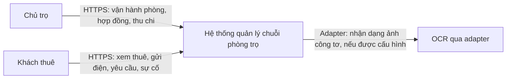

Tiền chuyển/hoàn ngoài hệ thống, Chủ trọ ghi nhận; không có ngân hàng/cổng thanh toán. Model OCR đã có ở phía người dùng nhưng cách gọi chưa biết nên `EXT_OCR` là ranh giới tích hợp, không khẳng định nó là service mạng.

## 3. C4 Level 2 — Deployable Unit View

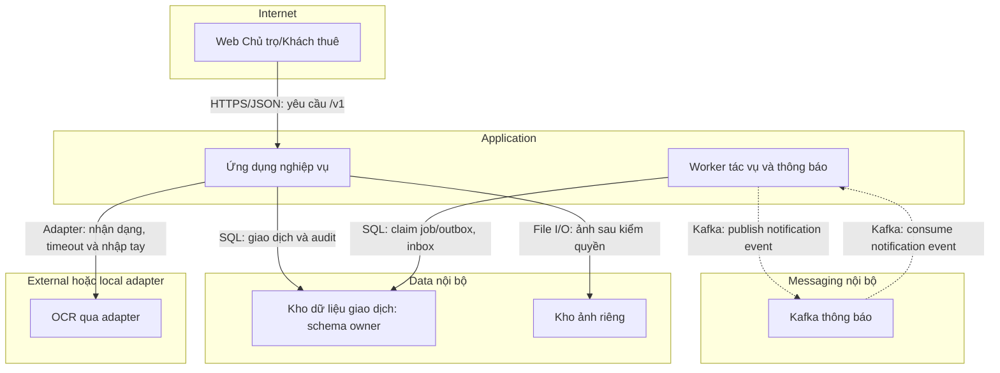

WEB có thể được APP_API phục vụ static hoặc deploy riêng theo frontend thật; không vẽ thêm entry component chưa quyết định. Mạng local/test dùng Compose theo design §18; production DNS/TLS termination, host, replica và HA là TBD.

## 4. C4 Level 3 — Component View

Lõi gồm LEASE và BILL vì chứa giao dịch tiền và trạng thái phòng, cần thấy owner; ID/INC/NTF/RPT/PROP là peer module, không phải service mạng.

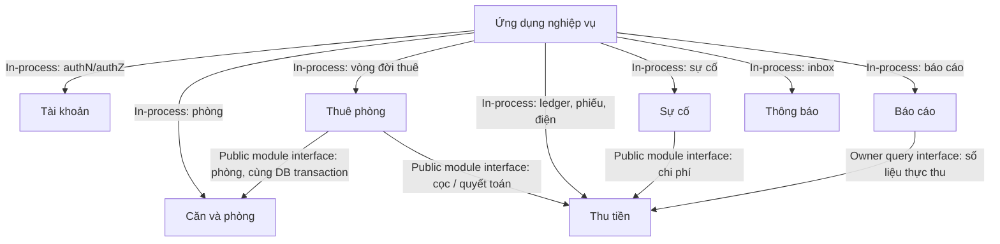

APP_WORKER nạp module và command handler từ cùng build; `JOB_SCHED` kích hoạt command, `OUTBOX` relay sự kiện, consumer gọi `M_NTF`. Cấm module import repository/schema của owner khác; orchestration liên module dùng transaction context chung.

## 5. Bounded Context Map

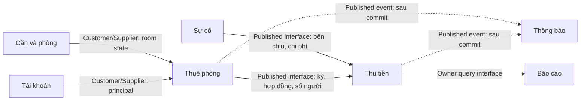

Published language: hợp đồng, phiếu thu, lần thu, công nợ theo glossary SRS §6; contract đặt trong `public.js`/contract của owner. OCR anti-corruption adapter biến output model thành chỉ số *đề xuất*, luôn có bước người dùng/chủ trọ xác nhận (SRS WF-04). RPT không đọc bảng BILL xuyên owner.

## 6. Public Request Flow — ghi nhận thu bổ sung

```mermaid
sequenceDiagram
  participant WEB as Web Chủ trọ/Khách thuê
  participant APP_API as Ứng dụng nghiệp vụ
  participant M_ID as Tài khoản
  participant M_BILL as Thu tiền
  participant DB_CORE as Kho dữ liệu giao dịch
  WEB->>APP_API: HTTPS POST /v1/invoices/{id}/payments + idempotency key
  APP_API->>APP_API: Gán correlationId, validate input
  APP_API->>M_ID: ResolvePrincipal, role và session
  alt Chưa đăng nhập hoặc sai quyền
    APP_API-->>WEB: 401 hoặc 403; không lộ phiếu người khác
  else Hợp lệ
    APP_API->>M_BILL: RecordPayment theo invoice owner
    M_BILL->>DB_CORE: SQL transaction khóa phiếu, append lần thu, audit, outbox
    alt Vượt số còn thiếu, trùng command khác nội dung hoặc lỗi DB
      DB_CORE-->>M_BILL: Rollback / conflict / dependency failure
      M_BILL-->>APP_API: Error code chuẩn
      APP_API-->>WEB: 409 / 422 / 503 + correlationId
    else Commit thành công hoặc replay cùng idempotency key
      DB_CORE-->>M_BILL: Số dư hiện hành
      M_BILL-->>APP_API: Ledger và số còn thiếu
      APP_API-->>WEB: 200 / 201; dữ liệu đã kiểm quyền
    end
  end
```

Timeout request cần đo theo NFR; OCR riêng ≤30s. Với kết quả DB commit chưa rõ, tra idempotency key trước khi thử lại tiền, không retry mù.

## 7. Core Business Workflows

Mỗi sequence dưới đây là một workflow SRS §8; `DB_CORE` commit nghiệp vụ và outbox trong cùng transaction. Sự kiện được APP_WORKER chuyển Kafka sau commit; notification eventual, lỗi delivery không rollback nghiệp vụ. Các nhánh lỗi quan trọng được ghi cụ thể.

### WF-01 Căn, phòng, khách

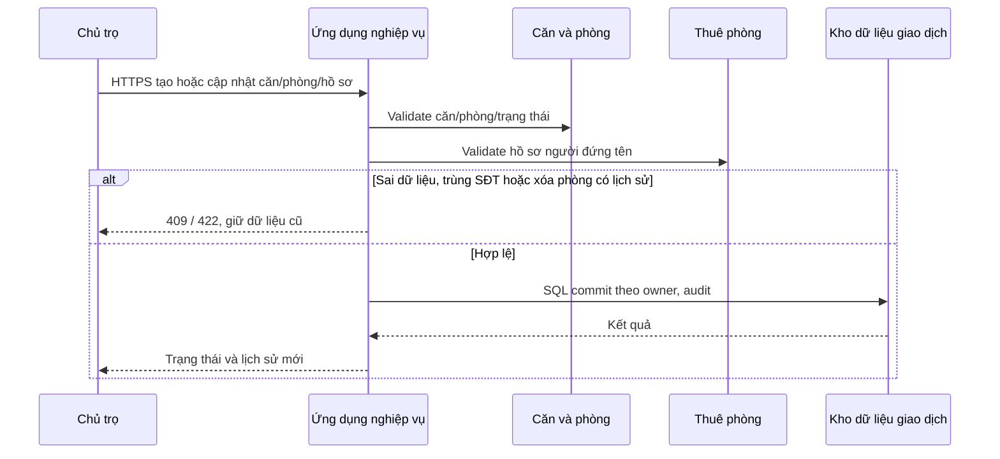

### WF-02 Hợp đồng, tiền cọc

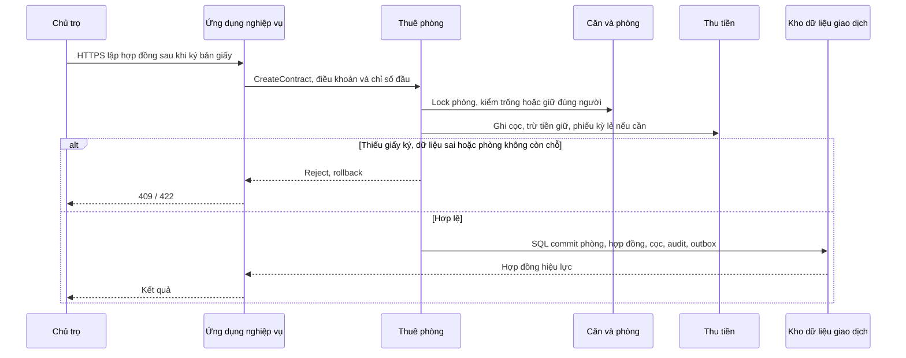

### WF-03 Yêu cầu gia hạn, trả phòng, đặt lại mật khẩu

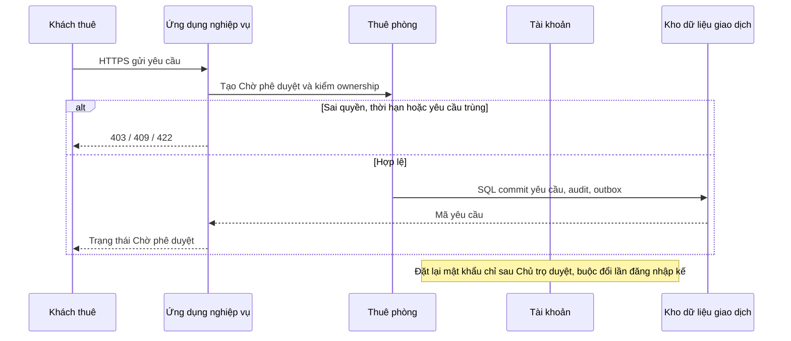

Chủ trọ duyệt/từ chối có lý do; ngoại lệ trả sớm có ngày thỏa thuận, rút duyệt chỉ trước ngày trả và trước thanh lý; mọi transition ghi audit/notification (SRS BR-45).

### WF-04 Chỉ số điện, OCR

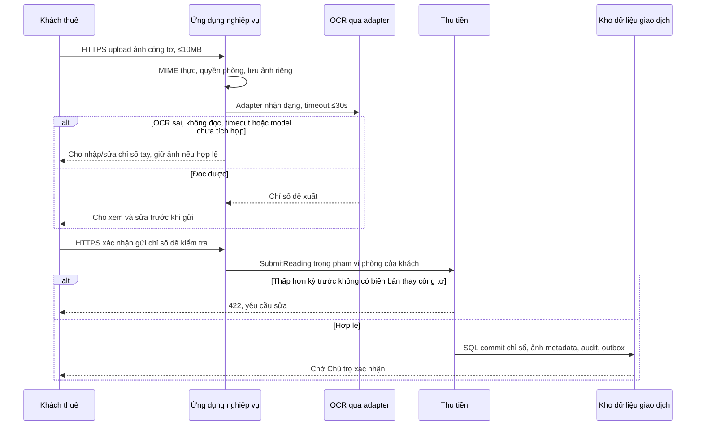

OCR không tự đưa chỉ số vào phiếu; Chủ trọ xác nhận theo UC-10 rồi mới tính điện. Nhận dạng và upload không gọi như một service mạng nếu model thực tế chạy local/in-process.

### WF-05 Phiếu thu và khoản điều chỉnh

```mermaid
sequenceDiagram
  participant APP_WORKER as Worker tác vụ và thông báo
  participant M_BILL as Thu tiền
  participant M_LEASE as Thuê phòng
  participant DB_CORE as Kho dữ liệu giao dịch
  participant BUS_KAFKA as Kafka thông báo
  APP_WORKER->>M_BILL: Command tạo phiếu kỳ theo lịch hoặc Chủ trọ yêu cầu
  M_BILL->>M_LEASE: Hợp đồng, giá, người ở
  M_BILL->>DB_CORE: SQL kiểm chỉ số Đã xác nhận, unique phòng/kỳ
  alt Thiếu chỉ số, phiếu trùng hoặc lưu lỗi
    M_BILL-->>APP_WORKER: Bỏ qua phòng này, log; phòng khác tiếp tục
  else Phiếu hợp lệ
    M_BILL->>DB_CORE: SQL commit phiếu, điều chỉnh, audit, outbox
    DB_CORE-->>APP_WORKER: Đã lưu phiếu
    APP_WORKER->>DB_CORE: Đọc outbox sau commit
    APP_WORKER-->>BUS_KAFKA: Kafka publish InvoiceIssued
  end
```

Chủ trọ có thể tạo thủ công; phiếu kỳ lẻ đầu không bắt điện. Phiếu đã thu một phần được sửa sai bằng dòng điều chỉnh có lý do, tổng mới ≥ đã thu; không ghi đè lần thu (BR-47).

### WF-06 Thanh toán và công nợ

```mermaid
sequenceDiagram
  participant ACT_OWNER as Chủ trọ
  participant APP_API as Ứng dụng nghiệp vụ
  participant M_BILL as Thu tiền
  participant DB_CORE as Kho dữ liệu giao dịch
  participant APP_WORKER as Worker tác vụ và thông báo
  ACT_OWNER->>APP_API: HTTPS ghi lần thu cho kỳ gốc
  APP_API->>M_BILL: RecordPayment, kiểm idempotency
  M_BILL->>DB_CORE: SQL lock phiếu, kiểm còn thiếu
  alt Vượt số dư hoặc trùng key khác payload
    M_BILL-->>APP_API: 409 / 422; rollback
    APP_API-->>ACT_OWNER: Không đổi công nợ
  else Hợp lệ kể cả sau ngày 10 / thanh lý
    M_BILL->>DB_CORE: SQL append lần thu, cập nhật nợ, audit, outbox
    DB_CORE-->>APP_API: Số dư mới
    APP_API-->>ACT_OWNER: Lịch sử và số còn thiếu
  end
  APP_WORKER->>M_BILL: Hết ngày 10: snapshot nợ chưa thu, chạy lại an toàn
```

Minh chứng khách tải không làm thay số chính thức; tiền chuyển ngoài hệ thống. Cờ quá hạn từ ngày 06, ghi nợ hết ngày 10 theo Asia/Ho_Chi_Minh.

### WF-07 Sự cố và chi phí

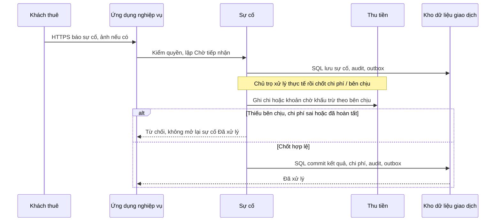

Sự cố phát sinh tiếp sau tạo mã mới liên kết mã cũ, không sửa sự cố đã hoàn tất (BR-48).

### WF-08 Trả phòng và thanh lý

```mermaid
sequenceDiagram
  participant ACT_OWNER as Chủ trọ
  participant APP_API as Ứng dụng nghiệp vụ
  participant M_LEASE as Thuê phòng
  participant M_BILL as Thu tiền
  participant M_PROP as Căn và phòng
  participant DB_CORE as Kho dữ liệu giao dịch
  ACT_OWNER->>APP_API: HTTPS chốt trả phòng ngày đã duyệt
  APP_API->>M_LEASE: Kiểm quyết định, ngày, hiện trạng
  M_LEASE->>M_BILL: Tính điện cuối, nợ, cọc, khấu trừ, hoàn từng dòng
  alt Thiếu dữ liệu hoặc kết quả chưa xác nhận
    M_LEASE-->>APP_API: 422; chưa thanh lý
    APP_API-->>ACT_OWNER: Hiển thị khoản thiếu
  else Đủ và Chủ trọ xác nhận
    M_LEASE->>M_PROP: Chuyển phòng Trống
    M_LEASE->>DB_CORE: SQL commit thanh lý, số hoàn thực tế, trạng thái, audit, outbox
    DB_CORE-->>APP_API: Kết quả, nợ sau thanh lý nếu âm
    APP_API-->>ACT_OWNER: Biên bản / dòng quyết toán
  end
```

Khóa tài khoản sau thanh lý theo policy ID, không xóa; lệnh lặp không hoàn cọc hai lần. Rút duyệt trước ngày trả và trước thanh lý hủy lịch chuyển phòng, giữ audit.

### WF-09 Thu chi, báo cáo

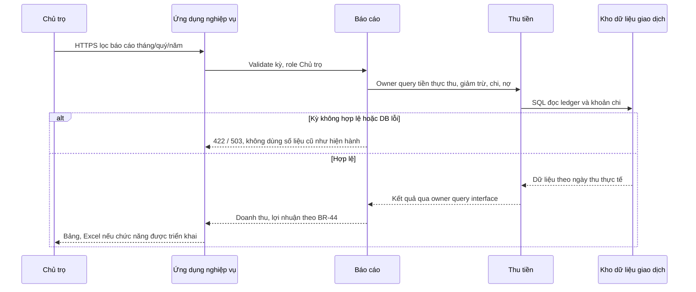

### WF-10 Giữ phòng

```mermaid
sequenceDiagram
  participant ACT_OWNER as Chủ trọ
  participant APP_API as Ứng dụng nghiệp vụ
  participant M_LEASE as Thuê phòng
  participant M_PROP as Căn và phòng
  participant M_BILL as Thu tiền
  participant DB_CORE as Kho dữ liệu giao dịch
  ACT_OWNER->>APP_API: HTTPS nhập tiền, hạn và điều kiện thỏa thuận
  APP_API->>M_LEASE: PlaceHold
  M_LEASE->>M_PROP: Lock phòng Trống, kiểm giữ trùng
  alt Đã giữ/đang thuê hoặc tiền/hạn không hợp lệ
    M_LEASE-->>APP_API: 409 / 422; rollback
  else Đủ điều kiện
    M_LEASE->>M_BILL: Ghi tiền giữ đã nhận
    M_LEASE->>DB_CORE: SQL commit giữ, trạng thái, audit, outbox
    DB_CORE-->>APP_API: Đang giữ và hạn đã thỏa thuận
  end
```

Quá hạn chỉ cảnh báo; Chủ trọ gia hạn hoặc hủy, hoàn 0…toàn bộ và hạch toán phần không hoàn. Chuyển hợp đồng trừ tiền giữ vào cọc tối đa số cọc, hoàn phần dư (BR-41).

### WF-11 Người ở cùng

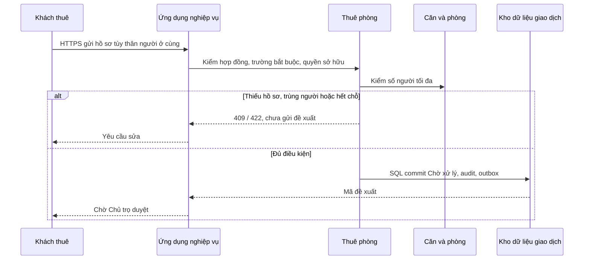

Chủ trọ duyệt/từ chối có lý do; chỉ sau duyệt mới tăng số người, tiền nước từ kỳ chưa lập phiếu. Người ở cùng không có tài khoản.

## 8. State Diagrams

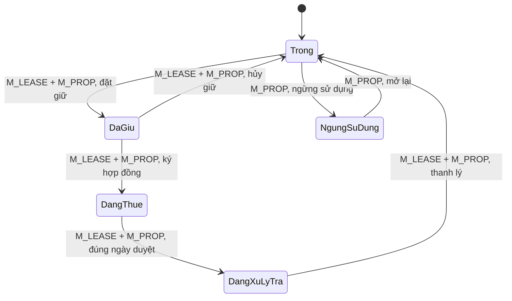

SM-01/phòng: cấm hai giữ/hợp đồng active và chuyển phòng khi giao dịch thanh lý chưa commit. Yêu cầu rút duyệt trước ngày trả không đổi trạng thái phòng sớm.

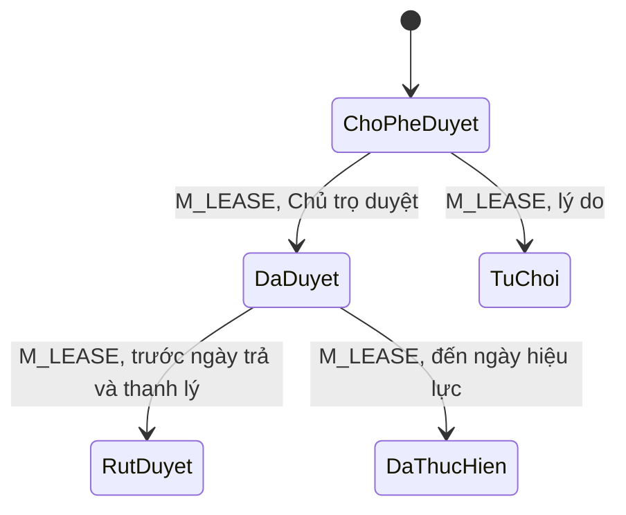

SM-05 yêu cầu: rút duyệt giữ lịch sử/audit, không xóa yêu cầu. Các state điện, phiếu, giữ phòng, sự cố, người ở cùng, minh chứng, cọc được chi tiết theo SRS §9; implementation kiểm invariant ở owner, không suy ra từ sơ đồ rút gọn này.

## 9. Event/Message-driven View

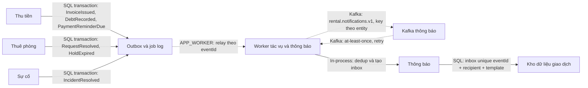

Chỉ module owner tạo event; payload tối thiểu, không CCCD/ảnh/mật khẩu. Ack sau inbox commit; event lỗi cố định vào cách ly/DLQ logic và replay. Topic đề xuất có tên trong design, retention/partition count TBD. Kafka down: outbox chờ, nghiệp vụ vẫn commit; phục hồi đo NFR-021.

## 10. Data Ownership View

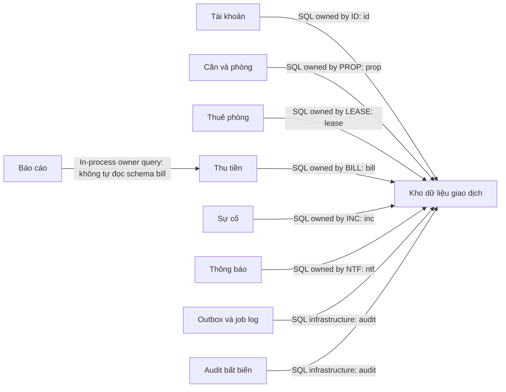

Một DB vật lý để có transaction nguyên tử; hình lặp node `DB_CORE` là cùng một DB. Metadata ảnh thuộc BILL/INC/LEASE tùy nguồn; binary trong FILE_STORE. Không FK trực tiếp xuyên owner schema; owner khác truy cập qua `public` interface. Đây không phải vi phạm shared DB vì ownership schema rõ và không query chéo.

## 11. Security và Trust Boundaries

```mermaid
flowchart LR
  WEB["Web Chủ trọ/Khách thuê"] -->|"HTTPS/TLS: token/phiên, validation"| APP_API["Ứng dụng nghiệp vụ"]
  APP_API -->|"In-process: role và ownership"| M_ID["Tài khoản"]
  APP_API -->|"SQL private: transaction, audit"| DB_CORE["Kho dữ liệu giao dịch"]
  APP_API -->|"File private: MIME/size và authZ"| FILE_STORE["Kho ảnh riêng"]
  APP_API -->|"Adapter: timeout, secret ngoài code"| EXT_OCR["OCR qua adapter"]
  APP_WORKER["Worker tác vụ và thông báo"] -->|"Internal: job identity"| DB_CORE
  APP_WORKER -.->|"Internal Kafka: event không PII"| BUS_KAFKA["Kafka thông báo"]
```

Threats: IDOR → kiểm owner server mỗi request; credential stuffing do mật khẩu khởi tạo `1` → buộc đổi và rate limit; file độc → kiểm MIME thật/giới hạn 10MB/private; event replay → idempotency/inbox; sửa tiền → ledger + audit. Secret DB/Kafka/OCR qua env/secret store, không commit; production secret store và TLS termination TBD. Thời hạn phiên, thuật toán token và chi tiết rotation cần contract/code security review, không bịa từ SRS.

## 12. Deployment Diagram

Local/test theo ADR-07; service `WEB` có thể phục vụ riêng hoặc APP_API serve static tùy repo/frontend hiện có. OCR là adapter gọi model hiện có, chỉ bật mock khi model không chạy được trong môi trường test; không nhân bản model.

```mermaid
flowchart TB
  WEB["Web Chủ trọ/Khách thuê"] -->|"HTTP(S) local entry, port TBD"| APP_API["Ứng dụng nghiệp vụ"]
  APP_API -->|"SQL internal, port TBD"| DB_CORE["Kho dữ liệu giao dịch"]
  APP_API -->|"Private volume/file I/O"| FILE_STORE["Kho ảnh riêng"]
  APP_API -->|"Adapter local/HTTPS TBD"| EXT_OCR["OCR qua adapter"]
  APP_WORKER["Worker tác vụ và thông báo"] -->|"SQL internal, health DB"| DB_CORE
  APP_WORKER -.->|"Kafka internal, health broker"| BUS_KAFKA["Kafka thông báo"]
  BUS_KAFKA -.->|"Kafka consumer, retry"| APP_WORKER
  APP_API -->|"Logs/metrics/readiness"| OBS["Log/metrics/readiness"]
  APP_WORKER -->|"Logs/metrics/job health"| OBS
```

Migration chạy trước API/worker. Public chỉ WEB/APP_API entry, DB/Kafka không publish host port trừ trường hợp debug local đã kiểm soát. Local single-node DB/Kafka không phải HA production. Production cần chốt host/TLS/backup off-host/monitoring/restore, OCR provider, số replica và kiểm NFR trước khi gọi ready.

## 13. Failure và Recovery View

```mermaid
flowchart LR
  APP_API["Ứng dụng nghiệp vụ"] -->|"SQL: command + outbox commit"| DB_CORE["Kho dữ liệu giao dịch"]
  DB_CORE -.->|"Relay sau commit; Kafka lỗi thì giữ outbox"| APP_WORKER["Worker tác vụ và thông báo"]
  APP_WORKER -.->|"Kafka: retry có backoff"| BUS_KAFKA["Kafka thông báo"]
  BUS_KAFKA -.->|"Consumer retry / replay"| APP_WORKER
  APP_WORKER -->|"In-process: inbox dedup"| M_NTF["Thông báo"]
```

| Tình huống | Phát hiện, ứng xử | Khôi phục, mục tiêu |
|---|---|---|
| OCR timeout/lỗi | Timeout ≤30s, nhập chỉ số tay; OCR không chặn API | Kiểm model/adapter; giữ ảnh hợp lệ; NFR-022 |
| Kafka down | Outbox tăng, command không rollback, thông báo trễ | Worker phát lại sau phục hồi; đo lag, NFR-021 ≤5 phút sau consumer hoạt động |
| Request/event lặp | Idempotency key + unique DB; inbox dedup | Replay cùng kết quả hoặc bỏ event trùng; NFR-007 |
| API/worker restart | DB transaction rollback nếu chưa commit; job lease thu hồi | Worker scan job/outbox; không tạo phiếu/lần thu trùng |
| DB lỗi | API trả 503/rollback, không báo thành công giả | Backup DB và ảnh, restore test hằng quý; RPO/RTO theo NFR-008 cần đo |
| File store lỗi | Không ghi metadata ảnh thành công giả; ảnh mồ côi dọn theo job | Retry upload có kiểm quyền, kiểm đồng bộ backup file+DB |
| Phiếu phòng lỗi | Job ghi lỗi riêng phòng, tiếp tục phòng khác, không gửi phiếu lỗi | Chủ trọ nhập/chạy lại idempotent sau khi sửa điện |

## 14. Traceability Table

| View/flow | Node owner | SRS | Design |
|---|---|---|---|
| §2/3/11 Web và auth | WEB, APP_API, M_ID | UC-01/02/24, SEC-01…14 | §§8/11/15 |
| §4/7 WF-01/02/10/11 | M_PROP, M_LEASE, M_ID | UC-03…08/26/28, BR-01/41/43 | §§4/9/13 |
| §6/7 WF-04/05/06/08 | M_BILL, M_LEASE, M_PROP | UC-09…12/15/20/22/23/29, BR-03/19/39/47 | §§9/10/13/14 |
| §7 WF-07 | M_INC, M_BILL | UC-17/18, BR-48/50 | §§9/13 |
| §7 WF-09 | M_RPT, M_BILL | UC-19, BR-44, RPT-01…07 | §§9/14 |
| §3/9/13 Notification | APP_WORKER, M_NTF, OUTBOX, BUS_KAFKA | UC-25/29, NTF-01…15 | §§8/12/18 |
| §3/10/12 Binary & OCR | FILE_STORE, EXT_OCR | UC-09/10/12/17, INT-01, SEC-09/10 | §§8/10/14/15 |
| §3/10/11/12 Core DB, audit/ops | DB_CORE, AUDIT_LOG, OBS, JOB_SCHED | NFR-006…008/021, AUD-01…10 | §§8/14/17/18 |

## 15. Architecture Gaps và Readiness

| ID | Mức | Ảnh hưởng | Việc Codex phải kiểm tra/chốt trước phần liên quan |
|---|---|---|---|
| AG-01 | Major | Frontend tích hợp | Chưa có source frontend thực; đối chiếu tên trang, JS, navigation, form, auth, gọi API với cây cũ; giữ UI đã có và chỉ thêm thiếu. |
| AG-02 | Major | OCR production | Chưa có artifact/interface model trong workspace; xác định runtime, input/output, license, độ chính xác, package và cách chạy; viết adapter theo interface thật; mock riêng test. |
| AG-03 | Major | DB và migration | Chốt PostgreSQL ứng viên qua môi trường thực, schema/tool migration/transaction bằng test; hợp đồng API là bước contract-first. |
| AG-04 | Major | Deploy production | Hosting, TLS, backup off-host, secret, Kafka retention/replicas, vận hành TBD; không gắn nhãn HA/SLA đạt. |
| AG-05 | Minor | UI chỉnh tiền sau thu | Chốt biểu mẫu lý do và dòng sửa sai trước code contract/UI; invariant đã chốt BR-47. |
| AG-06 | Minor | Port / web hosting local | Lấy port và URL từ repo/.env.example sau khi khảo sát, không hardcode vào diagram. |

**Kiểm tra tĩnh:** 23 block Mermaid trong tài liệu; ID chỉ ASCII, đều có trong Registry (actor, container, module, data, capability); 11/11 WF có sequence và nhánh lỗi; mũi tên async chỉ ở Kafka/outbox; DB duy nhất với schema owner. Mermaid CLI chưa có trong môi trường tại thời điểm soạn: **chưa render-test bằng `mmdc`**; Codex phải chạy render khi có tool. Không có blocker kiến trúc cho local/test; production còn Major. **Kết luận: `READY WITH TBD`** cho triển khai local/test, không phải chứng nhận production.

### Implementation update 2026-10-04

The brownfield repository keeps the modular-monolith boundary and existing legacy
`/api/*` routes. The first versioned slice is implemented under `/api/v1` for
UC-09/UC-10, with the existing FastAPI OCR adapter at internal `POST /ocr`.
Audit, outbox, idempotency and private-file metadata are persisted in the same
transactional database. Kafka publishing/consumer remains a follow-up because
the repository has no broker configuration yet; this is a partial local
implementation, not a production-readiness claim.
