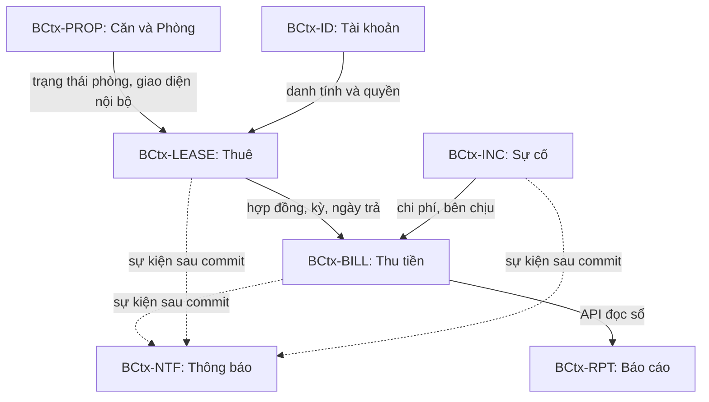
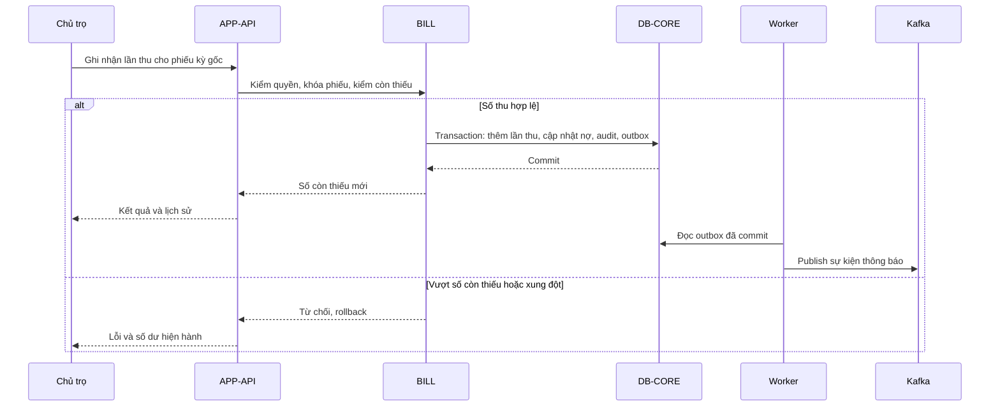
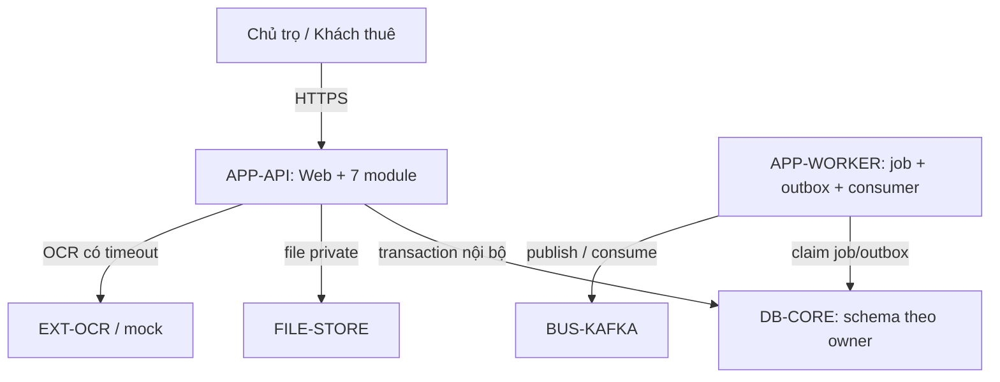

# HỆ THỐNG QUẢN LÝ CHUỖI PHÒNG TRỌ — SYSTEM DESIGN

| Thuộc tính | Giá trị |
|---|---|
| Phiên bản | 0.1 — 04/10/2026 |
| Đầu vào có hiệu lực | `SRS_v0.3.md`, cập nhật từ `SRS(7).md` v0.2 theo xác nhận N-01…N-16 của Chủ trọ ngày 04/10/2026 |
| Trạng thái | **READY FOR ARCHITECTURE REVIEW**; thiết kế logic, chưa có mã nguồn/benchmark/kiểm thử chạy thật |
| Quy ước | `[CONFIRMED]` từ SRS; `[DECIDED]` có ADR; `[ASSUMED]` chi tiết vận hành cần đo; `[DESIGN-BLOCKER]` thiếu quyết định chặn phần triển khai liên quan; `[PROPOSED]` ngoài phạm vi |
| Kiểu kiến trúc | **Modular monolith**, cùng một kho dữ liệu quan hệ với schema/module tách quyền; Kafka cho thông báo trong ứng dụng theo Q-08 |

**Phạm vi:** MVP trong SRS §5; UC-27 chuyển phòng P1, UC-21 đã bỏ, FR-045 `DEPRECATED`. Không tái sử dụng ID. Đây là tài liệu thiết kế, không tự thay đổi quy tắc nghiệp vụ đã chốt. Những điểm kỹ thuật được đề xuất có ADR và điều kiện xác minh.

## 1. Executive Summary

Hệ thống phục vụ 3 căn hiện tại khoảng 90 phòng/180 người và mức đích 150 phòng/300 người (NFR-005), vận hành bởi một Chủ trọ và Khách thuê qua web. Lõi nghiệp vụ gồm phòng, hợp đồng, chỉ số điện, phiếu thu, thanh toán từng lần, công nợ, trả phòng; dữ liệu phải nhất quán trong các giao dịch NFR-006/007. Một ứng dụng triển khai gồm 7 module nghiệp vụ, một worker cùng mã nguồn cho lịch/outbox/thông báo; Kafka chỉ dùng cho luồng thông báo đã được SRS yêu cầu. Hệ thống ghi nhận chuyển/hoàn tiền ngoài hệ thống, không tích hợp ngân hàng. OCR đi qua adapter có mock và nhập tay dự phòng (INT-01). **7 bounded context (BCtx), 2 process ứng dụng từ cùng một bản build; không có 7 microservice.**

## 2. Architectural Drivers

| Nguồn | Kích thích / môi trường | Phản hồi thiết kế | Mục tiêu và phép đo |
|---|---|---|---|
| NFR-006; UC-11/15/16/17/20 | Lỗi giữa các bản ghi liên quan | Một giao dịch DB bao cả cập nhật nhiều module và outbox; rollback nếu lỗi | 0 bản ghi nghiệp vụ dở dang trong fault-injection |
| NFR-007; BR-26/28 | Hai người hoặc job lập phiếu cùng phòng/kỳ | Unique theo phòng+kỳ của phiếu hợp lệ; command idempotent | 0 phiếu trùng khi chạy song song/lặp |
| NFR-001/002/005 | 50 phiên đồng thời; 150 phòng/300 người; bộ dữ liệu 1 năm | Index theo phòng/kỳ, phân trang, query tổng hợp; báo cáo đọc theo module interface | p95 thao tác ≤3 s, báo cáo ≤5 s, tính một phòng ≤1 s; thử tải ở 3× |
| NFR-003/022; INT-01 | OCR chậm/lỗi; ảnh ≤10 MB trên 4G | Timeout 30 s; kết quả p95 ≤10 s nếu provider đạt; nhập tay/ảnh mới, mock local | Test thời gian và fallback; không hứa p95 phụ thuộc nhà cung cấp chưa chọn |
| NFR-004/008; OPS-01 | Mất tiến trình/DB | Restart, backup ngày, lưu 30 ngày; tập khôi phục mỗi quý | ≥98%/tháng, RPO ≤24 h, RTO ≤8 h; đo sau triển khai |
| NFR-012/021; Q-08 | Kafka/consumer tạm ngừng | Outbox → Kafka → inbox/unique notification; retry/replay | Hiển thị ≤1 phút bình thường; không mất; hồi phục ≤5 phút sau consumer hoạt động |
| SEC-02/03/10/14 | Khách đổi ID để xem dữ liệu người khác/giấy tờ | AuthZ server side và kiểm phạm vi hợp đồng/phòng, che CCCD, URL ảnh qua quyền | Test IDOR và phân quyền âm tính; 0 truy cập chéo |
| NFR-017; UC-16/17 | Hai phiên cùng thay trạng thái | Version/conditional update, giao dịch, báo xung đột | Chỉ một cập nhật hợp lệ; test đồng thời |

Nguyên tắc kiểm chứng: (1) tiền nguyên VND, làm tròn BR-38/44, test ca biên; (2) mỗi entity/command có một owner; (3) không đọc bảng module khác; (4) không publish Kafka trước khi commit; (5) tác vụ chạy lại không trùng; (6) mọi query của khách kiểm ownership; (7) thông báo thất bại không rollback dữ liệu nghiệp vụ đã commit.

## 3. Domain Decomposition

| Subdomain | Loại | Capability / ngôn ngữ chuẩn | SRS |
|---|---|---|---|
| Thuê và vòng đời hợp đồng | Core | phòng đang thuê, hợp đồng, gia hạn, trả phòng, giữ phòng, người ở cùng | WF-01/02/03/08/10/11; UC-03…08, 13…16, 26, 28 |
| Thu và quyết toán | Core | chỉ số điện, khoản phải thu, phiếu thu, lần thanh toán, công nợ, cọc, điều chỉnh | WF-04/05/06/08; UC-09…12, 15, 20, 22, 23 |
| Sự cố | Supporting | sự cố, bên chịu chi phí, chờ khấu trừ | WF-07; UC-17/18 |
| Tài khoản | Generic | tài khoản, phiên, đổi mật khẩu, quyền truy cập | UC-01/02/24; SEC-01…14 |
| Thông báo/báo cáo | Supporting | thông báo trong ứng dụng; báo cáo thực thu theo ngày | UC-19/25/29; NTF-01…15; RPT-01…07 |

Dùng đúng glossary SRS §6: **Phiếu thu** không gọi hóa đơn; **khoản phải thu** là tổng nghĩa vụ phòng/kỳ; **thanh toán** là bản ghi do Chủ trọ xác nhận, không phải chuyển tiền điện tử; **công nợ** là phần chưa thu ghi cuối ngày 10; **Người quản lý căn** có quyền Khách thuê, không thành role mới. Đặt mã `BCtx-*` để không lẫn ký hiệu boundary condition trong tài liệu khác.

## 4. Bounded Context Discovery

| ID / Context | Aggregate, invariant, command/query, event | Dữ liệu sở hữu / ngoài phạm vi | SRS và lý do ranh giới |
|---|---|---|---|
| BCtx-ID — Identity | `Account`: SĐT duy nhất, hash, khóa/mở, buộc đổi mật khẩu; `Login`, `ResetPassword`, `GetSession`; `AccountLocked`, `PasswordReset` | Tài khoản/phiên; **không** sở hữu hồ sơ CCCD, hợp đồng, tiền | UC-01/02/24; SEC-01…08. Quyền truy cập tách khỏi đời sống thuê |
| BCtx-PROP — Property | `Building`, `Room`: một trạng thái phòng hợp lệ, một giữ/hợp đồng active; `CreateRoom`, `ChangeRoomState`, `GetRoom`; `RoomStateChanged` | Căn, phòng, thuộc tính nội thất; **không** sở hữu hợp đồng hoặc giá áp dụng hợp đồng | UC-03/04, BR-10/15, SM-01; tính sẵn có phòng |
| BCtx-LEASE — Tenancy | `TenantProfile`, `Contract`, `Hold`, `Cohabitant`, `Request`, `Settlement`: một HĐ active/phòng, một người đứng tên, ngày trả/thỏa thuận; `CreateContract`, `ApproveRequest`, `WithdrawCheckout`, `SettleCheckout`; `ContractCreated`, `RequestResolved`, `CheckoutSettled` | Hồ sơ khách/người ở cùng, HĐ/lịch sử, giữ phòng, yêu cầu, quyết toán; **không** sở hữu số thu/phiếu/cọc thực tế | UC-05…08/13…16/26/28; BR-21/40/41/43/45. Vòng đời thuê và điều kiện đồng ý nghiệp vụ |
| BCtx-BILL — Billing | `MeterReading`, `InvoiceForPeriod`, `PaymentLedger`, `Deposit`, `Debt`, `Adjustment`, `Expense`: tối đa một phiếu/phòng/kỳ, thu không vượt còn lại, lần thu không bị ghi đè; `ConfirmReading`, `IssueInvoice`, `RecordPayment`, `AdjustCharge`, `RecordDebt`, `CloseDeposit`; `InvoiceIssued`, `DebtRecorded` | Điện, khoản phải thu, phiếu, lần thu/minh chứng/nợ, cọc, khoản điều chỉnh/chi, khoản hoàn đã ghi; **không** sở hữu trạng thái phòng/HĐ | UC-09…12/15/19/20/22/23; BR-03/19/34/39/44/47. Các số tiền cần một sổ gốc |
| BCtx-INC — Incident | `Incident`: loại, tình trạng, chi phí ước/đã chốt, bên chịu, tham chiếu sự cố cũ; `ReportIncident`, `ResolveIncident`, `CancelIncident`; `IncidentReported`, `IncidentResolved` | Sự cố/ảnh; **không** sở hữu khoản chi kế toán hoặc khấu trừ cọc | UC-17/18; BR-18/31/32/48/50. Sửa chữa thực tế ngoài hệ thống |
| BCtx-NTF — Notification | `Notification`: event+recipient duy nhất, đã đọc; `DeliverNotification`, `MarkRead` | Thông báo/inbox; **không** quyết định tiền, trạng thái phòng hoặc gửi SMS | UC-25/29, NTF-01…15; Q-08 |
| BCtx-RPT — Reporting | Query/tổng hợp theo ngày thu, căn, loại chi, tuổi nợ; không có command thay sổ gốc | Không sở hữu dữ liệu tiền; cache/projection nếu sau này cần và có quy trình tái dựng; **không** sửa nguồn | UC-19/23; RPT-01…07, BR-44. View đọc theo owner API |

`Scheduler`, `OCR adapter`, `Outbox relay`, `Audit` và `Configuration` là năng lực kỹ thuật trong ứng dụng, không tách thành BCtx nghiệp vụ. `Audit` append-only ghi cùng giao dịch của command; `Configuration` do Chủ trọ đổi với audit (FR-200).

## 5. Architecture Style Decision

Chấm 0–5; trọng số: domain fit 20, nguyên tử tiền 20, vận hành 20, NFR 15, chi phí 15, tiến hóa 10. Điểm = Σ(trọng số × điểm/5), là **đánh giá thiết kế** chứ không phải số đo thực nghiệm.

| Phương án | Domain | Nguyên tử | Vận hành | NFR | Chi phí | Tiến hóa | Tổng /100 |
|---|---:|---:|---:|---:|---:|---:|---:|
| Modular monolith + Kafka theo SRS | 5 | 5 | 4 | 4 | 4 | 4 | **88** |
| Hybrid: lõi thuê/tiền + notification riêng | 4 | 4 | 3 | 4 | 3 | 4 | 73 |
| Microservices theo từng BCtx | 4 | 2 | 1 | 4 | 1 | 4 | 51 |
| Serverless/event driven | 2 | 2 | 2 | 3 | 2 | 3 | 45 |
| Batch/pipeline | 1 | 2 | 3 | 1 | 4 | 1 | 41 |

**Quyết định ADR-01:** modular monolith vì NFR-006 yêu cầu cập nhật phòng–hợp đồng–tiền một cách nguyên tử, quy mô 150 phòng và chi phí sinh viên không biện minh nhiều DB/service. Kafka vẫn được dùng cho thông báo, chấp nhận chi phí vận hành thêm do SRS Q-08. Tách service sau khi có nhiều nhóm phát triển độc lập, profile tải tách rõ hoặc module cần vòng đời triển khai riêng; phải đo số request, thời gian và tỷ lệ lỗi trước khi tách. Không chọn serverless/batch làm lõi giao dịch vì không phù hợp luồng giao diện và transaction; hybrid chỉ dùng nếu cần scale thông báo độc lập.

## 6. Deployment Unit Decision

| BCtx | Đơn vị | Lý do gộp/tách | Scale, security, team/release |
|---|---|---|---|
| ID, PROP, LEASE, BILL, INC, RPT | `APP-API` — cùng process và DB vật lý, schema tách module | Cho phép điều phối giao dịch nguyên tử, lời gọi in-process không tạo chuỗi RPC | Scale cùng nhau ở MVP; một team; quyền server side; release cùng nhau |
| NTF | `APP-API` cho đọc; `APP-WORKER` cho consumer Kafka | Consumer độc lập vòng đời xử lý, cùng mã nguồn và contract module | Worker có thể restart riêng; không là một microservice sở hữu DB riêng |
| Job lịch/outbox | `APP-WORKER` | Giữ lịch và retry ngoài request web; dùng API module nội bộ | Một lịch chung; khóa lease/advisory lock hoặc claim row để tránh chạy đôi |

Ranh giới module cưỡng chế bằng public interface và test import: `billing` không import repository `lease`; mỗi module chỉ ghi schema của nó. Một application use case liên module mở **một transaction DB**, gọi command interface của các module trong transaction đó; transaction commit/rollback toàn bộ, kèm audit và outbox. Đây là ngoại lệ có chủ đích của monolith, không phải shared table hay distributed transaction. Khi tách service phải thiết kế lại choreography/saga, không giữ giả định transaction xuyên service.

## 7. Context Map

Upstream `LEASE` công bố snapshot điều khoản đã hiệu lực cho `BILL` (Published Language: ContractTermsSnapshot); `BILL` giữ snapshot khi lập phiếu để kỳ trước không đổi (BR-11). `PROP` cung cấp room state API; `LEASE` điều phối chuyển trạng thái qua interface, không ghi bảng phòng. `INC` công bố kết quả có mã sự cố; `BILL` quyết định khoản chi hoặc khoản chờ khấu trừ. `NTF` là downstream conformist đối với event được version hóa; không dùng Shared Kernel domain. OCR có anti-corruption adapter từ kết quả provider về chỉ số và độ tin cậy; không tin kết quả trước xác nhận (INT-01).

## 8. System Components

| ID | Thành phần / trách nhiệm | Không sở hữu | Căn cứ |
|---|---|---|---|
| WEB | Web Chủ trọ/Khách, responsive ≥360px | Quyết định quyền, số tiền tin cậy | SRS §5; NFR-010/011 |
| APP-API | Entry HTTPS, auth, validation, các module và orchestration | Dữ liệu provider OCR/Kafka | UC-01…29; SEC-01…14 |
| APP-WORKER | Tác vụ SYS-01…06, outbox relay, Kafka consumer | Nghiệp vụ mới ngoài module | UC-29; OPS-04; NFR-021 |
| DB-CORE | DB quan hệ; schema theo owner, transaction, unique, audit/outbox | Bảng ghi chung không owner | NFR-006/007/008; ADR-02 |
| FILE-STORE | Ảnh công tơ, minh chứng, sự cố dưới namespace owner; chỉ cấp quyền qua APP | Ảnh public tĩnh | INT-01; SEC-09/10 |
| BUS-KAFKA | Vận chuyển event thông báo, retry/replay | Source of truth tiền/phiếu | Q-08; NFR-021 |
| EXT-OCR | OCR provider hoặc mock, sau adapter | Quyết định chỉ số chính thức | INT-01; Q-09; NFR-022 |

**ADR-02 (đề xuất kỹ thuật):** DB quan hệ có transaction/constraint (ví dụ PostgreSQL) với một DB vật lý cho MVP, schema tách `id/prop/lease/bill/inc/ntf/audit`. So với SQLite (rẻ nhưng hạn chế đồng thời/worker đa process) và nhiều DB theo service (phức tạp, mất nguyên tử), phương án này phù hợp NFR-006/017. Chi phí: quản lý backup DB và schema migration; có thể đổi engine nếu test cùng đặc tính. **ADR-03:** file volume private local cho local/test, có backup cùng DB; khi triển khai nhiều máy chuyển sang object storage tương thích và kiểm tra phân quyền, không đổi hợp đồng module. **ADR-04:** OCR mock miễn phí cho test; provider thật chưa chọn, xem DG-02.

## 9. Thiết kế chi tiết từng đơn vị

| Module | Public commands/queries (khái niệm) | Giao dịch, đồng thời, quyền, lỗi và phép thử |
|---|---|---|
| ID | `Login`, `ChangePassword`, `Grant/Lock/Unlock`, `ResolvePrincipal` | SĐT unique; hash; buộc đổi "1"; rate limit SEC-07/08; Chủ trọ reset khách qua yêu cầu; audit; test bị khóa/trùng SĐT |
| PROP | `CreateBuilding/Room`, `GetRoom`, `ChangeRoomState` | State/version CAS; cấm xóa phòng có lịch sử; chỉ Chủ trọ; test hai người giữ một phòng |
| LEASE | `CreateContract`, `PlaceHold`, `ProposeCohabitant`, `ApproveRequest`, `WithdrawCheckout`, `SettleCheckout` | Unique active contract/hold per room; Chủ trọ duyệt ngoại lệ trả sớm và rút duyệt trước ngày trả, lý do/audit; đủ hồ sơ người ở cùng; gọi PROP/BILL/ID qua interface trong cùng DB transaction; test rollback giữa chừng |
| BILL | `ConfirmReading`, `IssueInvoice`, `RecordPayment`, `AdjustCharge`, `RecordOldDebtPayment`, `CalculateSettlement`, `GetLedger` | Ledger append-only/hủy có lý do; unique invoice(room,period); số còn thiếu derived, không overwrite; điều chỉnh tổng không thấp hơn đã thu; BR-03/19/39/44; Chủ trọ sửa, khách chỉ đọc own; test trùng job/thu sau ngày 10/đồng thời |
| INC | `Report`, `Accept`, `Resolve`, `Cancel`, `FollowUp` | Chi phí Chủ trọ chịu → BILL expense; Khách chịu → BILL pending deduction; sự cố Done bất biến, follow-up mã mới; rollback chi phí + trạng thái nếu lỗi; test UC17-AC1…5 |
| NTF | `CreateFromEvent`, `ListMine`, `MarkRead` | Unique(eventId,recipient,template); Kafka at-least-once + inbox dedup; offline vẫn xem khi đăng nhập; không gửi ra ngoài ứng dụng; test consumer restart/lặp |
| RPT | `GetRevenue/Expense/Debt/Aging`, `Export` (Could) | Đọc qua query interface BILL/LEASE/PROP, nhóm theo ngày thực thu, BR-44; kiểm owner Chủ trọ; đối chiếu 0 đồng một kỳ |

Health/readiness: API chỉ ready khi DB sẵn; worker ready khi DB, Kafka và job lease sẵn; OCR lỗi không làm API chết mà hiển thị đường nhập tay. Mỗi command ghi correlation ID, audit theo AUD-01…10; timeout OCR 30s. Không retry mù các command tiền; idempotency key cho hành động người dùng/job và unique constraint ở DB.

## 10. Communication Design

| Caller → Callee | Mục đích / kiểu | Auth, timeout, retry, idempotency, fallback | WF |
|---|---|---|---|
| WEB → APP-API | HTTPS request đồng bộ; danh tính phiên | AuthN/AuthZ trên server; timeout request cần đo; GET an toàn; command có idempotency key | Mọi WF |
| APP-API → DB-CORE | Transaction nội bộ DB | Pool, timeout/rollback; command tiền không tự retry nếu chưa xác định commit, tra idempotency key trước | WF-01…11 |
| APP-API → EXT-OCR | HTTPS qua adapter, sync có timeout | Key provider chưa chốt; 30s tối đa theo NFR-003, retry tối đa một lần chỉ khi an toàn, nhập tay | WF-04 |
| APP-WORKER → DB-CORE | Claim job/outbox, áp command nội bộ | Lease/unique; chạy lại an toàn; log thất bại từng phòng | WF-02/05/06/08/10 |
| APP-WORKER → Kafka → APP-WORKER | Async notification events | Outbox, ack sau inbox commit, retry backoff, poison event cách ly; dedup eventId+recipient | NTF-01…15 |
| APP-API → FILE-STORE | Ảnh riêng có authZ | Giới hạn 10MB, kiểm MIME thật, file orphan dọn sau lỗi DB; fallback nhập tay cho OCR | WF-04/06/07 |

Không có vòng gọi đồng bộ qua network nội bộ; các module gọi in-process. Request công khai không đợi Kafka gửi thành công. Chỉ có OCR là lời gọi ra ngoài nằm trong đường đi người dùng; nếu timeout, khách vẫn có lựa chọn nhập tay (UC-09/10).

## 11. API Contract Rules

HTTP/JSON trên public entry point là `[DECIDED]` ADR-05 cho web; SRS không bắt buộc gRPC giữa module trong cùng process. Resource theo glossary, URL có version `/v1`, tên số nhiều, không lộ schema DB. Contract phải định nghĩa request/response, status/error code, validation, RBAC + ownership, phân trang/lọc/sắp xếp cho danh sách, idempotency key cho tạo phiếu/thu/duyệt/thanh lý, phiên bản row cho sửa đồng thời, correlation ID. Tiền là integer VND; kỳ là `YYYY-MM` ở API, ngày theo `Asia/Ho_Chi_Minh`, timestamp ISO 8601 có offset. Error envelope: `{code,message,correlationId,details}` (không trả PII nhạy cảm). Lỗi xác thực 401, cấm 403, không tồn tại/không thuộc quyền trả mã bảo vệ tránh lộ dữ liệu, xung đột version 409, sai input 422; hợp đồng chi tiết cần kiểm thử nhất quán trước code. Chỉ module owner phát sự kiện và định nghĩa contract của mình; phiên bản event không tái sử dụng với payload khác.

## 12. Event Catalog

Kafka chỉ phục vụ thông báo; sự kiện nghiệp vụ có thể ghi outbox, `NTF` chọn template theo mã NTF. **Tên event quá khứ, một owner/prod cho mỗi loại**; envelope `{eventId,type,version,occurredAt,producer,aggregateId,correlationId,recipientIds,payloadMinimum}`. Không đưa CCCD, ảnh hoặc mật khẩu vào payload.

| Event / producer | Consumer, nguồn | Key / ordering / retry |
|---|---|---|
| `MeterReadingSubmitted` / BILL | NTF-03; UC-09 | roomId+period; dedup eventId |
| `InvoiceIssued` / BILL | NTF-04; UC-20 | roomId+period; một phiếu hợp lệ |
| `PaymentReminderDue`, `DebtRecorded` / BILL | NTF-12; UC-29 | invoiceId+kind+period; job chạy lại an toàn |
| `ContractExpiring`, `CheckoutDue`, `HoldExpired` / LEASE | NTF-05/15/13; UC-29 | contractId/holdId; cảnh báo một lần theo mốc |
| `RequestSubmitted`, `RequestResolved` / LEASE | NTF-01/02/06/07; UC-01/13/14/16 | requestId; kết quả chỉ sau commit |
| `CohabitantProposed`, `CohabitantResolved` / LEASE | NTF-10/14; UC-08/28 | proposalId |
| `IncidentReported`, `IncidentResolved` / INC | NTF-08/09; UC-17/18 | incidentId |
| `PaymentProofUploaded` / BILL | NTF-11; UC-12 | proofId |

Topic đề xuất `rental.notifications.v1` (`[DECIDED]` ADR-06), partition key theo entity để giữ thứ tự trong một thực thể; không bảo đảm thứ tự giữa các thực thể. At-least-once, dedup inbox; retry có backoff, bản lỗi cố định vào tập cách ly/DLQ logic để Chủ trọ/nhóm kỹ thuật xử lý và replay. Kafka không quyết định commit nghiệp vụ; nếu broker hỏng, outbox chờ. Thời gian giữ log/topic, số partition và giới hạn queue được cấu hình theo môi trường/đo thực tế, không đoán trong SRS.

## 13. Workflow và Transaction Boundary

| WF | Commit và owner | Failure/recovery / consistency |
|---|---|---|
| WF-01/02/10 | LEASE + PROP + BILL + ID trong một DB transaction khi tạo HĐ, cọc, chỉ số đầu, giữ chỗ; SRS BR-01/40/41 | Lock phòng; conflict 409; rollback cả phòng/HĐ/điện/cọc; thông báo eventual sau outbox |
| WF-03/08 | LEASE điều phối PROP, BILL, ID khi duyệt/trả phòng/thanh lý | Version yêu cầu; rút duyệt hủy scheduled transition; tiền quyết toán từng dòng không lặp; rollback nếu thiếu dữ liệu BR-06 |
| WF-04/05 | BILL xác nhận chỉ số rồi tạo phiếu từng phòng/kỳ | Phòng chưa có điện bỏ qua; unique constraint + idempotency; lỗi một phòng không dừng phòng khác; không gửi nếu commit thất bại |
| WF-06 | BILL thêm một lần thu vào ledger và cập nhật số dư kỳ gốc | Lock invoice/ledger; vượt còn lại bị từ chối; sau ngày 10 vẫn giảm nợ; không xóa lần thu, chỉ hủy có lý do/audit |
| WF-07 | INC hoàn tất + BILL chi phí/chờ khấu trừ cùng transaction | Lỗi ở một phía rollback cả hai; đã Done không mở lại; follow-up là sự cố mới |
| WF-09/11 | RPT đọc, LEASE xác nhận người ở cùng | Mỗi lần xác nhận người ở cùng giao dịch với phòng/số người; tiền nước từ kỳ chưa lập phiếu; báo cáo là dữ liệu đọc từ source |

Không có saga/distributed transaction trong MVP: mọi thay đổi nghiệp vụ liên module nằm trong một DB transaction; chỉ delivery notification eventual. Nếu sau này tách BCtx ra service, phải thiết kế saga/compensation và kiểm định lại NFR-006 trước khi triển khai.

## 14. Data Architecture

| Schema logic / owner | Entity nguồn sự thật | Chỉ đọc từ module khác qua |
|---|---|---|
| `id` / ID | account, session, password-reset state | `ResolvePrincipal`, `GetAccountState` |
| `prop` / PROP | building, room, furniture | `GetRoom`, `GetRoomHistory` |
| `lease` / LEASE | tenant profile, cohabitant, contract, extension/violation, hold, request, settlement, room history P1 | `GetContractTerms`, `GetOccupancy`, `GetSettlement` |
| `bill` / BILL | meter reading/image pointer, deposit, invoice/charge lines, payment ledger, proof pointer, debt balance, adjustment, expense, refunds | `GetInvoice`, `GetLedger`, `GetDebt`, `GetExpense` |
| `inc` / INC | incident, followUpIncidentId, image pointer, responsibility | `GetIncidentOutcome` |
| `ntf` / NTF | notification, inbox/dedup | `ListMine` |
| `audit` / infrastructure | audit log, outbox, job log, configuration history | restricted read for Chủ trọ/operations |

Mỗi schema có một owner module, dù cùng DB vật lý. Không đặt FK xuyên schema owner; lưu foreign ID + kiểm điều kiện qua module interface trong cùng transaction. Unique/partial unique: SĐT khách, active contract per room, active hold per room, meter room+period, invoice active room+period, outbox eventId, notification eventId+recipient+template, job idempotency key. Payment ledger append-only; hủy theo bản ghi bù/trạng thái và lý do; số còn thiếu phải thu bằng tổng hiện hành trừ các lần thu còn hiệu lực; công nợ là snapshot/projection cập nhật cùng transaction, tái dựng được. Khoản điều chỉnh có provenance (người, thời điểm, lý do, tổng trước/sau). Tháng lẻ BR-38 dùng số ngày lịch thật và integer VND; BR-39 tách cọc, nợ, điện, tiền phòng hoàn, tránh tính hai lần. Báo cáo BR-44 phân bổ theo từng lần thu, dồn sai số vào lần cuối.

Ảnh lưu private ngoài web root; metadata và quyền thuộc module sở hữu, không lưu URL công khai. Báo cáo ban đầu ghép query owner trong process; khi cần projection, event/rebuild phải rõ độ trễ và không biến projection thành source tiền. Migration có version theo schema, backup DB + tệp đồng bộ, chạy restore test quý. Dữ liệu seed giả; không CCCD/số tài khoản thật (SRS §19). Retention theo SRS: lịch sử HĐ/tiền lâu dài, audit không xóa trong vận hành, thông báo 12 tháng theo mục 13; chính sách xóa dữ liệu cá nhân khi triển khai thực tế cần được chốt riêng, không tự hứa tuân thủ pháp lý cụ thể.

## 15. Security Architecture

Trust boundaries: Internet ↔ HTTPS entry ↔ module nội bộ ↔ DB/file/Kafka ↔ OCR provider. Chủ trọ một tài khoản, Khách một tài khoản/phòng; Người quản lý căn vẫn là Khách; Người ở cùng không có tài khoản (SRS §3, SEC-02). Server kiểm role và ownership theo contract/hợp đồng/phòng tại mọi truy vấn, không tin roomId/tenantId từ client. Password hash có salt; mật khẩu khởi tạo "1" được Q-06 giữ, nhưng bắt buộc đổi ngay, giới hạn thử sai, token/phiên hết hạn; reset Chủ trọ ngoài hệ thống phải xác minh và ghi biên bản. CCCD người ở cùng là Restricted, khách gửi hồ sơ của phòng mình nhưng chỉ Chủ trọ xem đầy đủ; response danh sách che ký tự, log/event không chứa CCCD. Ảnh/minh chứng qua signed short-lived access hoặc stream sau kiểm quyền; MIME/size validation, khóa thực thi file. TLS ngoài biên; secret OCR, DB, Kafka ngoài mã nguồn, rotation có runbook. Audit AUD-01…10 ghi actor, hành động, object, trước/sau ở mức tối thiểu, kết quả, thời điểm; không ghi mật khẩu/ảnh thô.

Threat model sơ bộ: IDOR → scope DB theo owner; credential stuffing vì "1" → forced change/rate limit; file độc → kiểm loại, cô lập storage; replay job/Kafka → idempotency/inbox; sửa tiền không dấu vết → ledger + audit; OCR leak CCCD không liên quan → chỉ gửi ảnh công tơ tối thiểu. Test từng control ở §20; pháp lý chi tiết ngoài phạm vi SRS Q-29, không đồng nghĩa được phép xử lý tùy tiện.

## 16. Reliability, Performance và Capacity

| Dependency/lỗi | Timeout, retry, suy giảm | Phục hồi/đo |
|---|---|---|
| DB chậm/hỏng | Fail closed với command; không báo thành công nếu chưa commit; connection timeout có cấu hình | Backup ngày, restore test quý; RPO 24h/RTO 8h phải diễn tập |
| OCR hỏng/chậm | 30s tối đa; retry có điều kiện tối đa 1; không để request bị treo không giới hạn | Khách sửa/nhập tay, Chủ trọ nhập; đo p95 10s thực tế |
| Kafka hỏng | Command nghiệp vụ commit cùng outbox, worker giữ event chờ; notification có thể trễ | Restart/replay; đo backlogs, ≤5 phút sau phục hồi |
| Worker/job restart | Claim/lease và unique key, mỗi phòng xử lý riêng, ghi job-run log | Rerun an toàn; cảnh báo job không chạy đúng giờ |
| Hai người cùng sửa | Version/conditional update, lock phiếu khi thu | 409 và tải lại; test 2 request cạnh tranh |
| Disk/file lỗi | Không commit metadata nếu upload chưa bền vững; dọn orphan nếu DB rollback | Backup file+DB đồng bộ, test restore có ảnh |

NFR-005 nhỏ; 50 phiên đồng thời và 450 phòng test stress không là bằng chứng đã đạt. Capacity estimate sơ bộ `[ASSUMED]`: 150 phiếu/kỳ ≈ 1.800/năm, ảnh điện ≈ 1.800/năm trước ảnh sự cố/minh chứng; với 10MB/ảnh là tối đa 18GB/năm chỉ riêng điện, phải đo kích thước ảnh thực và đặt quota/backup. Không đặt autoscale/replica tùy ý cho quy mô sinh viên. NFR-004 98%/tháng và không gián đoạn >2h trong ngày 01–10 chỉ được xác nhận sau giám sát; không thể chứng minh bằng sơ đồ. Suy giảm: OCR lỗi vẫn nhập tay; Kafka lỗi vẫn xem dữ liệu nghiệp vụ, thông báo sẽ được phát lại; DB lỗi chặn nghiệp vụ tiền.

## 17. Observability và Operations

Structured log có correlationId, module, UC, jobRunId, không chứa token/CCCD/ảnh. Metrics: request rate/error/duration p95, DB transaction rollback, invoice duplicate conflict, payment rejected, OCR success/latency/timeout, outbox age, Kafka lag, notification duplicate, job last-success, backup age/restore elapsed, số phòng bỏ qua vì điện chưa xác nhận. Dashboard Chủ trọ: kỳ hiện tại, phiếu thiếu, nợ, job thất bại; dashboard kỹ thuật: latency/error/lag/backup. Alert theo NFR: job ngày 02 chưa chạy đúng lịch, outbox lag >1 phút bình thường, consumer phục hồi >5 phút, backup không có bản ngày gần nhất; ngưỡng cuối cấu hình sau đo. Runbook: rerun một job theo kỳ với idempotency key, replay event cách ly, khôi phục DB+file, reset mật khẩu Chủ trọ sau xác minh, rollback release/migration. Config ngày 01/05/10, lịch 02 08:00, danh mục, ảnh, ngưỡng giữ phòng qua FR-200 với audit; không sửa mã để đổi.

## 18. Deployment Topology

**Local/test đề xuất ADR-07:** một bộ Docker Compose: WEB (có thể do APP-API phục vụ), APP-API, APP-WORKER cùng image, DB-CORE, Kafka single-node, OCR mock và private file volume. Chỉ HTTP(S) entry được publish cho browser; DB/Kafka chỉ trong internal network. Migration chạy một lần trước API/worker; health checks chặn worker khi DB chưa ready. Chưa có port, domain, cloud, số replica, cấu hình production được khách cung cấp; ghi `TBD` chứ không tự bịa. Single-node Kafka/DB không đáp ứng HA thật; bản demo local khác production. Nếu có production: HTTPS termination, backup off-host, secret store, giám sát và restore drill cần thiết; phải kiểm tra chi phí và NFR trước khi công bố đạt SLA.

Chi phí hạ tầng chưa báo số tiền vì chưa có hosting, dung lượng ảnh và nhà cung cấp OCR; yếu tố chi phối là broker bắt buộc, lưu ảnh/backup và thời gian vận hành. So sánh bản local và production trong architecture.md sẽ dùng inventory dưới đây, không tự thêm thành phần không có ADR.

## 19. Repository và Contract Structure

Một monorepo theo một team/release: `apps/web`, `apps/api`, `apps/worker`, `modules/{identity,property,tenancy,billing,incident,notification,reporting}`, `contracts/http`, `contracts/events`, `db/migrations/<owner>`, `tests/{unit,contract,integration,e2e,load}`, `infra/local`, `docs/{adr,runbooks}`. Đây là **cấu trúc đề xuất**, prompt 04 phải đối chiếu repo thực tế, không nhận đây là cây file đã tồn tại. Chỉ import qua `modules/<owner>/public`; lint architecture rule cấm `repository` của module khác, cấm query schema owner khác. Contract event versioned; migration module có owner; cùng build đảm bảo release khớp. Tách repo/service chỉ khi trigger ADR-01 được đo và giải bài toán transaction NFR-006.

## 20. Test Strategy

| Test/evidence cần chạy khi implementation | SRS chứng minh |
|---|---|
| Unit rule tiền: tháng 28/29/30/31 ngày, kỳ 12→1, BR-03/38/39/44, net=0, sai số đồng cuối | UC-15/19/20, N-01…04; NFR-006 |
| Concurrency + DB integration: hai người giữ phòng, hai job tạo phiếu, hai lần thu tranh cùng số dư, chèn lỗi giữa module | NFR-006/007/017; UC-11/16/20/26 |
| Contract/authZ: khách A đổi ID phòng/HĐ/ảnh/phiếu/NTF của B; người ở cùng không đăng nhập; CCCD chỉ Chủ trọ xem đầy đủ | SEC-01…14; UC-07/08/12/25/28 |
| Job/Kafka: restart, duplicate/replay/out-of-order, broker down, backlog phục hồi; cảnh báo ngày 05, ghi nợ cuối 10, rút duyệt trước job | UC-29; NFR-012/021; AC-V03-01/04/05 |
| OCR: provider mock đúng/sai/timeout, ảnh 10MB và 10MB+1 byte, nhập tay, kiểm PII upload | UC-09/10; INT-01; NFR-003/019 |
| End-to-end UAT-01…14 và AC-V03-01…08; đối chiếu Excel một kỳ 0 đồng | SRS §20; MIG-02/03; BG-01…09 |
| Load 50 phiên đồng thời + bộ 1 năm, thử 3×; restore DB+file từ backup, đo thời gian | NFR-001…005/008; OPS-01 |

Không ghi PASS/coverage/benchmark ở tài liệu thiết kế. Đầu ra cần bằng chứng command, môi trường, seed, pass/fail và sai lệch khi prompt 04 triển khai. FR Must đều cần test; FR Should/Could có thể trì hoãn theo N-16 nhưng không đánh DONE khi chưa có test.

## 21. Traceability Matrix

| SRS nguồn | BCtx / module owner | Contract / dữ liệu | Test yêu cầu |
|---|---|---|---|
| BG-02; WF-01; UC-03/04; FR-020…029 | PROP | Building/Room/Furniture | phòng trùng, state, lịch sử |
| BG-02; WF-01/02; UC-02/05/06/07; FR-001…010, 030…049, 180…184, 199 | ID + LEASE + PROP + BILL | account/profile/contract/deposit/reading | điều kiện cấp TK; HĐ giấy ký, cọc, điện đầu nguyên tử |
| BG-02; WF-11; UC-08/28; FR-050…054, 166, 177…179 | LEASE | cohabitant/profile/occupancy | đủ hồ sơ, max người, nước kỳ sau |
| BG-06; WF-04; UC-09/10; FR-055…070 | BILL + OCR adapter | reading/image pointer | OCR sai/timeout, chỉ số chốt |
| BG-03/04; WF-05/06; UC-11/12/20/22/23; FR-071…086, 144…157, 163…165, 171…176, 181, 196 | BILL + NTF | invoice/ledger/debt/proof/adjustment | NFR-006/007; thu muộn, điều chỉnh, không vượt nợ |
| BG-05/09; WF-03/08; UC-13/14/15/16; FR-087…112, 185…190 | LEASE + PROP + BILL + ID | request/settlement/room/deposit | rút duyệt, ngoại lệ trả sớm, khấu trừ nguyên tử |
| BG-07/08; WF-07/09; UC-17/18/19; FR-113…143, 191…194 | INC + BILL + RPT | incident/expense/report | bên chịu, sự cố mới tham chiếu, BR-44 |
| BG-02; WF-10; UC-26; FR-167…170 | LEASE + PROP + BILL | hold/room/refund/other income | hạn riêng, hoàn một phần, quá hạn |
| BG-02; UC-24; FR-011/197/198 | ID | account/session | "1" buộc đổi, lockout, đổi MK |
| BG-01; UC-25; FR-159/162; NTF-01…15 | NTF | Kafka event/inbox/notification | đúng người, duplicate/replay |
| BG-04/05; UC-29; FR-153/158/168/172/173/186 | LEASE + BILL + worker + NTF | job log/outbox | restart, kỳ gốc, không chuyển phòng khi rút duyệt |
| Toàn WF; FR-157/160/161/200; SEC-01…14; AUD-01…10; NFR-001…022 | Owner theo §4 + infrastructure | config/audit + interface | UAT, security, load, backup/restore |
| P1 UC-27; FR-195; BR-16 | LEASE + PROP + BILL | transfer history | giữ HĐ, chốt điện/phòng nguyên tử ở P1 |

BR-01…50 đi với workflow/module ở §4/9/13; INT-01 thuộc OCR adapter, INT-02 thuộc NTF/Kafka. Mọi dữ liệu §13 SRS có owner tại §14 thiết kế. RPT-01…07 chỉ Chủ trọ xem; FR-045 đã deprecated, UC-21 không tồn tại trong release. Các FR có dải giao nhau được ghi ở đúng owner có trách nhiệm thực thi; traceability đến endpoint/event cụ thể sẽ được chốt bằng contract-first ở prompt 04.

## 22. ADR, Risks và Design Gaps

| ADR | Context / options | Decision, consequence, status |
|---|---|---|
| ADR-01 | 150 phòng, giao dịch tiền nguyên tử; modular vs hybrid vs micro | Modular monolith + Kafka thông báo; ít process hơn microservice, cần test ranh giới module; `[DECIDED]` |
| ADR-02 | DB quan hệ một máy vs SQLite vs DB/service | Một DB vật lý có schema/owner tách; transaction liên module; chọn PostgreSQL như ứng viên triển khai, khóa phiên bản sau khi kiểm môi trường; `[DECIDED]` về capability, engine `[ASSUMED]` |
| ADR-03 | File private volume vs object store | Volume private cho local/test, không public; production cần object storage/backup tương đương nếu đa máy; `[DECIDED]` local, production TBD |
| ADR-04 | OCR thật/miễn phí/mock | Adapter + mock, nhập tay; provider thật `[DESIGN-BLOCKER]` riêng cho luồng OCR production |
| ADR-05 | Web public HTTP vs gRPC nội bộ | HTTPS/JSON cho web; interface in-process giữa module, không tạo RPC không cần thiết; `[DECIDED]` |
| ADR-06 | Kafka chỉ cho notification vs mọi domain command | Outbox + topic notification, consumer dedup; broker hỏng không mất commit; `[DECIDED]` theo Q-08 |
| ADR-07 | Local chạy gọn | Compose 2 app process + DB + Kafka + OCR mock; production topology TBD; `[DECIDED]` local |

| Gap/risk | Mức | Tác động / câu hỏi / đề xuất |
|---|---|---|
| DG-01 | **Major** | SRS v0.3 đã chốt nghiệp vụ nhưng chưa có môi trường production/domain/ngân sách/on-call. Thiết kế local dùng được; chốt hosting trước khi cam kết NFR-004/008. |
| DG-02 | **Major** | Nhà cung cấp OCR, chi phí, nơi xử lý ảnh và hợp đồng dữ liệu chưa chọn. Mock cho demo; chọn provider/đo p95 và phương án nhập tay trước tích hợp production. |
| DG-03 | **Major** | Kafka bắt buộc ở quy mô sinh viên gây chi phí vận hành; chốt mô hình triển khai/bảo trì, retention/topic config qua test NFR-021. Không loại Kafka trái Q-08. |
| DG-04 | **Major** | Định nghĩa rút duyệt sau đúng thời điểm job đang chạy và trả sớm cùng ngày cần test race; dùng lock/version request+room, điều kiện thời điểm commit. |
| DG-05 | **Major** | N-06 điều chỉnh phiếu sau thu: cần chốt UI/contract cho lý do, dòng điều chỉnh, người duyệt và người nhận thông báo; invariant tổng ≥ đã thu đã chốt trong SRS. |
| DG-06 | **Major** | Chính sách đồng bộ backup DB+ảnh, thời gian restore, dung lượng 10MB/ảnh chưa đo; kiểm bằng restore drill quý. |
| DG-07 | **Minor** | SRS còn nhãn `[ASSUMED]` lịch sử v0.2; §22.8 v0.3 có hiệu lực. Khi dọn văn bản SRS về sau, không đổi ID/ý nghĩa đã chốt. |
| DG-08 | **Minor** | Chi tiết cost/port/replica/DLQ retention chưa có; xác định từ môi trường và load test, không đưa số giả vào architecture view. |

**Risk lớn nhất:** mất tính nguyên tử khi tách service quá sớm; mật khẩu "1" theo Q-06; dữ liệu giấy tờ người ở cùng; OCR provider và chi phí Kafka. Giảm thiểu bằng giao dịch DB, forced change/rate limit, scope quyền+file private, adapter/mock và runbook. Không có yêu cầu nghiệp vụ chưa có owner; các gap trên chặn công bố production readiness, nhưng không chặn vẽ kiến trúc hoặc implementation local với mock.

### Design Readiness Report

- 7 BCtx, 2 process ứng dụng cùng codebase, 1 DB vật lý tách schema/module, 1 Kafka, 1 private file store, 1 OCR adapter.
- Kiểm tra logic: mỗi entity có owner (§14); không có direct cross-schema access; không có vòng RPC nội bộ; event có producer duy nhất theo type; retryable command có idempotency; WF-01…11 có recovery ở §13/16; NFR-001…022 có cơ chế và phép thử ở §2/20. **Chưa chạy test hoặc đo thật.**
- Blocker vận hành production: DG-01/02/03/06; còn lựa chọn kỹ thuật local theo ADR. Điểm thiết kế (0–5, đánh giá chủ quan): Domain fit 4, Consistency 4, Operability 3, Security 4, Evolvability 4, Traceability 4.
- Kết luận **READY FOR ARCHITECTURE REVIEW**; **chưa READY FOR IMPLEMENTATION production**. Có thể bắt đầu implementation local các slice không phụ thuộc OCR provider thật, đồng thời kiểm chứng NFR và điều kiện deployment.

### Implementation update 2026-10-04

The current source is a Node/Express + Sequelize/MySQL brownfield monolith, so
the first implementation preserves that runtime instead of introducing a new
database engine or seven services. `phong-tro-backend/migrations/001_mvp_foundation.sql`
adds the additive reading/audit/outbox/idempotency tables required by the
versioned UC-09/UC-10 contract. OCR availability is deliberately non-blocking:
the adapter maps timeout/provider failure to manual entry while keeping the
uploaded evidence private. Kafka remains an infrastructure follow-up until a
broker and worker process are configured in this repository.

### Inventory chuẩn cho prompt 03/04

| ID ổn định | Tên hiển thị | Loại / owner | Protocol / data / event | SRS nguồn |
|---|---|---|---|---|
| WEB | Web Chủ trọ/Khách thuê | client / APP-API | HTTPS | ACT-01/02; NFR-010 |
| APP-API | Ứng dụng nghiệp vụ | process / team dự án | HTTPS public, module interface in-process | UC-01…29 |
| APP-WORKER | Worker tác vụ và thông báo | process cùng codebase / team dự án | DB / Kafka internal | UC-29; OPS-04 |
| M-ID | Identity | module / BCtx-ID | schema `id`; AccountLocked | UC-01/02/24 |
| M-PROP | Property | module / BCtx-PROP | schema `prop`; RoomStateChanged | UC-03/04 |
| M-LEASE | Tenancy | module / BCtx-LEASE | schema `lease`; RequestResolved, ContractExpiring | UC-05…08/13…16/26/28 |
| M-BILL | Billing | module / BCtx-BILL | schema `bill`; InvoiceIssued, DebtRecorded | UC-09…12/15/20/22/23 |
| M-INC | Incident | module / BCtx-INC | schema `inc`; IncidentResolved | UC-17/18 |
| M-NTF | Notification | module / BCtx-NTF | schema `ntf`; consume notification event | UC-25, NTF-01…15 |
| M-RPT | Reporting | module / BCtx-RPT | owner query interface, không có bảng tiền riêng | UC-19, RPT-01…07 |
| DB-CORE | Kho dữ liệu giao dịch | datastore / schema owner như §14 | DB internal; audit/outbox/job | NFR-006…008 |
| FILE-STORE | Kho ảnh riêng | datastore / owner theo file namespace | APP only | SEC-09/10; NFR-019 |
| BUS-KAFKA | Kafka thông báo | broker / platform | async notification events | Q-08; INT-02 |
| EXT-OCR | Dịch vụ OCR hoặc mock | external / provider TBD | HTTPS qua adapter | INT-01 |

**Handoff:** prompt 03 dùng đúng ID/tên/owner này, vẽ các view không tự thêm gateway/service/DB; prompt 04 dùng SRS_v0.3 và Inventory, implement theo slice, báo PASS chỉ với evidence thật. Tác động nếu SRS đổi: cập nhật ADR, owner matrix, event catalog, contract, diagrams và test traceability trước khi code.
